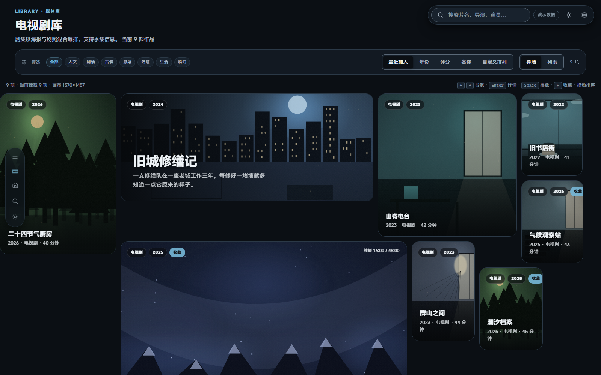
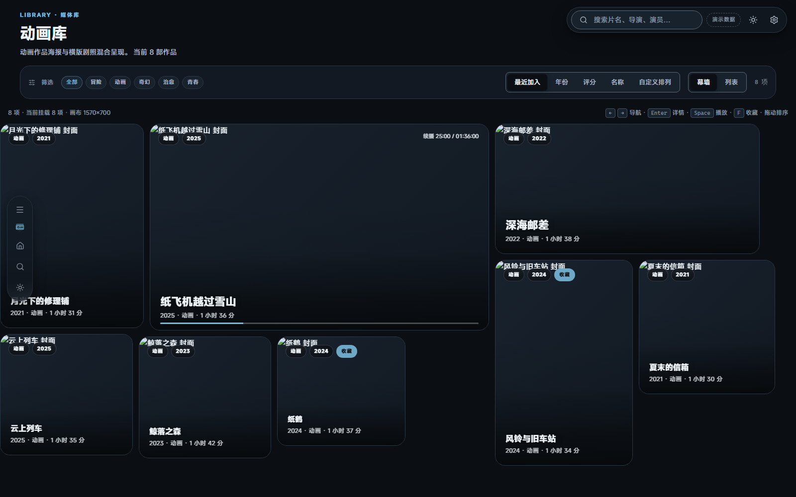
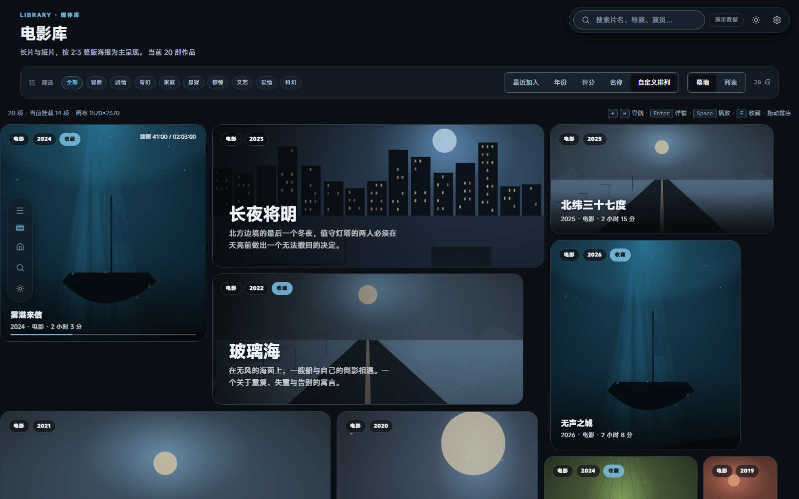
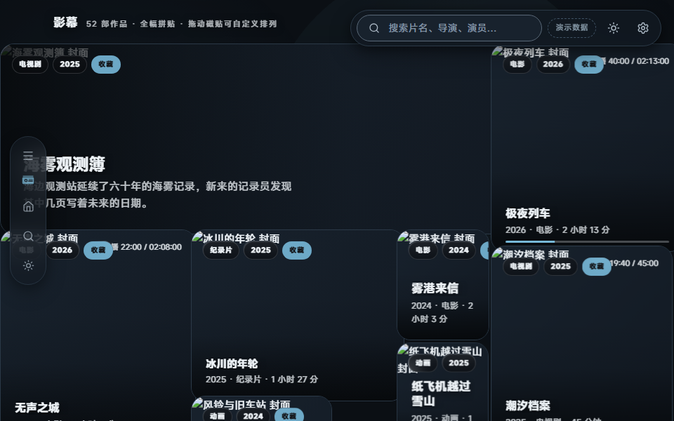
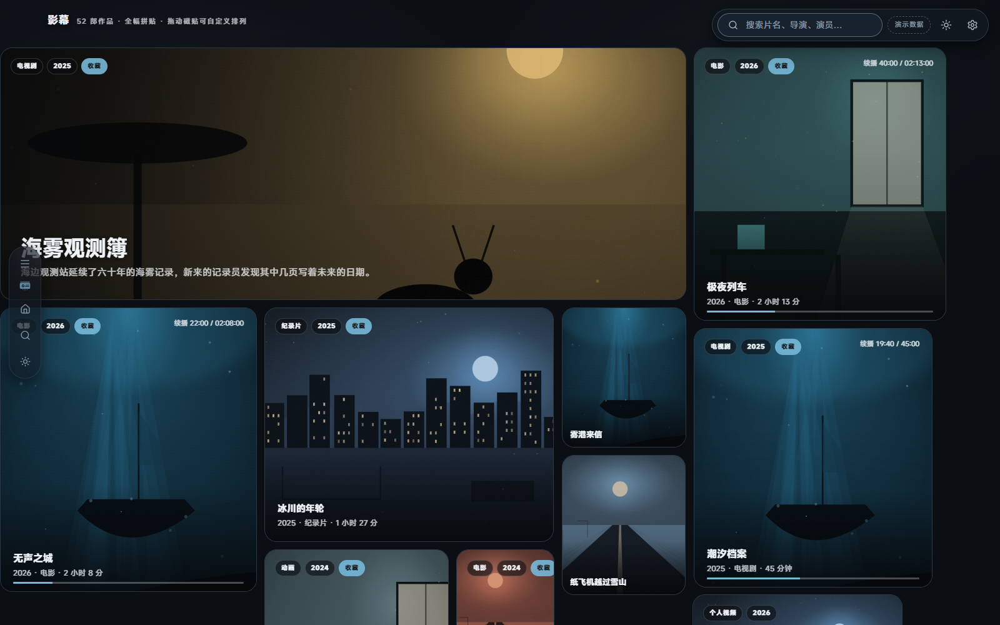
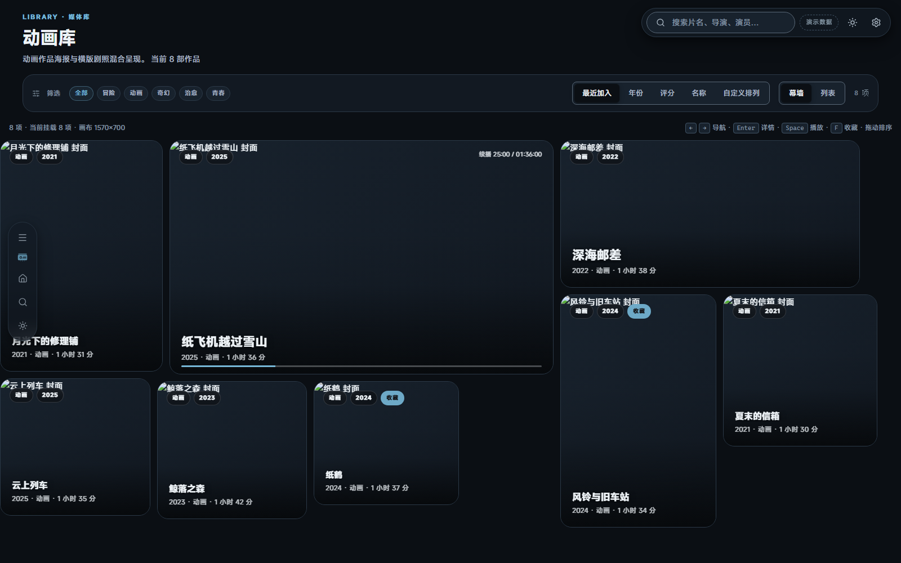
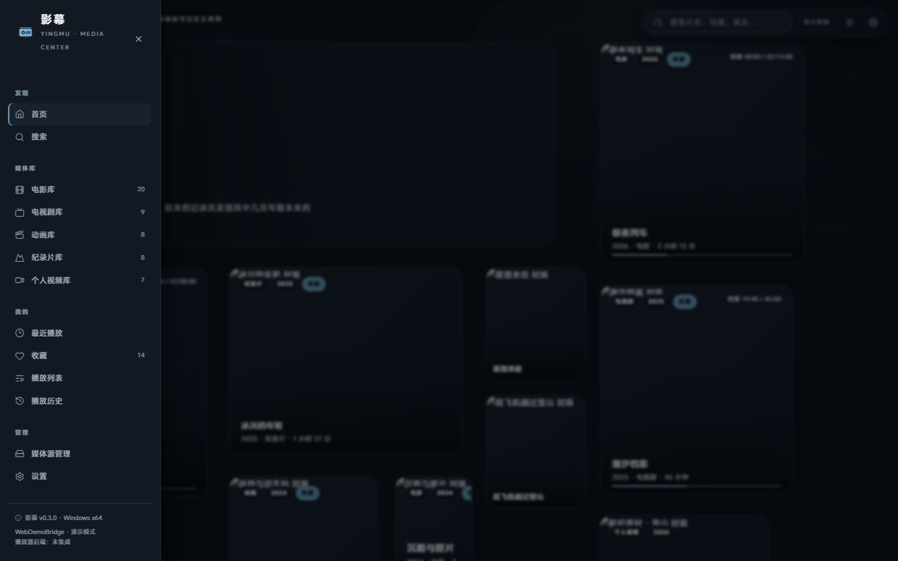
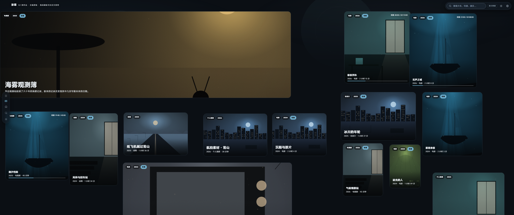

# 影幕 · YingMu

> 让媒体库像艺术品一样呈现，让播放器像专业设备一样可靠。

影幕是一款面向个人媒体库的桌面媒体中心：以 Folia 式不规则磁贴幕墙组织内容，以 Infuse 式的电影 / 剧集 / 个人视频管理方式组织数据，并以专业播放器为长期目标。

- **应用标识符 / Bundle ID**：`com.moko.yingmu`（所有配置一致；仅作标识符，**不是用户数据目录名**，数据目录为 `%APPDATA%\YingMu` 体系，见「构建 Windows 安装包」）
- **版本**：`0.3.2`
- **首发平台**：Windows 10 22H2 x64 / Windows 11 x64
- **仓库**：`https://github.com/MokoKing666/yingmu`（目标仓库，默认分支 `main`）
- **许可证**：**尚未确定**，见下方「许可证说明」

---

## ⚠️ 当前交付状态（务必先读）

这份仓库是**按正式软件工程方式搭建的可审查工程**，但本阶段**没有交付可安装的 Windows 桌面应用**。请勿把下列「已实现」误读为完整产品。

| 交付项 | 状态 | 依据 |
|---|---|---|
| React 19 前端（16 个页面、磁贴幕墙、深浅主题、动画） | ✅ **本机已运行** | 本页截图来自 `vite preview` 实际运行实例；`npm run build` 成功 |
| 原创 SVG Logo、图标、Design Tokens | ✅ **已编写 + 本机已校验** | `assets/branding/`、`packages/design-tokens/`；`check-token-sync.mjs` 0 漂移 |
| 统一接口契约（数据模型 / PlatformBridge / PlayerBackend） | ✅ **已编写** | `packages/media-models/`、`packages/player-api/` |
| 前端自动化测试 / 类型检查 / Lint / 生产构建 | ✅ **本机已运行** | 18 个 Vitest 文件 / 193 个用例、TS 严格模式、ESLint 0 警告 |
| WCAG 对比度 / Token 同步 | ✅ **本机已运行 + CI 强制** | `check-contrast.mjs` 32 组/主题 0 不达标；`check-token-sync.mjs` 0 漂移 |
| GitHub Actions CI / Release 工作流 | ✅ 工作流已编写并随推送触发 | `.github/workflows/`；本机从未执行 GitHub Actions，云端结果见仓库 Actions 页面 |
| Rust 媒体核心 / Tauri 2 配置 / NSIS 配置 | ✅ **CI 已构建并测试**（fmt / clippy / test / MSRV 1.89）；**本机未编译** | `crates/yingmu-core/`、`apps/desktop/src-tauri/`；本机 cargo 不在 PATH 且链接器被遮蔽，结论只来自 CI 日志 |
| Tauri 桌面端布局持久化（SQLite） | ✅ **已编写 + CI 单测覆盖**；**真实桌面端重启恢复未人工执行** | 迁移 003 + `layout_get/set`；Rust 4 个用例、TS 7 个用例 |
| libmpv 嵌入式播放 / 原生视频 Surface | ❌ **未集成、未验证** | 见 `docs/playback/windows-surface-validation.md` |
| HDR10 / HDR10+ / HLG / Dolby Vision 原生输出 | ❌ **未验证**；仅做到「文件标识识别」 | 见 `docs/dolby-compatibility/` |
| Dolby Audio / Atmos 音频直通 | ❌ **未验证**；未获得 Dolby 官方认证 | 见 `docs/dolby-compatibility/audio-matrix.md` |
| TMDB / NFO 刮削、SMB / WebDAV 实际连接 | ❌ 未在本机验证 | 演示桥接不发起网络请求 |
| **NSIS 安装包 `YingMu-Setup-0.3.2-x64.exe`** | ✅ **CI 已真实构建**（约 4.48 MiB，未签名）；❌ **Windows 交互式安装未测试** | `windows-latest` 上 `tauri-action` 产出，Artifact `yingmu-nsis-installer`，见 [Actions 运行列表](https://github.com/MokoKing666/yingmu/actions/workflows/ci.yml) 的最近一次 Windows NSIS job；**SHA-256 以当次 Artifact 内的 `SHA256SUMS.txt` 为准，文档不固定记录某一次构建的哈希**（NSIS 含时间戳，构建不可复现，详见下方说明）；PE 版本资源 `FileVersion/ProductVersion = 0.3.2`、`ProductName = 影幕 YingMu` |
| **GitHub 源码推送 / CI 执行 / Release** | ✅ **源码已推送**；CI 已由推送触发；Release ❌ **未创建** | 公开仓库 `MokoKing666/yingmu`、功能分支 `feat/folia-fullbleed-mosaic-nsis-both`；文件数与提交数以仓库为准（逐文件 blob SHA 校验通过），CI 结果见 Actions 页面 |

**重要**：本仓库中的媒体条目、海报、进度均为**原创虚构演示数据**（UI 中有「演示数据」角标），不是真实影片刮削结果，也不是任何用户的私人媒体库。

---

## 界面截图

以下截图均由本机 Edge 无头浏览器访问 `vite preview`（端口 4173）的**真实运行实例**截取，非概念图、非设计稿。全部截图为 **v0.3.1** 版本（Cinematic Neutral 色板 + 冷调封面 + 本轮交互/比例修复），已覆盖旧版本截图。共 16 张，目录见 [`docs/design/screenshots/`](docs/design/screenshots/)。

### 首页 · 深色主题（全幅无级大磁贴拼贴）


### 首页 · 浅色主题


### 电影库（筛选 / 排序 / 幕墙与列表双视图）


### 电视剧库



### 动画库（不同媒体库的排序 / 排列作用域互不污染）



### 自定义排列（拖拽后该作用域切到 custom 模式）



### 小窗口 960×600（连续尺寸与安全区收敛）



### 减少动态效果（prefers-reduced-motion：动效关闭后的静态状态）



### 导航折叠状态（默认悬浮轨道，不挤压画布）



### 导航展开状态（浮层抽屉，覆盖而非挤占）



### 超宽屏 3440×1440（尺寸反差进一步拉开）



### 搜索（全文检索字段与结果片段）


### 媒体详情（多版本、音轨字幕、封面焦点调整）


### 播放器（控制界面预览，后端未集成）


### 设置与诊断


### 媒体源管理


> 截图生成方式可复现：`npm run build && npm run preview`，再执行 `node scripts/capture-screenshots.mjs`（调用本机 Edge 无头模式截取真实运行实例，同时输出 `docs/design/screenshots/viewport-probe.json` 视口探测数据）。
> 布局与性能实测数字见 [`docs/testing/performance-report.md`](docs/testing/performance-report.md)。

---

## 功能说明

### 已可用（浏览器 / Vite 实例）

- **首页幕墙**：确定性 Skyline 二维装箱的无级全幅拼贴——连续像素尺寸（超大横幅 / 超大竖版 / 宽幅 / 方形 / 不规则比例并存）、左右零边距铺满内容区、零重叠、可复现；悬停反馈、拖拽排序、键盘方向导航（方向键 / Enter / Space / F）、共享元素 `layoutId`、页面转场。
- **导航**：默认折叠的悬浮轨道 + 浮层抽屉（`[` / `Ctrl+B` 呼出，`Esc` 收起），不占画布宽度；右上角悬浮搜索胶囊。
- **性能策略**：按可见区域虚拟化（1000 条时首屏仅挂载约 25 个磁贴，实测值来自 `mosaic-layout.test.ts` 输出，不手工挑选）、IntersectionObserver 封面懒加载、ResizeObserver 合帧、滚动区间量化、`MediaTile` memo、Artwork 内存缓存（按 `mediaId:kind:size` 键，可重建）。实测数据见 [`docs/testing/performance-report.md`](docs/testing/performance-report.md)。
- **动态背景**：PixiJS 8 渲染缓慢漂移的光圈 / 光束；WebGL 不可用或「减少动态效果」时自动降级为 CSS 渐变。
- **16 个页面**：首页、电影库、电视剧库、动画库、纪录片库、个人视频库、最近播放、收藏、播放列表、搜索、媒体详情、媒体源管理、播放器、播放历史、设置、媒体信息编辑。各页信息结构不同，不是同一卡片模板套用。
- **深浅双主题**：完整 CSS 变量体系，跟随系统偏好，支持 `?theme=light` URL 覆盖。
- **数据层抽象**：`PlatformBridge` 统一契约，`WebDemoBridge`（localStorage 持久化：收藏、元数据修正、播放列表、进度、设置、自定义排序）与 `TauriBridge`（类型安全 IPC）可替换。
- **稳定 Media ID**：由内容指纹派生，路径不参与计算；同一影片可有多版本；换 NAS 地址后元数据 / 收藏 / 观看记录保留。
- **播放器控制界面**：进度、倍速、音量、音轨、字幕（含 ASS / PGS 原生渲染标记）、章节、播放列表、全屏、视频信息面板。**控制栏只改变 UI 状态，不解码、不推进时间、不伪造解码统计**。

### 架构已定义但本阶段未验证

媒体扫描（递归 / 增量 / 去重 / 断点恢复）、Provider（本地 / UNC / SMB / WebDAV）、Metadata Engine（TMDB / NFO / 手动修正）、Artwork Cache、SQLite + FTS5 + 迁移、Subtitle Manager、Network Connection Manager、Playback History、Error Diagnostics、PlayerBackend / libmpv、Tauri 命令层。

详见 [`docs/architecture/overview.md`](docs/architecture/overview.md) 与 [`docs/testing/strategy.md`](docs/testing/strategy.md)。

---

## 技术栈

| 层 | 技术 |
|---|---|
| 前端 | React 19.3、TypeScript 6.0（严格模式）、Vite 8（Rolldown）、Tailwind CSS 4.3、Motion 14、Zustand 5.1、PixiJS 8.22、React Router 7.18 |
| 桌面端 | Tauri 2、Rust（MSRV 1.89）、WebView2 |
| 数据 | SQLite + FTS5（`rusqlite` 0.41，`bundled`），版本化迁移 |
| 播放器目标 | libmpv + 原生视频 Surface（D3D11 / WGL），**当前未集成** |
| 测试 | Vitest 5.1 + Testing Library、ESLint 10.14、Prettier、Rust `cargo test` |
| CI/CD | GitHub Actions（前端 / Rust / Windows NSIS / Release），Node 26 主线 + Node 24 兼容矩阵 |
| 安装器 | Tauri 2 官方 NSIS Bundler（简体中文界面，支持当前用户 / 所有用户两种范围） |

Three.js 保留为按需扩展位，当前未引入；不为使用技术而使用技术。

---

## 项目结构

```text
yingmu/
├── apps/desktop/
│   ├── src/                    # React 前端（页面 / 组件 / stores / hooks / lib / 测试）
│   ├── src-tauri/              # Tauri 2 工程、Rust 命令层、tauri.conf.json、图标
│   └── dist/                   # 前端生产构建产物（不入库）
├── crates/yingmu-core/         # Rust 媒体核心（providers / scanner / metadata / database …）
├── native/windows/             # Windows 原生 Surface 技术验证说明
├── packages/
│   ├── media-models/           # 全项目数据模型 + PlatformBridge 契约（唯一真源）
│   ├── player-api/             # PlayerBackend 抽象与 5 层能力模型
│   └── design-tokens/          # 字体 / 颜色 / 圆角 / 间距 / 阴影 / 磁贴 / 动效
├── assets/branding/            # 原创 SVG Logo 全套、PNG 多尺寸、ICO
├── docs/                       # 架构 / 设计 / 播放 / Dolby 兼容性 / 数据库 / 测试 / ADR
├── scripts/                    # 图标生成、密钥扫描、Release 校验、CI 本地检查
├── tests/                      # 仓库契约测试（node:test）
├── .github/workflows/          # CI 与 Release
├── CHANGELOG.md / CONTRIBUTING.md / SECURITY.md / THIRD_PARTY_NOTICES.md
└── package.json                # npm workspaces 根
```

---

## 开发环境

本机实测（2026-11-06，Windows 11 专业工作站版 x64）：

| 组件 | 结果 |
|---|---|
| Node.js / npm | v22.22.2 / 10.9.7 ✅ |
| Git | 2.55.0 ✅ |
| WebView2 Runtime | 156.0.4314.58 ✅ |
| Edge（用于真实截图） | 已安装 ✅ |
| Rust stable | ✅ **已安装**：`cargo 1.99.1` / `rustc 1.99.1`（含 `rustfmt`、`clippy`），工具链 `stable-x86_64-pc-windows-msvc`；位于 `%USERPROFILE%\.cargo\bin`，**不在自动化 shell 的默认 PATH 中** |
| **MSVC / Windows SDK（便携工具链）** | ✅ **已就位**：Rust 1.99.1 已安装；本地已具备 MSVC 编译器/链接器与 Windows SDK 导入库/头文件（便携工具链，非系统级 Visual Studio 安装，需显式配置 `PATH` / `LIB` / `INCLUDE`） |
| GitHub 认证与推送通道 | ✅ 已打通：`api.github.com` 直连 + `Basic 用户名:token`；本机 `git push` 通道仍不可用（代理 502） |
| C: 可用空间 | 约 15 GB |

前端要求 Node `^22.13 || ^24 || >=26`（`package.json` 的 `engines` 与 `.nvmrc` 一致，CI 用 Node 26 为主、Node 24 做兼容矩阵）。Tauri 桌面端要求 `x86_64-pc-windows-msvc`、MSVC 编译器、Windows SDK、WebView2 与 NSIS（由 Tauri 下载）。

**Rust 侧在哪验证**：本机的 `cargo` 不在自动化 shell 的默认 PATH 内，且默认 shell 里 Git Bash 的 `/usr/bin/link.exe` 会遮蔽 MSVC 链接器，因此**本机没有完成 `cargo build`**——这一点如实记录，不当作已验证。Rust 的真实验证发生在云端 CI（`windows-latest`）：`cargo fmt --all -- --check`、`cargo clippy -p yingmu-core -- -D warnings`、`cargo test -p yingmu-core` 全部通过，`rusqlite 0.41.1`（FTS5）实际编译并由 `fts_triggers_keep_index_in_sync_and_search_paginates` 用例覆盖；`tauri build` 也已在 CI 中真实产出 NSIS 安装包。

---

## 本地运行

```bash
npm ci                    # 在仓库根目录安装 workspaces 依赖
npm run dev                # http://127.0.0.1:5173
```

浏览器会自动使用 `WebDemoBridge`，无需编译 Tauri 桌面端即可完整浏览与交互（桌面端构建产物非前端运行前提）。

```bash
npm run typecheck          # TypeScript 严格类型检查
npm run lint               # ESLint（0 警告）
npm run test               # Vitest 18 个测试文件 / 193 个用例
npm run build              # 生产构建到 apps/desktop/dist
npm run preview            # 预览生产构建
node scripts/check-token-sync.mjs     # Design Token TS↔CSS 一致性（已进 CI）
node scripts/check-contrast.mjs       # WCAG 2.2 AA 对比度实测（已进 CI）
npm run brand:icons        # 从 SVG 源重新生成 PNG / ICO
node scripts/secret-scan.mjs          # 提交前凭据扫描
node --test tests/repo-contract.test.mjs  # 仓库契约测试
```

> npm registry：本机曾被配置为国内镜像且出现 SSL 错误；若 `npm ci` 失败，请在命令后附加 `--registry=https://registry.npmjs.org`。仓库不硬编码任何 registry。

### 本机验证结果（2026-11-06，实测）

以下为在本机真实执行并**通过**的检查，记录的是实际结果，不是计划：

| 检查 | 命令 | 实测结果 |
| --- | --- | --- |
| 类型检查 | `npm run typecheck` | ✅ 通过（TypeScript 严格模式） |
| Lint | `npm run lint` | ✅ 通过（ESLint 0 警告） |
| 单元测试 | `npm run test` | ✅ 通过（18 个测试文件 / 193 个用例全部通过） |
| 生产构建 | `npm run build` | ✅ 通过（Vite 产出 `apps/desktop/dist`） |
| 凭据扫描 | `node scripts/secret-scan.mjs` | ✅ 通过（未发现敏感信息；扫描文件数随版本增长） |
| 仓库契约测试 | `node --test tests/repo-contract.test.mjs` | ✅ 通过（6/6） |

Rust 侧检查：**本机未完成、云端 CI 已完成**，两者都如实记录：

| 检查 | 本机 | 云端 CI（`windows-latest`） |
| --- | --- | --- |
| `cargo fmt --all -- --check` | ✅ 通过（exit 0） | ✅ 通过 |
| `cargo clippy -p yingmu-core -- -D warnings` | ❌ 未完成（链接器被 Git Bash 的 `link.exe` 遮蔽） | ✅ 通过 |
| `cargo test -p yingmu-core` | ❌ 未完成（同上） | ✅ 通过（含 FTS5 索引同步用例） |
| `tauri build`（NSIS 打包） | ❌ 未在本机执行 | ✅ 通过，产出安装包 Artifact |

本机的 `cargo` 位于 `%USERPROFILE%\.cargo\bin`、不在自动化 shell 的默认 PATH 内；默认 shell 里 Git Bash 的 `/usr/bin/link.exe`（GNU coreutils 硬链接命令）会遮蔽 MSVC 链接器，报 `link: extra operand`。由于工作区依赖未做 vendor，本机也无法离线完成依赖编译。**因此本机的 Rust 结论一律以「未验证」记录，Rust 的真实结论只来自 CI 日志。** 完整状态见 [`docs/testing/strategy.md`](docs/testing/strategy.md)。界面截图均由 `vite preview` + 本机 Edge 无头浏览器截取，属真实运行实例（见上文「界面截图」章节）。

---

## 构建 Windows 安装包

**预期生成路径**（在具备完整 MSVC 工具链的机器上）：

```text
apps/desktop/src-tauri/target/release/bundle/nsis/YingMu-Setup-0.3.2-x64.exe
```

标准步骤：

```bash
npm ci
npm run build
cd apps/desktop
npx tauri build --target x86_64-pc-windows-msvc --bundles nsis
```

安装包采用 Tauri 2 官方 NSIS Bundler，`installMode: "both"`，**同一个 exe 支持两种安装范围**：

| 选项 | 默认目录 | 注册表 | 快捷方式 | 安装器权限 | 应用本体权限 |
|---|---|---|---|---|---|
| 仅为我安装（当前用户） | `%LOCALAPPDATA%` 下（Tauri 模板默认目录，向导里可改） | `HKCU` | 当前用户开始菜单 | **UAC 提权**（见下） | 普通用户 |
| 为这台电脑上的所有用户安装 | `%ProgramFiles%\YingMu`（x64 使用 64 位 Program Files） | `HKLM` | 所有用户开始菜单 | **UAC 提权** | 普通用户 |

安装向导包含**安装范围页**与**安装目录页**（`MULTIUSER_PAGE_INSTALLMODE` + `MUI_PAGE_DIRECTORY`），用户可以查看并修改最终安装路径；切换范围时默认路径随之调整。

> **UAC 行为如实告知**：`installMode: "both"` 使用 `MULTIUSER_EXECUTIONLEVEL Highest`，
> 因此**两种范围启动安装器时都会请求 UAC**（官方文档原文：「the installer will require
> Administrator privileges to execute」），即使最终选择「仅为我安装」。
> UAC 提权用于写 Program Files、写卸载信息与注册表；**安装完成后的影幕本体始终以普通用户权限运行**。
> 本项目不通过修改执行级别去伪装「仅为我安装不需要管理员」。
>
> **必须区分两件事**：① 安装器启动时的提权（两种范围都要）；② 安装目标位置（`%LOCALAPPDATA%` vs `%ProgramFiles%`）。
> 「仅为我安装」改变的是**装到哪里、写哪个注册表分支**，不是要不要 UAC。

用户数据固定存放于 `%APPDATA%\YingMu`（配置与数据库）、`%LOCALAPPDATA%\YingMu\Cache`（缓存）、`%LOCALAPPDATA%\YingMu\Logs`（日志），**不写入安装目录**；因此即使选择「所有人安装」，每个 Windows 用户也有各自的收藏、历史与配置。升级保留媒体库与播放记录，卸载默认不删除用户数据，只清理对应范围的程序与快捷方式。

完整说明与验证状态见 [`docs/installation/nsis.md`](docs/installation/nsis.md)。

> **CI 已真实构建出该安装包**：`windows-latest` 上 `tauri-action` 产出约 **4.48 MiB** 的 NSIS 安装器 `YingMu-Setup-0.3.2-x64.exe`（PE32 可执行、版本资源 `FileVersion/ProductVersion = 0.3.2`、`ProductName = 影幕 YingMu`、未签名），经 `scripts/verify-release.mjs` 校验（存在 / >1MB / MZ 头 / SHA-256）后作为 Artifact `yingmu-nsis-installer` 上传。
> **哈希如何取**：**以当次 Artifact 内的 `SHA256SUMS.txt` 为准**。NSIS 打包含时间戳，**构建不可复现**——同一份源码只改文档重跑，安装包的字节数与 SHA-256 就会变（实测两轮相差 1,382 字节）。因此文档不固定记录某一次构建的哈希，避免后来的读者拿旧哈希去校验新构建而误判。
> **本机未执行交互式安装测试**：点击向导、观察 UAC、多用户数据隔离、覆盖升级与卸载都需要可交互 Windows 桌面或独立 VM，本机与 CI runner 都不具备，因此这些项保持「未执行」，不以构建成功冒充安装测试成功。

---

## 已知问题与未完成事项

1. **本机无法编译 Tauri/NSIS，CI 已构建成功**：本机受构建环境限制（Git Bash 的 `/usr/bin/link.exe` 遮蔽 MSVC 链接器、safe-delete 拦截 cargo 临时目录删除），`cargo check` / `cargo build` 无法完成，因此本机只能验证 `cargo fmt`；`cargo clippy` / `cargo test -p yingmu-core` 与桌面端编译、NSIS 打包均由 GitHub Actions 完成，三个 job **均已通过**（Rust 核心库、前端、Windows NSIS）。
2. **GitHub 已推送，但本机 `git push` 通道仍不可用**：仓库 `https://github.com/MokoKing666/yingmu` 已于 2026-11-08 创建为公开仓库并完成源码推送。本机 `git push` 通道不可达（`github.com:443` 直连超时、代理返回 502），故改用 `api.github.com` 直连：该 classic PAT 只接受 `Basic 用户名:token` 认证（`Bearer` / `token` 写法返回 401 `Bad credentials`，属鉴权写法差异，并非凭据失效），经 GitHub REST / Git Data API 分 7 个提交推送全部 173 个文件（含 24 个 PNG/ICO 二进制），**逐文件 blob SHA 校验 173/173 完全一致**；凭据仅从本地文件读入内存用于鉴权，未写入代码、提交、remote URL 或日志。GitHub Actions 由本次推送自动触发（`ci.yml` 的 `frontend` / `rust` / `windows-installer` 三个 job），实际结果以仓库 Actions 页面为准；`release.yml` 需推送 `v*` Tag 才触发，本阶段**未创建 Release**。`gh` CLI / GCM 仍缺失；桌面凭据文件为明文 PAT，建议用后轮换并删除。
3. **播放器后端未集成**：libmpv DLL、D3D11 + HWND 原生视频 Surface 与 WebView2 组合、4K HEVC / HDR 输出均**未完成实机验证**。播放器页面只提供控制界面预览。
4. **Dolby / HDR 状态**：仅实现「文件标识识别」；元数据解析、解码、正确渲染、原生信号输出四层均未验证。未获得 Dolby 官方认证，未使用 Dolby 官方 Logo。详见 [`docs/dolby-compatibility/compatibility-matrix.md`](docs/dolby-compatibility/compatibility-matrix.md)。
5. **媒体库为演示数据**：扫描、刮削、网络媒体源连接、真实播放记录均需 Tauri + Rust 核心在桌面端运行。
6. **Rust 源码的编译状态**：云端 GitHub Actions 的 `rust` job 已真实通过 `cargo fmt --check`、`cargo clippy -D warnings` 与 `cargo test -p yingmu-core`（81 个单元测试全部通过）；本机仍受构建环境限制（GNU `link.exe` 遮蔽、临时文件删除拦截）无法完成 cargo 构建。桌面端 `yingmu-desktop` 的编译与 NSIS 打包由 `windows-installer` job 在 `windows-latest` 上验证。**播放器后端 libmpv 仍未集成**，因此即使编译通过也不代表具备播放、HDR 或 Dolby 输出能力。以仓库 Actions 页面与 `docs/testing/strategy.md` 为准。

---

## Dolby 支持状态（一句话版）

**支持的是「文件里有 Dolby 标识」的识别；不支持、也不宣称原生 Dolby Vision 输出、Dolby Audio 直通或任何 Dolby 认证。** 五层能力模型与逐项矩阵见 `docs/dolby-compatibility/`。

---

## 许可证说明

**本项目尚未决定开源许可证。** 仓库公开仅用于代码审查、提交记录追踪与后续协作开发；在许可证正式确定前，**未授权任何第三方复制、修改、分发本仓库代码或将其用于商业用途**。

第三方依赖（含 React、Tauri、Rust crates、PixiJS、Motion、mpv / FFmpeg / libplacebo、MiSans 字体、NSIS、WebView2）的名称、版本、官方仓库、许可证与分发限制，以及 GPL / LGPL / 专利 / 商标 / Dolby 授权专项审查，见 [`THIRD_PARTY_NOTICES.md`](THIRD_PARTY_NOTICES.md)。**不能假定动态链接自动免除许可证义务。**

MiSans 字体：本机系统已安装，但**系统字体文件不打包进仓库**，CSS 仅通过字体栈引用；正式发行前需从官方渠道获取并遵守其授权。

---

## 文档索引

| 文档 | 内容 |
|---|---|
| [`docs/architecture/overview.md`](docs/architecture/overview.md) | 系统分层、模块边界、数据流、跨平台抽象 |
| [`docs/architecture/ipc-contract.md`](docs/architecture/ipc-contract.md) | TS ↔ Rust IPC 命令契约表 |
| [`docs/design/design-system.md`](docs/design/design-system.md) | Design Tokens、磁贴体系、主题规则 |
| [`docs/playback/player-interface.md`](docs/playback/player-interface.md) | PlayerBackend 抽象与状态机 |
| [`docs/playback/windows-surface-validation.md`](docs/playback/windows-surface-validation.md) | 原生 Surface 技术验证报告（未验证） |
| [`docs/dolby-compatibility/compatibility-matrix.md`](docs/dolby-compatibility/compatibility-matrix.md) | Dolby Vision 五层兼容性矩阵 |
| [`docs/database/schema.md`](docs/database/schema.md) | 表结构、迁移、FTS5、升级保留策略 |
| [`docs/testing/strategy.md`](docs/testing/strategy.md) | 哪些测试真实跑过、哪些没有 |
| [`docs/adr/`](docs/adr/) | 关键技术决策记录 |
| [`CHANGELOG.md`](CHANGELOG.md) | 实际功能变更 |
