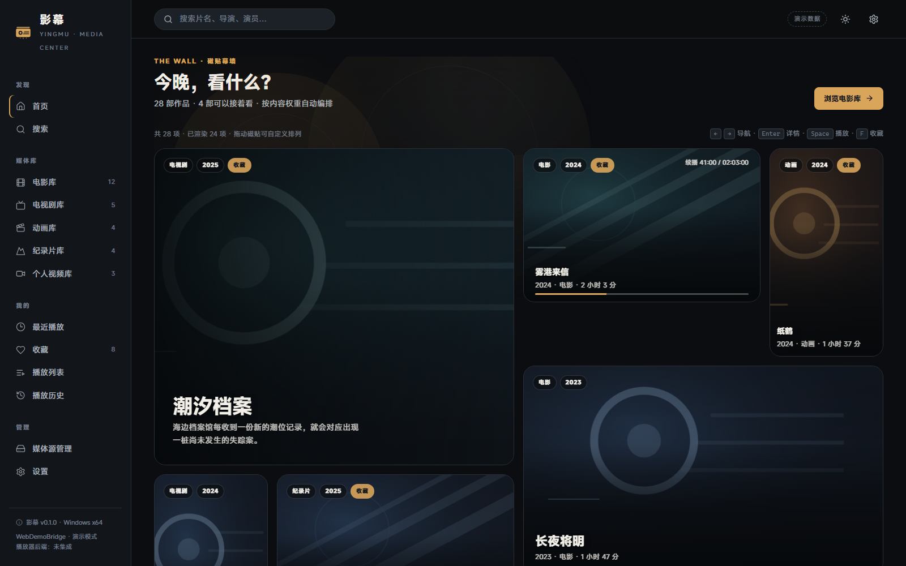
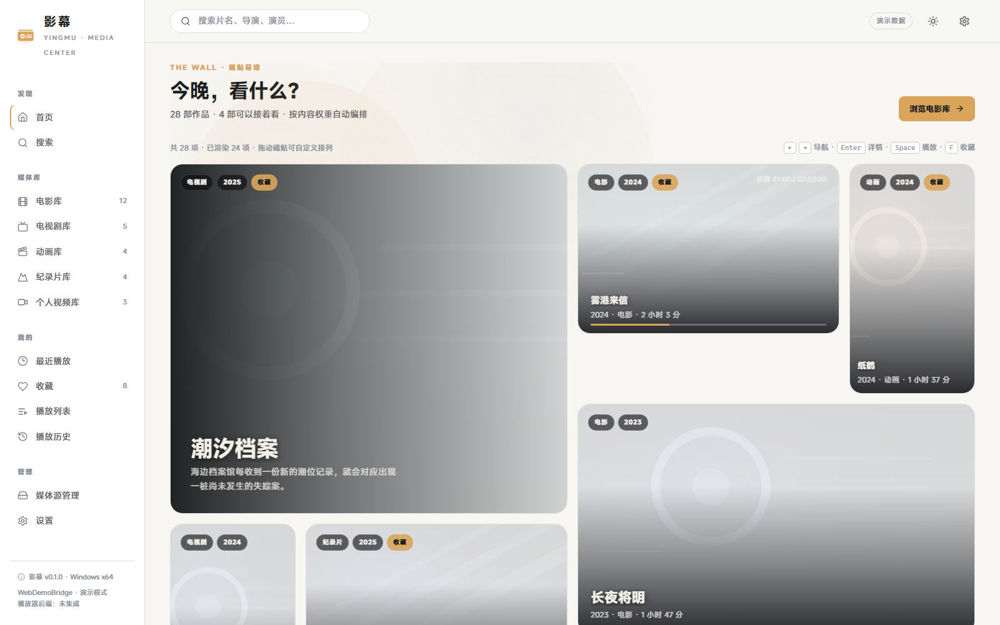
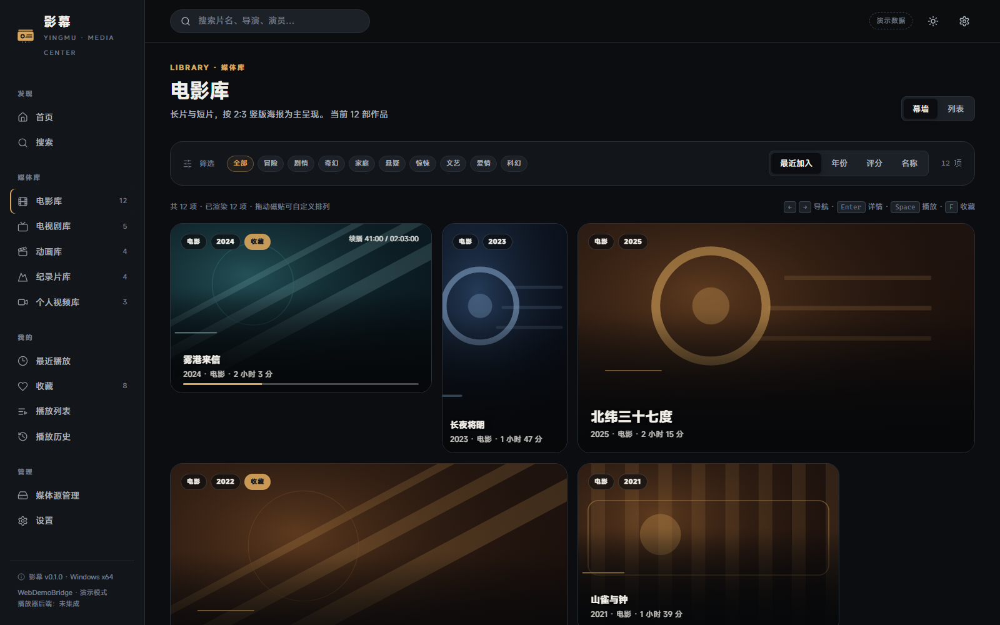
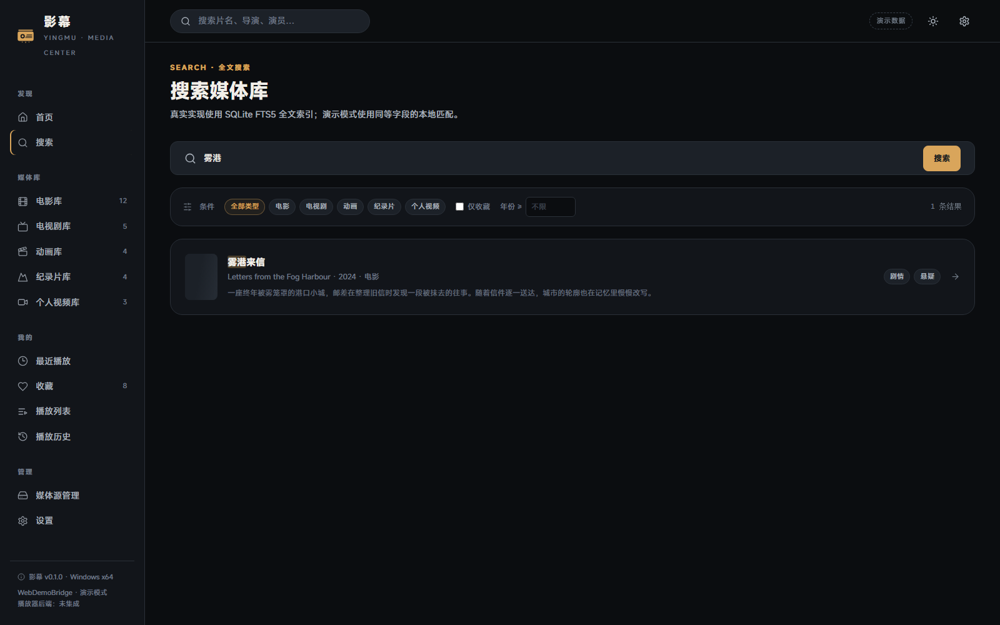
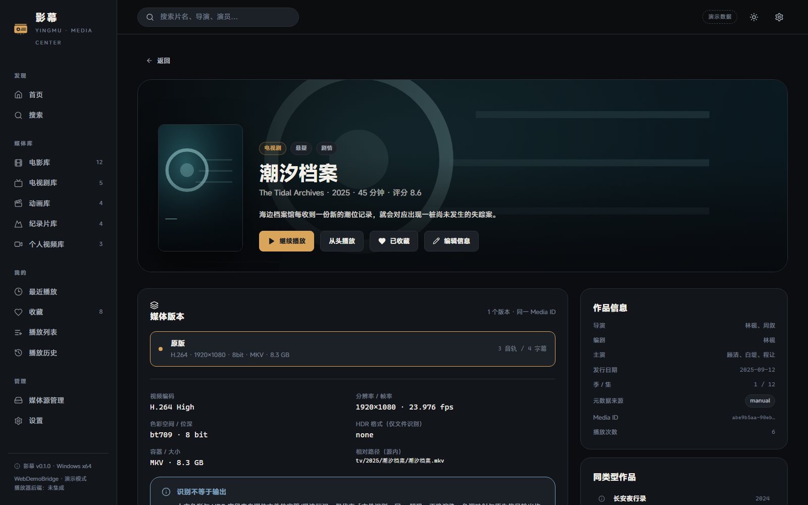
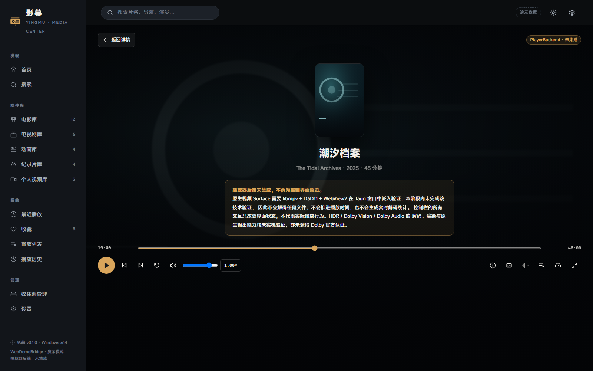
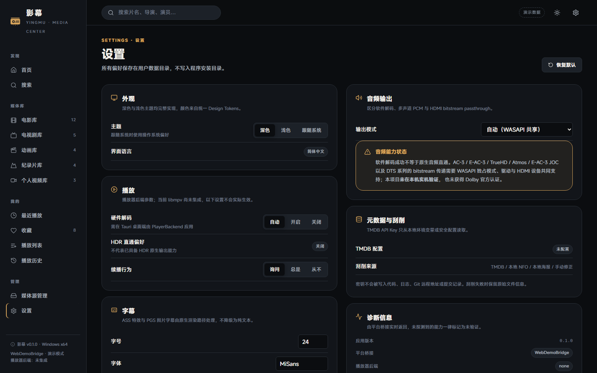
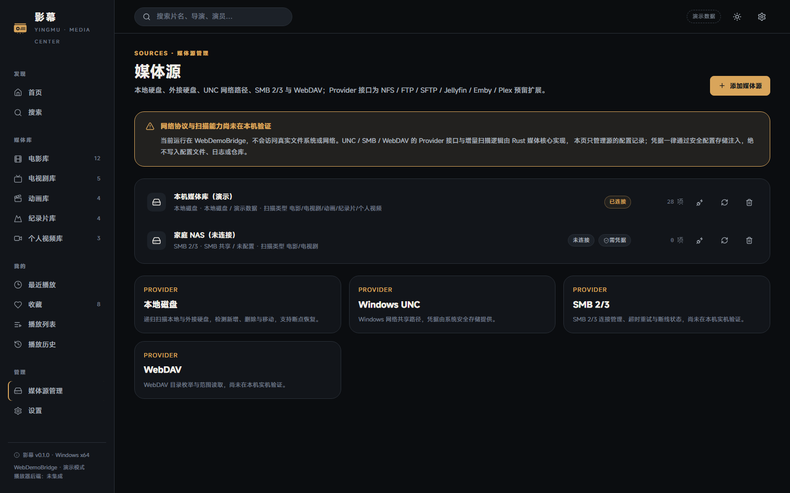

# 影幕 · YingMu

> 让媒体库像艺术品一样呈现，让播放器像专业设备一样可靠。

影幕是一款面向个人媒体库的桌面媒体中心：以 Folia 式不规则磁贴幕墙组织内容，以 Infuse 式的电影 / 剧集 / 个人视频管理方式组织数据，并以专业播放器为长期目标。

- **应用标识符 / Bundle ID**：`com.moko.yingmu`（所有配置一致；仅作标识符，**不是用户数据目录名**，数据目录为 `%APPDATA%\YingMu` 体系，见「构建 Windows 安装包」）
- **版本**：`0.1.0`
- **首发平台**：Windows 10 22H2 x64 / Windows 11 x64
- **仓库**：`https://github.com/MokoKing666/yingmu`（目标仓库，默认分支 `main`）
- **许可证**：**尚未确定**，见下方「许可证说明」

---

## ⚠️ 当前交付状态（务必先读）

这份仓库是**按正式软件工程方式搭建的可审查工程**，但本阶段**没有交付可安装的 Windows 桌面应用**。请勿把下列「已实现」误读为完整产品。

| 交付项 | 状态 | 依据 |
|---|---|---|
| React 19 前端（16 个页面、磁贴幕墙、深浅主题、动画） | ✅ **已实现并真实运行** | 本页截图来自 `vite preview` 实际运行实例；`npm run build` 成功 |
| 原创 SVG Logo、图标、Design Tokens | ✅ 已实现 | `assets/branding/`、`packages/design-tokens/` |
| 统一接口契约（数据模型 / PlatformBridge / PlayerBackend） | ✅ 已实现 | `packages/media-models/`、`packages/player-api/` |
| 前端自动化测试 / 类型检查 / Lint / 生产构建 | ✅ **真实通过** | 50 个 Vitest 用例、TS 严格模式、ESLint 0 警告 |
| GitHub Actions CI / Release 工作流 | ✅ 工作流已编写 | `.github/workflows/`；**未在本机执行过**（需 GitHub 托管 runner） |
| Rust 媒体核心 / Tauri 2 配置 / NSIS 配置 | ⚠️ **源码已落地，但未经编译验证**（受构建环境限制），编译状态见 `docs/testing/strategy.md` | `crates/yingmu-core/`、`apps/desktop/src-tauri/` |
| libmpv 嵌入式播放 / 原生视频 Surface | ❌ **未集成、未验证** | 见 `docs/playback/windows-surface-validation.md` |
| HDR10 / HDR10+ / HLG / Dolby Vision 原生输出 | ❌ **未验证**；仅做到「文件标识识别」 | 见 `docs/dolby-compatibility/` |
| Dolby Audio / Atmos 音频直通 | ❌ **未验证**；未获得 Dolby 官方认证 | 见 `docs/dolby-compatibility/audio-matrix.md` |
| TMDB / NFO 刮削、SMB / WebDAV 实际连接 | ❌ 未在本机验证 | 演示桥接不发起网络请求 |
| **NSIS 安装包 `YingMu-Setup-0.1.0-x64.exe`** | ❌ **本阶段未生成** | 由 CI / Release 工作流在 `windows-latest` 构建并把关，详见「已知问题」 |
| **GitHub 源码推送 / CI 执行 / Release** | ❌ **本阶段未完成** | 凭据通道受阻：git 通道不可达、本地凭据文件已失效（401）、GitHub App 无建仓权限（403）；完整源码已打包为 git bundle，详见「已知问题」 |

**重要**：本仓库中的媒体条目、海报、进度均为**原创虚构演示数据**（UI 中有「演示数据」角标），不是真实影片刮削结果，也不是任何用户的私人媒体库。

---

## 界面截图

以下截图均由本机 Edge 无头浏览器访问 `vite preview`（端口 4173）的**真实运行实例**截取，非概念图、非设计稿。

### 首页 · 深色主题（不规则磁贴幕墙）



### 首页 · 浅色主题



### 电影库（筛选 / 排序 / 幕墙与列表双视图）



### 搜索（全文检索字段与结果片段）



### 媒体详情（多版本、音轨字幕、文件识别信息）



### 播放器（控制界面预览，后端未集成）



### 设置与诊断



### 媒体源管理



> 截图生成方式可复现：`npm run build && npm run preview`，再执行 `node scripts/capture-screenshots.mjs`（调用本机 Edge 无头模式截取真实运行实例）。

---

## 功能说明

### 已可用（浏览器 / Vite 实例）

- **首页幕墙**：12 列 dense 不规则网格，6 种磁贴形态（大主视觉 / 大中小竖版海报 / 宽幅 / 续播 / 动态），悬停反馈、卡片缩放、拖拽排序、键盘导航（方向键 / Enter / Space / F）、共享元素 `layoutId` 声明、页面转场。
- **性能策略**：分批增量渲染（每批 24）、IntersectionObserver 封面懒加载、`content-visibility: auto` 浏览器级离屏跳过、Artwork 内存缓存（按 `mediaId:kind:size` 键，可重建）。
- **动态背景**：PixiJS 8 渲染缓慢漂移的光圈 / 光束；WebGL 不可用或「减少动态效果」时自动降级为 CSS 渐变。
- **16 个页面**：首页、电影库、电视剧库、动画库、纪录片库、个人视频库、最近播放、收藏、播放列表、搜索、媒体详情、媒体源管理、播放器、播放历史、设置、媒体信息编辑。各页信息结构不同，不是同一卡片模板套用。
- **深浅双主题**：完整 CSS 变量体系，跟随系统偏好，支持 `?theme=light` URL 覆盖。
- **数据层抽象**：`PlatformBridge` 统一契约，`WebDemoBridge`（localStorage 持久化：收藏、元数据修正、播放列表、进度、设置、自定义排序）与 `TauriBridge`（类型安全 IPC）可替换。
- **稳定 Media ID**：由内容指纹派生，路径不参与计算；同一影片可有多版本；换 NAS 地址后元数据 / 收藏 / 观看记录保留。
- **播放器控制界面**：进度、倍速、音量、音轨、字幕（含 ASS / PGS 原生渲染标记）、章节、播放列表、全屏、视频信息面板。**控制栏只改变 UI 状态，不解码、不推进时间、不伪造解码统计**。

### 架构已定义但本阶段未验证

媒体扫描（递归 / 增量 / 去重 / 断点恢复）、Provider（本地 / UNC / SMB / WebDAV）、Metadata Engine（TMDB / NFO / 手动修正）、Artwork Cache、SQLite + FTS5 + 迁移、Subtitle Manager、Network Connection Manager、Playback History、Error Diagnostics、PlayerBackend / libmpv、Tauri 命令层。

详见 [`docs/architecture/overview.md`](docs/architecture/overview.md) 与 [`docs/testing/strategy.md`](docs/testing/strategy.md)。

---

## 技术栈

| 层 | 技术 |
|---|---|
| 前端 | React 19、TypeScript（严格模式）、Vite 6、Tailwind CSS 4、Motion for React、Zustand 5、PixiJS 8、React Router 7 |
| 桌面端 | Tauri 2、Rust、WebView2 |
| 数据 | SQLite + FTS5，版本化迁移 |
| 播放器目标 | libmpv + 原生视频 Surface（D3D11 / WGL），**当前未集成** |
| 测试 | Vitest 3 + Testing Library、ESLint 9、Prettier、Rust `cargo test` 源码 |
| CI/CD | GitHub Actions（前端 / Rust / Windows NSIS / Release） |
| 安装器 | Tauri 2 官方 NSIS Bundler（简体中文界面） |

Three.js 保留为按需扩展位，当前未引入；不为使用技术而使用技术。

---

## 项目结构

```text
yingmu/
├── apps/desktop/
│   ├── src/                    # React 前端（页面 / 组件 / stores / hooks / lib / 测试）
│   ├── src-tauri/              # Tauri 2 工程、Rust 命令层、tauri.conf.json、图标
│   └── dist/                   # 前端生产构建产物（不入库）
├── crates/yingmu-core/         # Rust 媒体核心（providers / scanner / metadata / database …）
├── native/windows/             # Windows 原生 Surface 技术验证说明
├── packages/
│   ├── media-models/           # 全项目数据模型 + PlatformBridge 契约（唯一真源）
│   ├── player-api/             # PlayerBackend 抽象与 5 层能力模型
│   └── design-tokens/          # 字体 / 颜色 / 圆角 / 间距 / 阴影 / 磁贴 / 动效
├── assets/branding/            # 原创 SVG Logo 全套、PNG 多尺寸、ICO
├── docs/                       # 架构 / 设计 / 播放 / Dolby 兼容性 / 数据库 / 测试 / ADR
├── scripts/                    # 图标生成、密钥扫描、Release 校验、CI 本地检查
├── tests/                      # 仓库契约测试（node:test）
├── .github/workflows/          # CI 与 Release
├── CHANGELOG.md / CONTRIBUTING.md / SECURITY.md / THIRD_PARTY_NOTICES.md
└── package.json                # npm workspaces 根
```

---

## 开发环境

本机实测（2026-11-06，Windows 11 专业工作站版 x64）：

| 组件 | 结果 |
|---|---|
| Node.js / npm | v22.22.2 / 10.9.7 ✅ |
| Git | 2.55.0 ✅ |
| WebView2 Runtime | 156.0.4314.58 ✅ |
| Edge（用于真实截图） | 已安装 ✅ |
| Rust stable | ✅ **已安装**：`cargo 1.99.1` / `rustc 1.99.1`（含 `rustfmt`、`clippy`），工具链 `stable-x86_64-pc-windows-msvc`；位于 `%USERPROFILE%\.cargo\bin`，**不在自动化 shell 的默认 PATH 中** |
| **MSVC / Windows SDK（便携工具链）** | ✅ **已就位**：Rust 1.99.1 已安装；本地已具备 MSVC 编译器/链接器与 Windows SDK 导入库/头文件（便携工具链，非系统级 Visual Studio 安装，需显式配置 `PATH` / `LIB` / `INCLUDE`） |
| GitHub 认证通道 | ⚠️ 连接器已认证为 `MokoKing666`（App 无建仓权限）；`gh` CLI / GCM 缺失；本地凭据文件已失效（401）；git 通道不可达 |
| C: 可用空间 | 约 15 GB |

前端要求 Node ≥ 20.19。Tauri 桌面端要求 `x86_64-pc-windows-msvc`、MSVC 编译器、Windows SDK、WebView2 与 NSIS（由 Tauri 下载）。Rust 1.99.1 已安装；本地已具备 MSVC 编译器/链接器与 Windows SDK 导入库/头文件（便携工具链，非系统级 Visual Studio 安装，需显式配置 `PATH` / `LIB` / `INCLUDE`）；但 `cargo fmt --all -- --check` 已通过（exit 0，格式已归一化）；`cargo check` / `cargo test` / `cargo clippy` 受构建环境限制未成功完成，仓库 Rust 代码仍未经完整编译与测试验证，所有 `#[cfg(test)]` 单元测试未运行。实际阻断有两类：默认 shell 中 Git Bash 的 `/usr/bin/link.exe`（GNU coreutils 硬链接命令）遮蔽 MSVC 链接器，报 `link: extra operand`；部分执行通道存在 safe-delete 删除拦截，cargo 清理 rlib 临时目录时返回 `拒绝访问 (os error 5)`。二者均发生在第三方依赖编译阶段，未到达 `yingmu-core` 自身源码类型检查完成。

---

## 本地运行

```bash
npm ci                    # 在仓库根目录安装 workspaces 依赖
npm run dev                # http://127.0.0.1:5173
```

浏览器会自动使用 `WebDemoBridge`，无需编译 Tauri 桌面端即可完整浏览与交互（桌面端构建产物非前端运行前提）。

```bash
npm run typecheck          # TypeScript 严格类型检查
npm run lint               # ESLint（0 警告）
npm run test               # Vitest 6 个测试文件 / 50 个用例
npm run build              # 生产构建到 apps/desktop/dist
npm run preview            # 预览生产构建
npm run brand:icons        # 从 SVG 源重新生成 PNG / ICO
node scripts/secret-scan.mjs          # 提交前凭据扫描
node --test tests/repo-contract.test.mjs  # 仓库契约测试
```

> npm registry：本机曾被配置为国内镜像且出现 SSL 错误；若 `npm ci` 失败，请在命令后附加 `--registry=https://registry.npmjs.org`。仓库不硬编码任何 registry。

### 本机验证结果（2026-11-06，实测）

以下为在本机真实执行并**通过**的检查，记录的是实际结果，不是计划：

| 检查 | 命令 | 实测结果 |
| --- | --- | --- |
| 类型检查 | `npm run typecheck` | ✅ 通过（TypeScript 严格模式） |
| Lint | `npm run lint` | ✅ 通过（ESLint 0 警告） |
| 单元测试 | `npm run test` | ✅ 通过（6 个测试文件 / 50 个用例全部通过） |
| 生产构建 | `npm run build` | ✅ 通过（Vite 产出 `apps/desktop/dist`） |
| 凭据扫描 | `node scripts/secret-scan.mjs` | ✅ 通过（扫描 168 个文件，未发现敏感信息） |
| 仓库契约测试 | `node --test tests/repo-contract.test.mjs` | ✅ 通过（6/6） |

Rust 侧检查**未通过**，如实记录：

| 检查 | 当前结果 |
| --- | --- |
| `cargo fmt --all -- --check` | ✅ **通过**（exit 0，格式已归一化） |
| `cargo clippy --workspace --all-targets -- -D warnings` | ❌ **未成功完成**：受构建环境限制，见 `docs/testing/strategy.md` |
| `cargo test --workspace` | ❌ **未通过**：同上，Rust 单元测试未运行 |

Rust 1.99.1 已安装；本地已具备 MSVC 编译器/链接器与 Windows SDK 导入库/头文件（便携工具链，非系统级 Visual Studio 安装，需显式配置 `PATH` / `LIB` / `INCLUDE`）。`cargo fmt --all -- --check` 已通过（exit 0，格式已归一化）；`cargo check` / `cargo test` / `cargo clippy` 受构建环境限制未成功完成，仓库 Rust 代码仍未经完整编译与测试验证，所有 `#[cfg(test)]` 单元测试未运行。实际阻断有两类：默认 shell 中 Git Bash 的 `/usr/bin/link.exe`（GNU coreutils 硬链接命令）遮蔽 MSVC 链接器，报 `link: extra operand`；部分执行通道存在 safe-delete 删除拦截，cargo 清理 rlib 临时目录时返回 `拒绝访问 (os error 5)`。二者均发生在第三方依赖编译阶段，未到达 `yingmu-core` 自身源码类型检查完成。完整状态见 [`docs/testing/strategy.md`](docs/testing/strategy.md)。界面截图均由 `vite preview` + 本机 Edge 无头浏览器截取，属真实运行实例（见上文「界面截图」章节）。

---

## 构建 Windows 安装包

**预期生成路径**（在具备完整 MSVC 工具链的机器上）：

```text
apps/desktop/src-tauri/target/release/bundle/nsis/YingMu-Setup-0.1.0-x64.exe
```

标准步骤：

```bash
npm ci
npm run build
cd apps/desktop
npx tauri build --target x86_64-pc-windows-msvc --bundles nsis
```

安装包采用 Tauri 2 官方 NSIS Bundler：简体中文界面、原创安装器图标、开始菜单快捷方式、可选桌面快捷方式、自定义安装目录、覆盖升级、正常卸载、WebView2 依赖检查。用户数据固定存放于 `%APPDATA%\YingMu`（配置与数据库）、`%LOCALAPPDATA%\YingMu\Cache`（缓存）、`%LOCALAPPDATA%\YingMu\Logs`（日志），**不写入安装目录**；升级保留媒体库与播放记录，卸载默认不删除用户数据。

> **本阶段该安装包未生成**，原因见下节。CI 中的 Windows job 会在 GitHub 托管 runner 上执行上述构建并校验产物存在性，但本机未执行过该 job。

---

## 已知问题与未完成事项

1. **NSIS 安装包未构建**：**本阶段未生成**，交付安装包由 CI / Release 工作流在 `windows-latest` 上构建并把关。`cargo fmt --all -- --check` 已通过（exit 0，格式已归一化）；`cargo check` / `cargo test` / `cargo clippy` 受构建环境限制未成功完成，仓库 Rust 代码仍未经完整编译与测试验证，所有 `#[cfg(test)]` 单元测试未运行。实际阻断有两类：默认 shell 中 Git Bash 的 `/usr/bin/link.exe`（GNU coreutils 硬链接命令）遮蔽 MSVC 链接器，报 `link: extra operand`；部分执行通道存在 safe-delete 删除拦截，cargo 清理 rlib 临时目录时返回 `拒绝访问 (os error 5)`。二者均发生在第三方依赖编译阶段，未到达 `yingmu-core` 自身源码类型检查完成。
2. **GitHub 未推送**：目标仓库 `MokoKing666/yingmu` 经已认证接口确认 404（账号下 8 个公开仓库中无同名或 `yingmu-player`，无覆盖风险）；GitHub 连接器已认证为 `MokoKing666`，但其 GitHub App 无「创建仓库」权限（403）；本机 `git push` 通道不可达（`github.com:443` 直连超时、代理返回 502），仅 `api.github.com` 直连可达；用户提供的本地凭据文件为标准格式的 classic PAT，但实测 `GET /user` 返回 401（凭据已失效）——其**内容未被读取输出，也未写入任何代码、提交、remote URL 或日志**。完整源码已打包为 git bundle 并保留全部提交历史，待有效凭据就绪后可一键推送。按项目安全要求，**不会**要求用户在聊天中粘贴 Token，也不会把凭据写进代码或 remote URL。可任选一条路径完成推送：① 更新本地凭据文件为具备 `repo` 权限的有效 PAT 后，由本仓库脚本经 `api.github.com` 直连创建仓库并分模块推送；② 在具备正常 git 网络的环境克隆随附的 git bundle，配置好 GCM / `gh auth login` 后执行 `git push`。首次 CI 与 Release 只能在推送后触发，本阶段**均未实跑**。
3. **播放器后端未集成**：libmpv DLL、D3D11 + HWND 原生视频 Surface 与 WebView2 组合、4K HEVC / HDR 输出均**未完成实机验证**。播放器页面只提供控制界面预览。
4. **Dolby / HDR 状态**：仅实现「文件标识识别」；元数据解析、解码、正确渲染、原生信号输出四层均未验证。未获得 Dolby 官方认证，未使用 Dolby 官方 Logo。详见 [`docs/dolby-compatibility/compatibility-matrix.md`](docs/dolby-compatibility/compatibility-matrix.md)。
5. **媒体库为演示数据**：扫描、刮削、网络媒体源连接、真实播放记录均需 Tauri + Rust 核心在桌面端运行。
6. **Rust 源码的编译状态**：源码已落地（`crates/yingmu-core/**`、`apps/desktop/src-tauri/**`），但**未经编译验证**——`cargo fmt --all -- --check` 已通过（exit 0，格式已归一化）；`cargo check` / `cargo test` / `cargo clippy` 受构建环境限制未成功完成，仓库 Rust 代码仍未经完整编译与测试验证，所有 `#[cfg(test)]` 单元测试未运行。实际阻断有两类：默认 shell 中 Git Bash 的 `/usr/bin/link.exe`（GNU coreutils 硬链接命令）遮蔽 MSVC 链接器，报 `link: extra operand`；部分执行通道存在 safe-delete 删除拦截，cargo 清理 rlib 临时目录时返回 `拒绝访问 (os error 5)`。二者均发生在第三方依赖编译阶段，未到达 `yingmu-core` 自身源码类型检查完成。以 `docs/testing/strategy.md` 与仓库 CI 实际结果为准，README 不预设「通过」结论。

---

## Dolby 支持状态（一句话版）

**支持的是「文件里有 Dolby 标识」的识别；不支持、也不宣称原生 Dolby Vision 输出、Dolby Audio 直通或任何 Dolby 认证。** 五层能力模型与逐项矩阵见 `docs/dolby-compatibility/`。

---

## 许可证说明

**本项目尚未决定开源许可证。** 仓库公开仅用于代码审查、提交记录追踪与后续协作开发；在许可证正式确定前，**未授权任何第三方复制、修改、分发本仓库代码或将其用于商业用途**。

第三方依赖（含 React、Tauri、Rust crates、PixiJS、Motion、mpv / FFmpeg / libplacebo、MiSans 字体、NSIS、WebView2）的名称、版本、官方仓库、许可证与分发限制，以及 GPL / LGPL / 专利 / 商标 / Dolby 授权专项审查，见 [`THIRD_PARTY_NOTICES.md`](THIRD_PARTY_NOTICES.md)。**不能假定动态链接自动免除许可证义务。**

MiSans 字体：本机系统已安装，但**系统字体文件不打包进仓库**，CSS 仅通过字体栈引用；正式发行前需从官方渠道获取并遵守其授权。

---

## 文档索引

| 文档 | 内容 |
|---|---|
| [`docs/architecture/overview.md`](docs/architecture/overview.md) | 系统分层、模块边界、数据流、跨平台抽象 |
| [`docs/architecture/ipc-contract.md`](docs/architecture/ipc-contract.md) | TS ↔ Rust IPC 命令契约表 |
| [`docs/design/design-system.md`](docs/design/design-system.md) | Design Tokens、磁贴体系、主题规则 |
| [`docs/playback/player-interface.md`](docs/playback/player-interface.md) | PlayerBackend 抽象与状态机 |
| [`docs/playback/windows-surface-validation.md`](docs/playback/windows-surface-validation.md) | 原生 Surface 技术验证报告（未验证） |
| [`docs/dolby-compatibility/compatibility-matrix.md`](docs/dolby-compatibility/compatibility-matrix.md) | Dolby Vision 五层兼容性矩阵 |
| [`docs/database/schema.md`](docs/database/schema.md) | 表结构、迁移、FTS5、升级保留策略 |
| [`docs/testing/strategy.md`](docs/testing/strategy.md) | 哪些测试真实跑过、哪些没有 |
| [`docs/adr/`](docs/adr/) | 关键技术决策记录 |
| [`CHANGELOG.md`](CHANGELOG.md) | 实际功能变更 |
