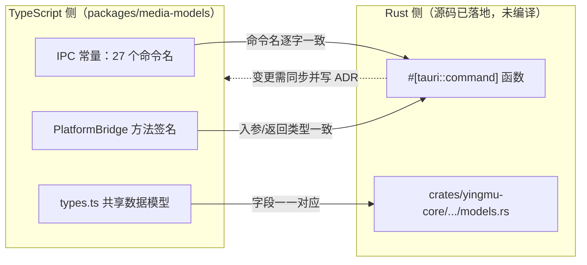

# IPC 契约（TypeScript ↔ Rust）

> 唯一真源：`packages/media-models/src/bridge.ts` 的 `IPC` 常量与 `PlatformBridge` 接口。
> 本文把命令逐项列表，用于对齐前端与 Rust 平台层。**命令名、入参、返回类型在 TS 与 Rust 两侧必须逐字一致**；任何字段或命令变更必须两侧同步并写 ADR（见 `docs/adr/0002-platform-bridge.md`）。

## 1. 契约性质

- `IPC` 以 `as const` 定义 27 个命令名字符串，`IpcCommand` 是其联合类型；前端不得在组件里硬编码命令字符串或直连 `window.__TAURI__`。
- `PlatformBridge`（`bridge.ts`）是前端与平台层的**唯一契约**：`WebDemoBridge`（浏览器/Vite/CI，演示数据 + `localStorage`）与 `TauriBridge`（类型安全 IPC）实现同一接口。
- `bridge.ts` 注释约定 Rust 命令实现位于 `apps/desktop/src-tauri/src/commands/*.rs`，与 `IPC` 一一对应。**该目录与 Rust 侧源码已落地**（`crates/yingmu-core/**`、`apps/desktop/src-tauri/**` 均在仓库，含 `Cargo.toml`；`src-tauri/src/commands/` 全部命令模块已落地，`yingmu_playlist_remove` 已补齐并在 `generate_handler!` 注册），但**未经编译验证**——Rust 1.99.1 已安装；本地已具备 MSVC 编译器/链接器与 Windows SDK 导入库/头文件（便携工具链，非系统级 Visual Studio 安装，需显式配置 `PATH` / `LIB` / `INCLUDE`），受构建环境限制尚未完成完整编译与测试。下表「Rust 实现位置」按契约模块划分，实际文件名以落地实现为准。

### 状态图例

| 标记 | 含义 |
| --- | --- |
| 已落地·未编译（Rust） | Rust `#[tauri::command]` 处理函数源码已落地，但未经编译验证（受构建环境限制，未经编译验证） |
| 演示（Web） | `WebDemoBridge` 可用内置演示数据 + `localStorage` 返回，属演示路径，**非真实平台能力** |
| 未提供（Web） | 当前 `PlatformBridge` 接口未暴露对应方法，演示路径未定义 |
| 推断 | 入参/返回按命名与 `packages/player-api` 推断，`bridge.ts` 未给出该命令的方法签名 |

> 本阶段 **Rust 1.99.1 已安装；本地已具备 MSVC 编译器/链接器与 Windows SDK 导入库/头文件（便携工具链，非系统级 Visual Studio 安装，需显式配置 `PATH` / `LIB` / `INCLUDE`），但 `cargo fmt --all -- --check` 已通过（exit 0，格式已归一化）；`cargo check` / `cargo test` / `cargo clippy` 受构建环境限制未成功完成，仓库 Rust 代码仍未经完整编译与测试验证，所有 `#[cfg(test)]` 单元测试未运行。实际阻断有两类：默认 shell 中 Git Bash 的 `/usr/bin/link.exe`（GNU coreutils 硬链接命令）遮蔽 MSVC 链接器，报 `link: extra operand`；部分执行通道存在 safe-delete 删除拦截，cargo 清理 rlib 临时目录时返回 `拒绝访问 (os error 5)`。二者均发生在第三方依赖编译阶段，未到达 `yingmu-core` 自身源码类型检查完成**，因此下表所有命令在 Tauri 路径下均为「源码已落地、未经编译验证」；不得把 `WebDemoBridge` 的演示返回当作平台能力已实现，也不得把「源码已落地」写成「已实现 / 已通过」。

## 2. 命令表

| # | 常量键 | IPC 命令名 | 入参（TS） | 返回（TS） | Rust 实现位置 | 当前状态 |
| --- | --- | --- | --- | --- | --- | --- |
| 1 | `libraryList` | `yingmu_library_list` | `kind?: string` | `Promise<MediaItem[]>` | `commands/library.rs` | 已落地·未编译（Rust）／演示（Web） |
| 2 | `libraryGet` | `yingmu_library_get` | `id: MediaId` | `Promise<MediaItem \| undefined>` | `commands/library.rs` | 已落地·未编译（Rust）／演示（Web） |
| 3 | `libraryUpdateMetadata` | `yingmu_library_update_metadata` | `id: MediaId, patch: Partial<MediaMetadata>` | `Promise<MediaItem>` | `commands/library.rs` | 已落地·未编译（Rust）／演示（Web） |
| 4 | `librarySetFavorite` | `yingmu_library_set_favorite` | `id: MediaId, favorite: boolean` | `Promise<void>` | `commands/library.rs` | 已落地·未编译（Rust）／演示（Web） |
| 5 | `libraryVersions` | `yingmu_library_versions` | `id: MediaId` | `Promise<MediaVersion[]>` | `commands/library.rs` | 已落地·未编译（Rust）／演示（Web） |
| 6 | `sourceList` | `yingmu_source_list` | 无 | `Promise<MediaSource[]>` | `commands/sources.rs` | 已落地·未编译（Rust）／演示（Web） |
| 7 | `sourceAdd` | `yingmu_source_add` | `Omit<MediaSource, 'id' \| 'status' \| 'itemCount'>` | `Promise<MediaSource>` | `commands/sources.rs` | 已落地·未编译（Rust）／演示（Web） |
| 8 | `sourceRemove` | `yingmu_source_remove` | `id: SourceId` | `Promise<void>` | `commands/sources.rs` | 已落地·未编译（Rust）／演示（Web） |
| 9 | `sourceTest` | `yingmu_source_test` | `id: SourceId` | `Promise<{ ok: boolean; message: string }>` | `commands/sources.rs` | 已落地·未编译（Rust）／演示（Web）；仅回传连通性结论，不回传凭据 |
| 10 | `scanStart` | `yingmu_scan_start` | `id: SourceId` | `Promise<void>` | `commands/scan.rs` | 已落地·未编译（Rust）／演示（Web） |
| 11 | `scanCancel` | `yingmu_scan_cancel` | `id: SourceId` | `Promise<void>` | `commands/scan.rs` | 已落地·未编译（Rust）／演示（Web）；对应 `ScanProgress.cancellable` |
| 12 | `scanStatus` | `yingmu_scan_status` | `id: SourceId` | `Promise<ScanProgress>` | `commands/scan.rs` | 已落地·未编译（Rust）／演示（Web） |
| 13 | `search` | `yingmu_search` | `query: SearchQuery` | `Promise<SearchResult>` | `commands/search.rs` | 已落地·未编译（Rust）／演示（Web）；FTS5 源码已落地·未编译 |
| 14 | `artworkGet` | `yingmu_artwork_get` | `req: ArtworkRequest` | `Promise<string>` | `commands/artwork.rs` | 已落地·未编译（Rust）／演示（Web） |
| 15 | `artworkRebuild` | `yingmu_artwork_rebuild` | 无 | `Promise<void>` | `commands/artwork.rs` | 已落地·未编译（Rust）／演示（Web） |
| 16 | `historyList` | `yingmu_history_list` | 无 | `Promise<PlaybackProgress[]>` | `commands/history.rs` | 已落地·未编译（Rust）／演示（Web） |
| 17 | `historySave` | `yingmu_history_save` | `progress: PlaybackProgress` | `Promise<void>` | `commands/history.rs` | 已落地·未编译（Rust）／演示（Web） |
| 18 | `playlistList` | `yingmu_playlist_list` | 无 | `Promise<Playlist[]>` | `commands/playlists.rs` | 已落地·未编译（Rust）／演示（Web） |
| 19 | `playlistSave` | `yingmu_playlist_save` | `playlist: Playlist` | `Promise<void>` | `commands/playlists.rs` | 已落地·未编译（Rust）／演示（Web） |
| 20 | `playlistRemove` | `yingmu_playlist_remove` | `id: PlaylistId` | `Promise<void>` | `commands/playlists.rs` | 已落地·未编译（Rust）／演示（Web） |
| 21 | `playerOpen` | `yingmu_player_open` | `PlayerMediaDescriptor`（推断） | `Promise<void>`（推断） | `commands/player.rs` | 已落地·未编译（Rust）／未提供（Web）；libmpv 未集成 |
| 22 | `playerControl` | `yingmu_player_control` | `PlayerCommand`（推断） | `Promise<void>`（推断） | `commands/player.rs` | 已落地·未编译（Rust）／未提供（Web） |
| 23 | `playerState` | `yingmu_player_state` | 无（推断） | `Promise<PlayerState>`（推断） | `commands/player.rs` | 已落地·未编译（Rust）／未提供（Web） |
| 24 | `playerAttachSurface` | `yingmu_player_attach_surface` | `containerId: string`（推断） | `Promise<PlayerSurface>`（推断） | `commands/player.rs` | 已落地·未编译（Rust）／未提供（Web）；D3D11 + HWND Surface 未验证 |
| 25 | `settingsGet` | `yingmu_settings_get` | 无 | `Promise<AppSettings>` | `commands/settings.rs` | 已落地·未编译（Rust）／演示（Web） |
| 26 | `settingsSet` | `yingmu_settings_set` | `patch: Partial<AppSettings>` | `Promise<AppSettings>` | `commands/settings.rs` | 已落地·未编译（Rust）／演示（Web） |
| 27 | `diagnosticsReport` | `yingmu_diagnostics_report` | 无 | `Promise<DiagnosticsReport>` | `commands/diagnostics.rs` | 已落地·未编译（Rust）／演示（Web）；未初始化时 `backend` 必须为 `none`、`backendReady=false` |

## 3. TS 与 Rust 两侧一致性要求

强制规则：

1. **命令名一致**：`IPC` 中每个字符串必须与 Rust `#[tauri::command]` 注册名完全一致；新增/重命名命令需两侧同步。
2. **类型一致**：`PlatformBridge` 方法的入参与返回，必须与 Rust 命令的 `Serialize`/`Deserialize` 结构对齐；`types.ts` 字段与 `models.rs` 字段一一对应。
3. **时间戳与序列化**：所有时间戳使用 ISO 8601 字符串（`types.ts` 约定），跨语言序列化一致。
4. **凭据隔离**：`sourceAdd` / `sourceTest` 路径不得回传或写入凭据；`MediaSource.uri` 与 `requiresAuth` 仅存定位与布尔标记。
5. **诊断诚实**：`DiagnosticsReport.backend` 在后端未初始化时不得谎称可用（`backend: 'none'`、`backendReady: false`）。

## 4. 契约一致性备注（QA 观察，仅记录不改代码）

以下为阅读 `bridge.ts` 时发现的接口与常量之间的待对齐点，供平台层落地时处理，本文不作代码修改：

- `PlatformBridge` 接口声明了 `playlistRemove(id: PlaylistId): Promise<void>`，`IPC` 常量现已补齐 `playlistRemove: 'yingmu_playlist_remove'`（`bridge.ts` 第 51 行），Rust 侧 `commands/playlists.rs` 亦已实现并在 `generate_handler!` 注册，**该待对齐点已消除**（源码已落地，仍未经编译验证）。
- `IPC` 中定义了 4 个 `player*` 命令（`playerOpen` / `playerControl` / `playerState` / `playerAttachSurface`），但当前 `PlatformBridge` 接口**未暴露**对应方法，播放器调用路径需与 `packages/player-api` 的 `PlayerBackend` 一并对齐。
- 剩余待办均属契约层待办；在平台层与播放器集成落地并通过编译验证前，相关能力状态保持「源码已落地 / 未编译验证」。
