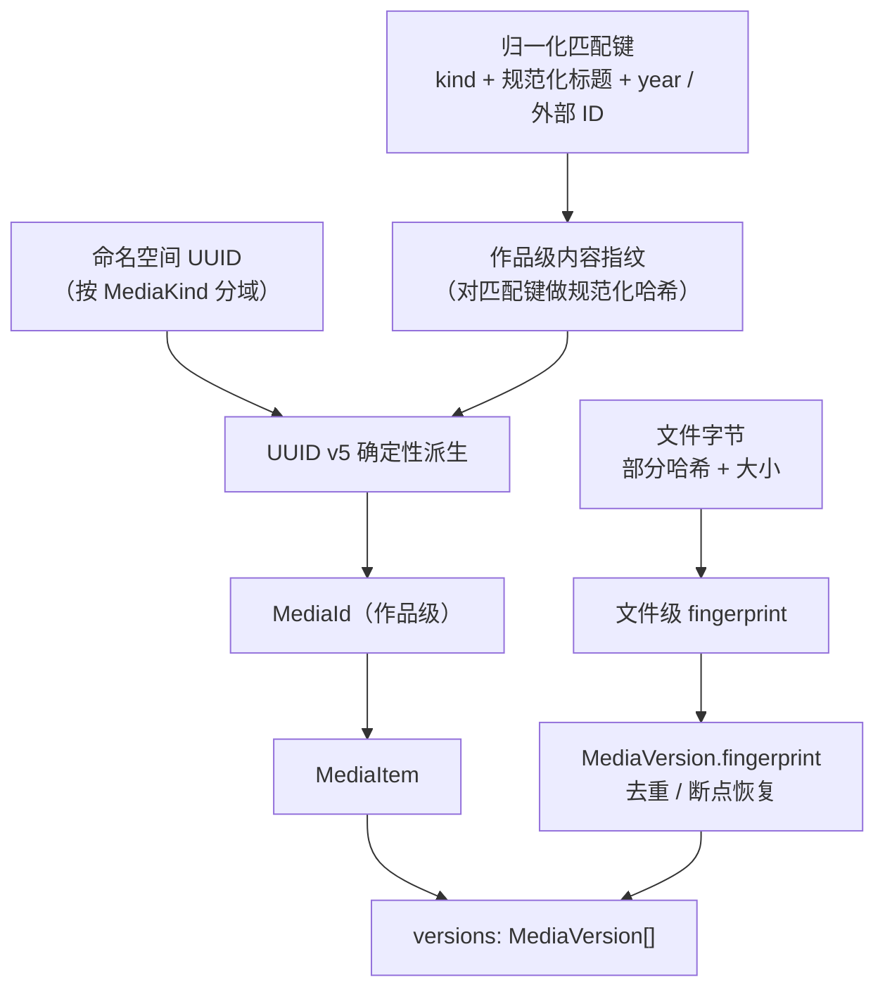
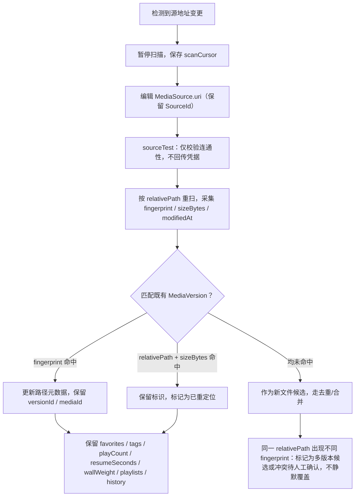

# 稳定 Media ID 与多版本 / NAS 重定位设计

> 唯一真源：`packages/media-models/src/types.ts`。
> 核心约定（来自该文件顶部注释）：**MediaId 是稳定内容标识，与文件路径解耦；路径变更不得导致 ID 变化。**

## 1. 标识层级

系统使用三类标识，作用层级不同，不得混用：

| 标识 | 类型 | 作用域 | 稳定性要求 |
| --- | --- | --- | --- |
| `MediaId` | `string` | 作品级（一部电影 / 一部剧） | 极高：路径、文件名、媒体源地址变更均不得改变 |
| `SourceId` | `string` | 媒体源（一个库根目录） | 高：地址变更时保留 ID，仅更新 `uri` |
| `VersionId` | `string` | 单个媒体文件版本 | 中：内容重编码时可作为新版本接入 |

`types.ts` 中 `MediaId` 注释为「UUID v5 风格，由内容指纹 + 命名空间派生，非路径」。为避免歧义，本文把「指纹」区分为两级：

- **作品级内容指纹 → `MediaId`**：由归一化匹配键（优先外部 ID 如 TMDB，其次 `kind` + 规范化标题 + `year`）在固定命名空间下做 UUID v5 确定性派生。UUID v5 是「命名空间 + 名称 → SHA-1 → 固定 UUID」，**确定性、可重算、非随机**，因此同一作品在任何机器、任何路径下都得到同一 ID。
- **文件级 `fingerprint` → `MediaVersion.fingerprint`**：`部分哈希 + 大小`（`types.ts` 注释），用于**文件级去重**与扫描断点恢复，不参与 `MediaId` 生成。

> 设计约束：`MediaId` 不得由 `relativePath`、文件名或 `SourceId.uri` 直接派生；否则 NAS 地址变更、文件重命名都会导致 ID 漂移，进而丢失收藏、进度、播放列表与幕墙排序。

## 2. 多版本模型

一个 `MediaId` 对应多个 `MediaVersion`（`MediaItem.versions`），用于表达同一作品的不同清晰度 / HDR / Dolby Vision / 语言 / 剪辑版本。

| 字段（`MediaVersion`） | 作用 |
| --- | --- |
| `id` / `mediaId` / `sourceId` | 版本主键、归属作品、归属媒体源 |
| `relativePath` | **相对媒体源根**的路径，是 remap 的关键（`types.ts` 注释：源地址变更时可重定位） |
| `fingerprint` / `sizeBytes` / `modifiedAt` | 去重、变更检测、断点恢复 |
| `durationSeconds` / `container` | 媒体信息 |
| `video` / `audio` / `subtitles` / `chapters` | 技术识别信息；仅代表「识别」，不代表渲染/输出能力 |
| `label` / `isDefault` | 用户可读标签（如「4K HDR DV / 普通话」）与默认版本 |

关联数据的归属规则：

- `PlaybackProgress` 绑定 `(mediaId, versionId)`：切换版本时进度归属明确，不会串到另一版本。
- `Playlist.mediaIds`、`TileLayout.mediaId`、`ArtworkRequest.mediaId`、`MediaItem.favorite/tags/wallWeight/playCount` 均绑定 `MediaId`（作品级），**与版本、路径无关**，因此 remap 后全部保留。

## 3. NAS 地址变更后的 remap 策略

场景：媒体源根地址变化，例如 UNC 主机/共享名变更、NAS IP 变更、协议从 `\\<NAS_HOST>\<SHARE>` 调整为 `smb://<HOST>/<SHARE>` 或 WebDAV 前缀调整。文件相对布局不变。

原则：**只更新 `MediaSource.uri`，不改 `MediaId`、不改 `MediaVersion.id`、不重建作品记录。**

匹配优先级（从强到弱）：

1. `fingerprint` 完全一致 → 判定为同一文件，最高置信度。
2. `relativePath` + `sizeBytes` 一致（指纹因部分哈希策略或文件被轻微改写而变化时）→ 保留标识，标记重定位。
3. 仅 `relativePath` 一致但 `fingerprint` 与大小均不同 → **不自动合并**，标记为「多版本候选 / 冲突待人工确认」。
4. 完全无匹配 → 新文件，走常规入库与去重。

数据保留与冲突处理：

| 情况 | 处理 |
| --- | --- |
| 仅源地址变更、文件内容不变 | 更新 `MediaSource.uri`；`relativePath`、`MediaId`、`VersionId` 全部保留；所有用户数据保留 |
| 文件被重新编码（内容变化） | 生成新 `fingerprint`，作为**新版本**接入既有 `MediaId` 或新建候选，不改动既有 `MediaId` |
| 同一相对路径出现多个不同内容 | 不静默覆盖，标记冲突或多版本候选 |
| 扫描中断 | 依赖 `MediaSource.scanCursor` 与 `ScanProgress` 断点恢复，`ScanProgress.duplicates` 记录重复数 |

> `MediaSource.requiresAuth` 仅存布尔标记，凭据经安全存储注入，绝不写入 `uri` 或任何可序列化字段——remap 过程同样不接触凭据本体。

## 4. 去重与分页相关

- **去重**：以 `MediaVersion.fingerprint`（部分哈希 + 大小）为文件级去重键；相同指纹出现在不同 `SourceId` / `relativePath` 时计入 `ScanProgress.duplicates`，不重复建立作品记录。
- **作品级合并**：多个文件归到同一 `MediaId` 由作品级匹配键决定，与去重是两个独立环节。
- **分页**：`SearchQuery.limit` / `offset` 与 `SearchResult.total` 绑定 `MediaId` 集合；因 ID 稳定，remap 不会造成分页错位或结果重复。

## 5. 当前状态

| 项 | 状态 |
| --- | --- |
| `MediaId` / `SourceId` / `VersionId` 类型与字段契约 | 已定义（`types.ts`） |
| UUID v5 派生、命名空间划分、remap 匹配算法、FTS5 落地 | **Rust 侧已按此设计实现（`derive_media_id` / `remap_source` 等，源码已落地），但未经编译验证**（本地工具链已就位，受构建环境限制；见 `docs/database/schema.md`） |
| NAS 实机 remap 验证 | **未执行** |
