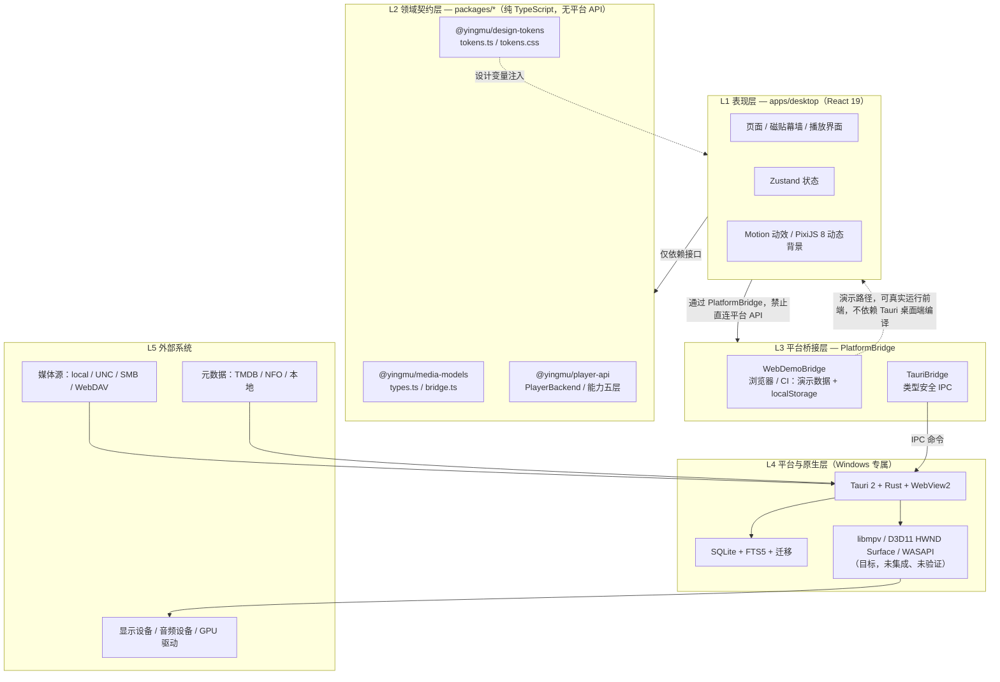

# 影幕 YingMu — 系统架构总览

> 版本：v0.1.0 ｜ App ID：`com.moko.yingmu` ｜ 目标平台：Windows 10 22H2 / Windows 11 x64
> 状态：分层骨架与跨语言契约已建立；Rust 平台层源码（`crates/yingmu-core/**`、`apps/desktop/src-tauri/**`）**已落地，但未经编译验证**（本地工具链已就位，受构建环境限制）；libmpv 播放后端未集成、未验证。
> 本文描述设计契约与模块边界。凡涉及「已实现 / 已验证」的表述，均以仓库当前代码与本机实机验证为准；**未实现、未验证、未实测**的项一律显式标注，不得由设计推定为实现。

## 1. 文档定位与事实基准

本文是架构层的索引文档，约束所有下游模块：`docs/architecture/ipc-contract.md`（IPC 契约）、`docs/architecture/media-id.md`（标识设计）、`docs/playback/*`、`docs/dolby-compatibility/*`、`docs/database/*`。

技术栈（来自根 `package.json` 与 `apps/desktop/package.json`）：

| 层次 | 技术 |
| --- | --- |
| 前端 | React 19.3、TypeScript 6.0、Vite 8（Rolldown）、Tailwind CSS 4.3、Motion 14、Zustand 5.1、PixiJS 8.22、react-router 7.18、lucide-react 1.70 |
| 桌面外壳 | Tauri 2、Rust（MSRV 1.85）、WebView2（Windows） |
| 数据 | SQLite + FTS5（`rusqlite` 0.41，bundled）、版本化迁移 |
| 播放器目标后端 | libmpv（**本阶段未集成、未验证**） |
| 包管理 | npm workspaces（`apps/*`、`packages/*`），Node `^22.13 \|\| ^24 \|\| >=26` |

本机实测环境（如实记录，仅用于说明可运行性边界）：Node 22.22.2 / npm 10.9.7、`node_modules` 已安装、Git 2.55、WebView2 156.0.4314.58 可用，网络可达 api.github.com / npm registry；**Rust 1.99.1 已安装；本地已具备 MSVC 编译器/链接器与 Windows SDK 导入库/头文件（便携工具链，非系统级 Visual Studio 安装，需显式配置 `PATH` / `LIB` / `INCLUDE`）**；GitHub 通过已认证的连接器可用。由此得出结论：**Tauri / NSIS 安装包本阶段未生成，由 CI / Release 在 `windows-latest` 构建；`cargo fmt --all -- --check` 已通过（exit 0，格式已归一化）；`cargo check` / `cargo test` / `cargo clippy` 受构建环境限制未成功完成，仓库 Rust 代码仍未经完整编译与测试验证，所有 `#[cfg(test)]` 单元测试未运行。实际阻断有两类：默认 shell 中 Git Bash 的 `/usr/bin/link.exe`（GNU coreutils 硬链接命令）遮蔽 MSVC 链接器，报 `link: extra operand`；部分执行通道存在 safe-delete 删除拦截，cargo 清理 rlib 临时目录时返回 `拒绝访问 (os error 5)`。二者均发生在第三方依赖编译阶段，未到达 `yingmu-core` 自身源码类型检查完成；libmpv 嵌入式播放未完成技术验证**。Rust 源码（`crates/yingmu-core/**`、`apps/desktop/src-tauri/**`，含 `Cargo.toml` 与 SQL 迁移）**已落地**。

## 2. 系统分层（文字版 Mermaid）

分层约束：

1. **L1 只依赖 L2 的接口**，不直接引用 `window.__TAURI__`、`fs` 或任何平台 API（`bridge.ts` 顶部约定）。
2. **L2 是唯一真源**：`packages/media-models` 的 `types.ts` 与 Rust 侧 `crates/yingmu-core/src/database/models.rs` 字段一一对应；`bridge.ts` 的 `IPC` 常量与 Rust `#[tauri::command]` 命令名一一对应；`tokens.ts` 与 `tokens.css` 数值一致。任何一侧变更必须同步并写 ADR。
3. **L3 是跨平台抽象边界**：同一种 `PlatformBridge` 接口有两种实现，业务代码不感知运行在哪一种之上。
4. **L4 的 Windows 专属实现**（D3D11、原生 HWND Surface、WASAPI、WebView2、NSIS 打包）不得进入 L1/L2。

## 3. 模块边界

| 模块 | 路径 | 职责 | 允许依赖 | 平台约束 |
| --- | --- | --- | --- | --- |
| 桌面应用 | `apps/desktop` | 页面、路由、状态、构建入口 | L2 契约、L3 桥接 | 不得直连平台 API |
| 数据模型 | `packages/media-models` | `MediaItem`/`MediaVersion`/`MediaSource`/`bridge.ts` 等共享类型 | 无 | 纯 TS，无 `window`/`fs`/`tauri` 引用 |
| 播放器接口 | `packages/player-api` | `PlayerBackend`、`PlayerCommand`、`CapabilityStage` 五层模型 | `media-models` | 纯抽象，不依赖 libmpv/D3D11/WASAPI |
| 设计令牌 | `packages/design-tokens` | 色彩/字体/圆角/间距/动效/磁贴/层级 | 无 | 纯数据与 CSS 变量 |
| Rust 核心 | `crates/yingmu-core` | 数据库模型、扫描、元数据 | — | **源码已落地，未经编译验证**（受构建环境限制） |
| Tauri 命令 | `apps/desktop/src-tauri/src/commands/*.rs` | IPC 命令实现、平台能力 | Rust 核心 | **源码已落地（部分模块补齐中），未经编译验证** |

> 说明：`crates/**` 与 `apps/desktop/src-tauri/**` 的 Rust 源码**已落地**在仓库中（含工作区 `Cargo.toml` 与数据库 SQL 迁移）。Rust 1.99.1 已安装；本地已具备 MSVC 编译器/链接器与 Windows SDK 导入库/头文件（便携工具链，非系统级 Visual Studio 安装，需显式配置 `PATH` / `LIB` / `INCLUDE`），但受构建环境限制，**所有 Rust 代码未经编译验证**；`cargo fmt --all -- --check` 已通过（exit 0，格式已归一化）；`cargo check` / `cargo test` / `cargo clippy` 受构建环境限制未成功完成，仓库 Rust 代码仍未经完整编译与测试验证，所有 `#[cfg(test)]` 单元测试未运行。实际阻断有两类：默认 shell 中 Git Bash 的 `/usr/bin/link.exe`（GNU coreutils 硬链接命令）遮蔽 MSVC 链接器，报 `link: extra operand`；部分执行通道存在 safe-delete 删除拦截，cargo 清理 rlib 临时目录时返回 `拒绝访问 (os error 5)`。二者均发生在第三方依赖编译阶段，未到达 `yingmu-core` 自身源码类型检查完成。凡依赖这些实现的能力一律标注为「源码已落地 / 未编译验证」，不得写成「已实现」或「已通过」。

## 4. 数据流

关键边界：

- **识别 ≠ 能力**。`VideoStreamInfo.hdrFormat`、`dolbyVisionProfile`、`hasRpu`、`hasEnhancementLayer` 仅代表「文件识别」结果；`AudioStreamInfo.format` 仅代表音轨标识；均不代表具备对应解码、渲染或原生输出能力（见 `docs/dolby-compatibility/compatibility-matrix.md`）。
- **凭据不入数据模型**。`MediaSource.uri` 仅存统一资源定位，`requiresAuth` 为布尔标记，凭据永远经安全存储注入（`types.ts` 约定）。
- **路径解耦**。`MediaVersion.relativePath` 是相对媒体源根的路径，稳定 `MediaId` 与绝对路径解耦（见 `media-id.md`）。

## 5. 跨平台抽象边界

以下规则用于保证业务核心（L1/L2）不绑定 Windows 实现：

| 规则 | 说明 |
| --- | --- |
| 单一桥接接口 | 前端只依赖 `PlatformBridge`（`bridge.ts`），平台差异封装在 `WebDemoBridge` / `TauriBridge` 内 |
| 能力经接口注入 | 文件系统、数据库、扫描、设置、诊断、播放器全部通过桥接方法，组件不得直接调用 `window.__TAURI__`、`fs` 等 |
| 原生 Surface 句柄化 | 平台层创建视频 Surface 并把 `handle` 交给前端，前端「不解释其内容」；`PlayerSurface.embedded` 用于区分是否真正嵌入应用窗口，禁止用独立外部播放器窗口冒充嵌入式播放 |
| 平台专属实现留在 L4 | D3D11、HWND、WASAPI、WebView2、注册表、NSIS 打包只出现在平台层；`packages/*` 不得出现这些引用 |
| 双向类型对齐 | TS 模型/命令名与 Rust 侧必须一致；字段变更两侧同步并写 ADR |
| 能力分级上报 | 播放器只上报真实探测到的能力，未验证项 `verified=false`，不得由「已识别」推定「已渲染 / 原生输出」 |

`WebDemoBridge` 的存在意义（详见 `docs/adr/0002-platform-bridge.md`）：在**尚未产出 Tauri 桌面端构建产物**的机器上（本地工具链已就位，受构建环境限制未完成完整编译），用内置演示数据 + `localStorage` 让前端真实运行、测试、截图，从而把「前端可运行性」与「平台层是否编译」解耦。

## 6. 构建与运行方式

前置条件（来自 `package.json` 与实测）：Node `>=20.19.0`（本机 22.22.2）、npm（本机 10.9.7）。`node_modules` 已安装。

| 命令 | 作用 | 本阶段可运行性 |
| --- | --- | --- |
| `npm install` | 安装 workspace 依赖 | 可运行（网络与 npm registry 可达） |
| `npm run dev` | Vite 开发服务器（127.0.0.1:5173） | **可真实运行前端**（走 `WebDemoBridge`，不依赖 Tauri 桌面端编译） |
| `npm run typecheck` | `tsc --noEmit` | ✅ 本机实测通过（2026-11-06） |
| `npm run lint` | ESLint `--max-warnings 0` | ✅ 本机实测通过 |
| `npm run test` / `test:watch` / `test:coverage` | Vitest 5.1（jsdom） | ✅ 本机实测通过（13 个测试文件 / 139 个用例全部通过） |
| `npm run build` | `typecheck && vite build`，产物 `dist/` | ✅ 本机实测通过（Vite 产出 `dist/`） |
| `node scripts/secret-scan.mjs` / `node --test tests/repo-contract.test.mjs` | 凭据扫描 / 仓库契约测试 | ✅ 本机实测通过（168 文件零命中 / 6-6 通过） |
| `npm run cargo:fmt` / `cargo:clippy` / `cargo:test` | Rust 检查与测试 | **`fmt` 已通过（exit 0）；`clippy` / `test` 未成功完成**：受构建环境限制，见 `docs/testing/strategy.md` |
| Tauri 桌面构建 / NSIS 安装包 | 生成 `.exe` 安装器 | **本阶段未生成**，由 CI / Release 在 `windows-latest` 构建 |
| 推送至 `github.com/MokoKing666/yingmu` | 代码托管 | ✅ **已完成**：仓库 `https://github.com/MokoKing666/yingmu` 已于 2026-11-08 创建为公开仓库并完成源码推送。本机 `git push` 通道不可达（`github.com:443` 直连超时、代理返回 502），故改用 `api.github.com` 直连：该 classic PAT 只接受 `Basic 用户名:token` 认证（`Bearer` / `token` 写法返回 401 `Bad credentials`，属鉴权写法差异，并非凭据失效），经 GitHub REST / Git Data API 分 7 个提交推送全部 173 个文件（含 24 个 PNG/ICO 二进制），**逐文件 blob SHA 校验 173/173 完全一致**；凭据仅从本地文件读入内存用于鉴权，未写入代码、提交、remote URL 或日志 |

> 前端构建产物（`dist/`）、安装器（`*.exe`/`*.msi`）、Rust 构建产物（`target/`）、字体二进制、用户数据库、媒体样本均被 `.gitignore` 排除，不得入库。用户数据目录统一以 Rust 侧 `DataDirs::resolve()` 为准：`%APPDATA%\YingMu`（数据库与设置）、`%LOCALAPPDATA%\YingMu\Cache`（缓存 / 封面）、`%LOCALAPPDATA%\YingMu\Logs`（日志），不写入安装目录；`com.moko.yingmu` 仅为应用标识符 / Bundle ID，**不用作目录名**（见 `docs/adr/0005-data-locations.md`）。文档一律用 `%APPDATA%` / `%LOCALAPPDATA%` 占位符表达，不写任何本机绝对路径。

## 7. 本阶段能力状态声明

| 能力 | 状态 |
| --- | --- |
| 分层骨架、共享类型、`PlatformBridge` 契约、Design Tokens | 已建立（契约层） |
| 前端在浏览器/Vite 下真实运行（`WebDemoBridge`） | ✅ 已实测（界面截图来自 `vite preview` 真实运行实例，见 README「界面截图」章节） |
| `TauriBridge` / Rust IPC 命令实现 | **源码已落地，未经编译验证**（受构建环境限制，未经编译验证） |
| SQLite 表结构、FTS5、迁移 | **源码已落地（含 SQL 迁移），未经编译验证**（见 `docs/database/schema.md`） |
| libmpv 集成与嵌入式播放 | **未集成、未验证** |
| D3D11 + 原生 HWND Surface 嵌入 | **未验证**（见 `docs/playback/windows-surface-validation.md`） |
| 4K HEVC / HDR / Dolby Vision 原生输出 | **未实测、未验证** |
| 音频 bitstream 直通 / Atmos 传递 | **未实机验证** |
| Tauri / NSIS 安装包 | **本阶段未生成**（由 CI / Release 构建） |
| GitHub 推送 | **无法进行** |
| Dolby 官方认证与官方 Logo 使用 | **未获得、未使用** |

「未验证」不等于「不支持」，但同样**不得据此宣称支持**。所有能力声明以实机验证证据为准（见 `docs/dolby-compatibility/*` 与 `docs/playback/windows-surface-validation.md`）。
