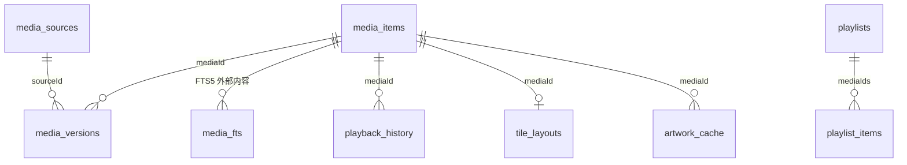
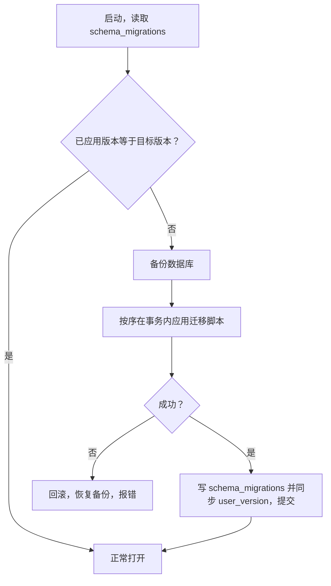

# 数据库设计（表结构 / 迁移 / FTS5 / 去重 / 备份）

> 状态：**设计规格；Rust 侧源码已落地，但未经编译验证**。本文描述基于 `packages/media-models/src/types.ts` 与 `bridge.ts` 契约的数据库设计；Rust 侧 `crates/yingmu-core`（含 `database/mod.rs` 与两份 SQL 迁移）与 `apps/desktop/src-tauri` **源码已落地**，但受构建环境限制（Rust 1.99.1 已安装；本地已具备 MSVC 编译器/链接器与 Windows SDK 导入库/头文件（便携工具链，非系统级 Visual Studio 安装，需显式配置 `PATH` / `LIB` / `INCLUDE`）），SQLite/FTS5/迁移代码**未经编译、未运行**。
> 数据目录按 Rust 侧 `DataDirs::resolve()` 统一为 `%APPDATA%\YingMu` / `%LOCALAPPDATA%\YingMu\Cache` / `%LOCALAPPDATA%\YingMu\Logs`，`com.moko.yingmu` 仅作应用标识符、不作目录名（见 `docs/adr/0005-data-locations.md`）；文档统一用 `%APPDATA%` / `%LOCALAPPDATA%` 占位符表示，不写任何本机绝对路径；数据库文件、WAL、日志、缓存均被 `.gitignore` 排除，不得入库。

## 1. 存储位置与连接

| 项 | 设计 |
| --- | --- |
| 数据库文件 | `%APPDATA%\YingMu\yingmu.db`（`DataDirs::database_path()`），设置同目录 `settings.json` |
| 图像缓存 | `%LOCALAPPDATA%\YingMu\Cache\Artwork\`（`DataDirs::cache.join("Artwork")`），按 `ArtworkRequest.size`（`sm/md/lg/xl`）分档 |
| 日志 | `%LOCALAPPDATA%\YingMu\Logs\` |
| 连接模式 | SQLite WAL（`journal_mode=WAL`）、`foreign_keys=ON`、`busy_timeout` |
| 凭据 | `MediaSource.uri` 不存凭据，`requiresAuth` 仅布尔标记；凭据经安全存储注入，绝不入库 |
| schema 版本 | 版本真源为 `schema_migrations` 表，并冗余写入 `PRAGMA user_version` 镜像；`Database::db_version()` 从 `schema_migrations` 读取，与 `DiagnosticsReport.dbVersion`（`bridge.ts`）对应 |

## 2. 表结构



### 2.1 `media_sources`（`MediaSource`）

| 列 | 类型 | 说明 |
| --- | --- | --- |
| `id` | TEXT PK | `SourceId`，稳定标识，地址变更保留 |
| `name` / `protocol` | TEXT | `local` / `unc` / `smb` / `webdav` |
| `uri` | TEXT | 统一资源定位，**不含凭据** |
| `status` / `enabled` | TEXT / INTEGER | `connected`/`disconnected`/`error`/`scanning` |
| `kinds` | TEXT(JSON) | 允许扫描的 `MediaKind[]` |
| `last_scan_at` | TEXT | ISO 8601 |
| `item_count` | INTEGER | 条目数 |
| `scan_cursor` | TEXT | 断点恢复游标 |
| `requires_auth` | INTEGER | 布尔标记 |

### 2.2 `media_items`（`MediaItem`）

| 列 | 类型 | 说明 |
| --- | --- | --- |
| `id` | TEXT PK | `MediaId`，稳定内容标识（见 `docs/architecture/media-id.md`） |
| `kind` | TEXT | `movie`/`tv`/`anime`/`documentary`/`personal` |
| `metadata` | TEXT(JSON) | `MediaMetadata` 整体（标题、演职员、类型、外部 ID 等） |
| `title` / `original_title` / `year` | 提取列 | 供 FTS5 与排序、筛选（`SearchQuery.yearFrom/yearTo`）使用 |
| `favorite` | INTEGER | 收藏 |
| `tags` | TEXT(JSON) | 用户标签 |
| `wall_weight` | REAL | 幕墙布局权重 |
| `resume_seconds` / `last_played_at` / `play_count` | 标量 | 最近播放与次数 |
| `added_at` / `updated_at` | TEXT | ISO 8601 |

> 元数据允许部分字段为空（`MediaMetadata` 注释：刮削失败时不得覆盖原始文件信息）；JSON 列与 TS 结构一一对应，字段变更需两侧同步并写 ADR。

### 2.3 `media_versions`（`MediaVersion`）

| 列 | 类型 | 说明 |
| --- | --- | --- |
| `id` | TEXT PK | `VersionId` |
| `media_id` | TEXT FK | → `media_items.id` |
| `source_id` | TEXT FK | → `media_sources.id` |
| `relative_path` | TEXT | **相对媒体源根**的路径，remap 关键 |
| `fingerprint` | TEXT | 内容指纹（部分哈希 + 大小），去重键 |
| `size_bytes` / `modified_at` | INTEGER / TEXT | 变更检测 |
| `duration_seconds` / `container` | 标量 | 媒体信息 |
| `video` / `audio` / `subtitles` / `chapters` | TEXT(JSON) | 与 `VideoStreamInfo` / `AudioStreamInfo` / `SubtitleStreamInfo` / `Chapter` 一一对应 |
| `label` / `is_default` | TEXT / INTEGER | 版本标签与默认版本 |

索引：`(source_id, relative_path)`、`fingerprint`（去重）、`media_id`。

> 设计选择：流信息与章节以规范化 JSON 列存储，与 TS 模型一一对应、减少联表；备选方案是拆为 `audio_streams` / `subtitle_streams` / `chapters` 子表。Rust 侧源码已落地，但**未经编译验证**；具体实现以落地源码为准。

### 2.4 其他表

| 表 | 对应契约 | 要点 |
| --- | --- | --- |
| `playlists` / `playlist_items` | `Playlist` | `playlist_items(playlist_id, media_id, position)` 表达 `mediaIds` 有序集合 |
| `playback_history` | `PlaybackProgress` | 唯一键 `(media_id, version_id)`，进度绑定版本 |
| `tile_layouts` | `TileLayout` | `colSpan` / `rowSpan` / `variant` / `order` |
| `artwork_cache` | `ArtworkRequest` | 按 `(media_id, kind, size)` 缓存路径/哈希，`artworkRebuild` 触发重建 |
| `settings` | `AppSettings` | 单行 JSON 或 key-value，默认 `DEFAULT_SETTINGS` |
| `scan_state` | `ScanProgress` | 可并入 `media_sources`，记录 `scanned/discovered/duplicates/removed/state` |
| `media_fts` | FTS5 虚表 | 见第 4 节 |

## 3. 迁移机制

- 版本源：`schema_migrations`（version / name / applied_at）表为版本真源，按版本升序、事务内逐条执行 `include_str!` 嵌入的 SQL；`Database::db_version()` 取该表 `MAX(version)`，对应 `DiagnosticsReport.dbVersion`。
- 迁移脚本版本化、顺序执行、**事务内**、尽量幂等；启动时比对 `schema_migrations` 已应用版本与目标版本，按序应用。
- 新增列优先 `ALTER TABLE ... ADD COLUMN` + 默认值；复杂结构变更采用「建新表 → 拷贝数据 → 事务内改名」模式，**禁止破坏性重建用户数据**。
- 迁移前自动备份，失败回滚到迁移前状态并保留备份。
- 每次迁移成功后写入 `schema_migrations` 并冗余同步 `PRAGMA user_version`；`dbVersion` 可被 `diagnosticsReport` 回读。



> 版本真源为 `schema_migrations` 表，`PRAGMA user_version` 仅作冗余镜像（与 `docs/adr/0005-data-locations.md`、`crates/yingmu-core/README.md` 一致）。迁移与备份源码已落地，但**未经编译、未验证**（受构建环境限制）；升级后数据保留测试**未执行**（见 `docs/testing/strategy.md`）。

## 4. FTS5 全文检索与触发器

`media_fts` 采用 FTS5「外部内容表」模式（`content='media_items'`），由触发器保持与 `media_items` 同步。以下为**设计示例 SQL，未执行、未验证**：

```sql
CREATE VIRTUAL TABLE media_fts USING fts5(
  title, original_title, synopsis, directors, cast, genres,
  content='media_items', content_rowid='rowid', tokenize='unicode61'
);

CREATE TRIGGER media_fts_ai AFTER INSERT ON media_items BEGIN
  INSERT INTO media_fts(rowid, title, original_title, synopsis, directors, cast, genres)
  VALUES (new.rowid, new.title, new.original_title, new.synopsis, new.directors, new.cast, new.genres);
END;

CREATE TRIGGER media_fts_ad AFTER DELETE ON media_items BEGIN
  INSERT INTO media_fts(media_fts, rowid, title, original_title, synopsis, directors, cast, genres)
  VALUES ('delete', old.rowid, old.title, old.original_title, old.synopsis, old.directors, old.cast, old.genres);
END;

CREATE TRIGGER media_fts_au AFTER UPDATE ON media_items BEGIN
  INSERT INTO media_fts(media_fts, rowid, title, original_title, synopsis, directors, cast, genres)
  VALUES ('delete', old.rowid, old.title, old.original_title, old.synopsis, old.directors, old.cast, old.genres);
  INSERT INTO media_fts(rowid, title, original_title, synopsis, directors, cast, genres)
  VALUES (new.rowid, new.title, new.original_title, new.synopsis, new.directors, new.cast, new.genres);
END;
```

- 高亮片段：`snippet()` / `highlight()` 对应 `SearchResult.snippets`（`Record<MediaId, string>`）。
- 中文分词：FTS5 默认 `unicode61` 对中文按字切分效果有限，需评估 `trigram` tokenizer 或外部分词器；**该选型待验证**，不得假定中文检索质量。
- 筛选条件（`kinds` / `favoritesOnly` / `yearFrom` / `yearTo` / `genres`）在 SQL 层与 FTS5 结果联合过滤。

## 5. 分页

- `SearchQuery.limit` / `offset` + `SearchResult.total` 实现分页；排序需稳定（如 `added_at` / `wall_weight` / 相关度），避免跨页重复或错位。
- 大数据量下可评估 keyset pagination 作为备选。
- 因 `MediaId` 稳定，NAS remap 不改变主键，分页结果不会错位（见 `docs/architecture/media-id.md`）。

## 6. 去重

| 层级 | 键 | 处理 |
| --- | --- | --- |
| 文件级 | `MediaVersion.fingerprint`（部分哈希 + 大小） | 相同指纹出现在不同 `source_id` / `relative_path` 计入 `ScanProgress.duplicates`，不重复建作品记录 |
| 作品级 | 归一化匹配键派生 `MediaId` | 多个文件归到同一作品，与文件级去重是两个独立环节 |

## 7. 备份与升级保留数据策略

用户数据类型（`media_items` 上的 `favorite` / `tags` / `wall_weight` / `resume_seconds` / `play_count`、`playback_history`、`playlists`、`settings`、`tile_layouts`）**必须在升级、覆盖安装、remap 后保留**。

| 场景 | 策略 |
| --- | --- |
| 在线备份 | 用 SQLite backup API 或 `VACUUM INTO` 生成一致性快照，避免直接复制 WAL 中的活动数据库 |
| 版本升级迁移 | 先备份 → 事务内迁移 → 校验 → 失败回滚；禁止删表重建用户数据 |
| 覆盖安装 | 复用既有用户数据目录，不清除数据库；执行必要迁移 |
| 卸载 | 设计上默认**不自动删除**用户数据目录，或提供明确可选项；具体交互待安装测试确认 |
| NAS remap | 仅更新 `media_sources.uri`，不改 `MediaId` / `VersionId`，用户数据全部保留（见 `media-id.md`） |
| 数据库文件入库 | 禁止：`.gitignore` 排除 `*.db` / `*.db-wal` / `*.db-shm` / `*.sqlite*` / `*.log` / `cache/` |

> 备份、迁移、卸载/覆盖安装的数据保留策略均为**设计规格**；因安装包本阶段未生成，相关安装与升级测试**未执行**。

## 8. 状态汇总

| 项 | 状态 |
| --- | --- |
| 表结构、字段与 TS 契约映射、ER 关系 | 设计规格（契约层） |
| SQLite 建表 / WAL / 迁移 / FTS5 触发器实际运行 | **源码已落地，未经编译、未验证**（受构建环境限制） |
| 中文分词选型、分页性能、去重效果 | **待验证** |
| 备份 / 升级 / 卸载数据保留测试 | **未执行** |
