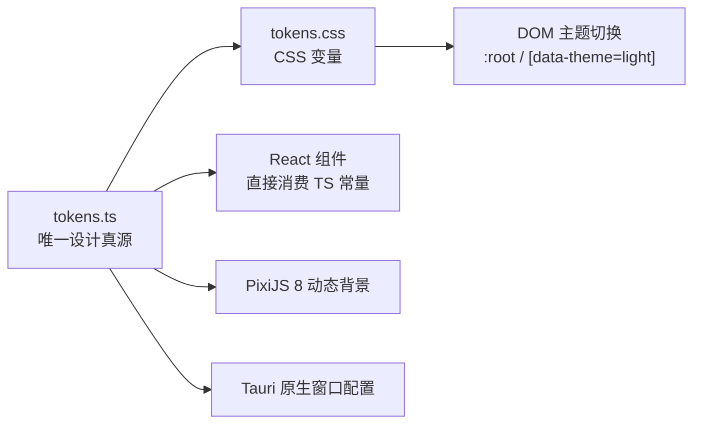

# 影幕 YingMu — 设计系统（Design Tokens / 主题 / 磁贴）

> 唯一真源：`packages/design-tokens/src/tokens.ts`（数值）与 `packages/design-tokens/src/tokens.css`（CSS 变量）。
> 约定（来自 `tokens.ts` 顶部注释）：所有数值以 rem/px 表达，动画参数统一由此导出，**禁止在组件里散落魔法数字**；`tokens.ts` 与 `tokens.css` 改动需同步两处并更新本文。



## 1. 字体与授权（重要）

**字体栈**（`typography.fontFamily`）：

```
"MiSans", "PingFang SC", "Microsoft YaHei UI", "Microsoft YaHei", "Segoe UI", system-ui, -apple-system, sans-serif
```

等宽栈（`typography.monoFamily`）：`"JetBrains Mono", "Cascadia Code", "Consolas", ui-monospace, monospace`。

授权与分发约束：

| 项 | 说明 |
| --- | --- |
| 本机状态 | 本机已安装 MiSans（`DEFAULT_SETTINGS.subtitleFontFamily = 'MiSans'`） |
| 仓库状态 | **系统字体文件不打包进仓库**。`.gitignore` 明确忽略 `*.ttf` / `*.otf` / `*.woff` / `*.woff2`，仅保留 SVG 品牌图形与授权说明 |
| 运行依赖 | 字体栈以 MiSans 优先，但**不硬依赖**：未安装时按栈回退到系统字体，不影响功能 |
| 正式发行 | 如需随应用分发字体，必须**从官方渠道获取并遵守其授权条款**；具体许可名称、可再分发范围与限制**待法务确认**（见根目录 `THIRD_PARTY_NOTICES.md`） |
| 禁止事项 | 不得把「本机已安装字体」等同于「可随应用再分发」；不得把系统字体二进制提交进仓库 |

> 字体授权状态：**待法务确认**。本文不编造许可证名称，也不宣称任何再分发权利。

## 2. 色彩

v0.3 起品牌色系为 **Cinematic Neutral**（冷调电影感）：深色 Cinematic Graphite、浅色 Silver Screen、
强调色 Glacier Blue。v0.2 的琥珀金 `#D9A55B` 与米黄底 `#F7F6F3` 已**全部移除**，仓库里不再有
`cinemaAmber` 这个 token，也没有任何 `--brand-amber` 残留。

> **单一真源与漂移防护**：`tokens.ts` 与 `tokens.css` 是同一套数值的两种形态
> （TS 给 Pixi/布局/动画用，CSS 给 DOM 用）。二者必须逐项相等，
> 由 `node scripts/check-token-sync.mjs` 强制校验（已进 CI）：
> 任何一处改了另一处没改都会失败，同时检查应用 CSS 里 `var(--x)` 的每个引用都有定义。

### 2.1 品牌强调色（Glacier Blue）

| Token | 深色（`--accent`） | 浅色覆盖 | 用途 |
| --- | --- | --- | --- |
| `accent` | `#77B8D8` | `#3C6F8B` | 主强调：选中态、焦点环、关键数字 |
| `accentSoft` | `#A0D0E8` | `#77B8D8` | 柔和变体（大字号、图标底色） |
| `accentDeep` | `#477F9F` | `#2A566E` | 按下态 / 深一层的描边 |
| `accentWash` | `#16252F` | `#DDEFF7` | 极浅底纹（选中行背景） |
| `accentOn` | `#08121A` | `#FFFFFF` | 压在强调色上的文字/图标 |

> **为什么浅色主题要换一支蓝**：`#77B8D8` 在 `#F4F7FA` 上只有 **2.2:1**，做正文或图标都不达标。
> 浅色主题改用 `#3C6F8B`，实测 **5.09:1**（见 2.5）。这是同一支色相的可访问性映射，
> 不是两套品牌色——组件永远只写 `var(--accent)`，由主题层决定具体值。

### 2.2 中性银幕白

| Token | 值 | 用途 |
| --- | --- | --- |
| `silver` | `#EEF3F7`（深色）/ `#F4F7FA`（浅色） | 压在封面、视频、深色玻璃上的文字基色 |

`silver` **不是品牌色**，它是「永远压在图像上的白」。凡是在封面上排版的文字（磁贴标题、徽标、
播放器控制条）都用它；凡是排在页面背景上的文字必须用 `--text-primary`，否则浅色主题会白底白字
——这正是 v0.3 修掉的一个真实缺陷（`docs/CHANGELOG` 0.3.0 条目）。

### 2.3 深色主题（默认，`:root`）— Cinematic Graphite

| Token | 值 | Token | 值 |
| --- | --- | --- | --- |
| `bgBase` | `#0B0F14` | `bgElevated` | `#121922` |
| `bgOverlay` | `#141C26` | `surface` | `#18222D` |
| `surfaceHover` | `#202D39` | `border` | `#2B3947` |
| `borderStrong` | `#405365` | `textPrimary` | `#EEF3F7` |
| `textSecondary` | `#AAB7C3` | `textTertiary` | `#8294A2` |
| `scrim` | `rgba(6, 11, 16, 0.72)` | | |

### 2.4 浅色主题（`[data-theme='light']` 覆盖）— Silver Screen

| Token | 值 | Token | 值 |
| --- | --- | --- | --- |
| `bgBase` | `#F4F7FA` | `bgElevated` | `#FFFFFF` |
| `bgOverlay` | `#FFFFFF` | `surface` | `#EDF2F6` |
| `surfaceHover` | `#E4ECF2` | `border` | `#D7E0E8` |
| `borderStrong` | `#B6C4D0` | `textPrimary` | `#1B2732` |
| `textSecondary` | `#5D6B78` | `textTertiary` | `#5D6B78` |
| `scrim` | `rgba(244, 247, 250, 0.82)` | | |

浅色主题的次/三级文字同为 `#5D6B78`：在这一档亮度上再分三级只会掉到 4.5:1 以下，
因此用**字重与字号**区分层级，而不是继续压暗颜色。

### 2.5 边框：功能性与装饰性分开

| Token | 深色 | 浅色 | 用途 | 对比度要求 |
| --- | --- | --- | --- | --- |
| `borderControl` | `#5A6978` | `#788898` | **功能性控件边界**：输入框、按钮、分段控件 | 3:1（WCAG 非文本 1.4.11） |
| `borderStrong` | `#405365` | `#B6C4D0` | 强调边框：弹层、Toast 外框 | 1.5:1（可见性） |
| `border` | `#2B3947` | `#D7E0E8` | 装饰性分隔线、面板外框 | 1.2:1（仅需可见） |

为什么分三档：功能控件的边界是**识别控件的视觉信息**，必须过 3:1；
弹层/Toast 的外框只是层次提示（控件本身由文字标签与焦点环识别）；
分隔线是纯装饰。三者混用同一支颜色，要么让分隔线喧宾夺主，要么让输入框边界不可见。

### 2.6 语义色（按主题分别给值）

| Token | 深色 | 浅色 | 语义 |
| --- | --- | --- | --- |
| `success` | `#6FB994` | `#3F7D5C` | 成功 |
| `warning` | `#D6A25C` | `#8F6320` | 警告 |
| `danger` | `#D98478` | `#A4473C` | 危险 / 错误 |
| `favorite` | `#DE8A82` | `#A84B44` | 收藏 |
| `info` | `#8FB4CF` | `#4A7391` | 信息 |

语义色与强调色**完全解耦**：v0.2 用琥珀金同时表示"品牌"和"收藏"，导致用户无法从颜色判断
这是品牌态还是状态。收藏用独立的珊瑚红，警告用暖褐——两者都不与 Glacier Blue 抢语义。

### 2.7 阴影

| 档位 | 深色 | 浅色 |
| --- | --- | --- |
| `sm` | `0 1px 2px rgba(0,0,0,.36), 0 2px 8px rgba(0,0,0,.24)` | `0 1px 2px rgba(27,39,50,.06), 0 2px 8px rgba(27,39,50,.05)` |
| `md` | `0 4px 16px rgba(0,0,0,.40), 0 12px 32px rgba(0,0,0,.28)` | `0 4px 16px rgba(27,39,50,.08), 0 12px 32px rgba(27,39,50,.06)` |
| `lg` | `0 12px 40px rgba(0,0,0,.52), 0 32px 80px rgba(0,0,0,.36)` | `0 12px 40px rgba(27,39,50,.12), 0 32px 80px rgba(27,39,50,.08)` |
| `glow` | `0 0 0 1px rgba(119,184,216,.32), 0 12px 32px rgba(0,0,0,.44)` | `0 0 0 1px rgba(71,127,159,.36), 0 12px 32px rgba(27,39,50,.10)` |

`glow` 从 v0.2 的「金色光晕」改为 Glacier Blue 冷光：光晕只由强调色派生，不再引入第四种颜色。
深色主题的阴影用双层（近距实影 + 远距扩散），单一 `0 8px 24px` 在 4K 全屏下会显得脏。

### 2.8 对比度实测（WCAG 2.2 AA）

`scripts/check-contrast.mjs` 直接解析 `tokens.css` 计算，不依赖肉眼判断，也不另抄一份色值：

```bash
node scripts/check-contrast.mjs   # 退出码非 0 表示有不达标项
```

判定阈值（任务书 9.1）：正文/图标文字 **4.5:1**；功能性控件边界、图标、焦点指示 **3:1**（非文本 1.4.11）；
装饰性边框只要求可见（1.2:1），但**明确标注为装饰**，不与功能边界混为一谈。

透明遮罩与渐变的处理假设（任务书 9.2）：压在图片/视频上的文字不拿不透明色的对比度冒充，
而是按「最不利画面 + 最强遮罩」合成后再算——画面高光区取 `#8A9299`（深色）/`#FFFFFF`（浅色），
遮罩取 `styles/wall.css` 的 scrim 最强端（深 0.9 / 浅 0.88）与 `styles/player.css` 的玻璃遮罩 0.72。

| 主题 | 配对数 | 文字最低值 | 非文本最低值 | 结论 |
| --- | --- | --- | --- | --- |
| 深色 Cinematic Graphite | 32 | 5.14:1（搜索 placeholder / 普通表面） | 3.41:1（功能性控件边界） | 全部通过 |
| 浅色 Silver Screen | 32 | 4.54:1（成功色文字 / 页面背景） | 3.38:1（功能性控件边界） | 全部通过 |

覆盖的真实组件配对包括：页面/面板文字、搜索输入框与 placeholder、主要/次级/禁用按钮、
选中与悬停状态、焦点环、收藏图标、成功/警告/危险/信息徽标、导航选中态、进度条、
磁贴文字与徽标压在封面 scrim 上、播放器控制文字压在玻璃遮罩上。

**当前不达标项：0。** 该脚本是唯一判定依据；任何"看起来还行"的结论都不作数。


## 3. 字体排印

字重（`typography.weights`）：`light 300` / `regular 400` / `medium 500` / `semibold 600` / `bold 700`。

| 档位 | 字号 | 行高 | 字距 |
| --- | --- | --- | --- |
| `display` | `3.25rem` | `1.1` | `-0.03em` |
| `h1` | `2rem` | `1.2` | `-0.02em` |
| `h2` | `1.5rem` | `1.28` | `-0.01em` |
| `h3` | `1.125rem` | `1.35` | `0` |
| `body` | `0.9375rem` | `1.6` | `0` |
| `caption` | `0.8125rem` | `1.5` | `0.01em` |
| `overline` | `0.6875rem` | `1.4` | `0.14em` |

## 4. 圆角

| Token | 值 | 说明 |
| --- | --- | --- |
| `xs` | `4px` | 小控件 |
| `sm` | `8px` | — |
| `md` | `12px` | — |
| `tile` | `20px` | **磁贴统一圆角**：固定像素而非百分比——高跨度宽高比下百分比圆角会被拉成椭圆，破坏 Folia 拼贴的轮廓一致性 |
| `lg` | `20px` | — |
| `xl` | `28px` | — |
| `pill` | `999px` | 胶囊 |

## 5. 间距

秩序基准（`spacing`）：**横向 16 / 纵向 24**。

| Token | 值 | Token | 值 |
| --- | --- | --- | --- |
| `unit` | `4` | `gutterX` | `16` |
| `gutterY` | `24` | `pageX` | `40` |
| `pageY` | `32` | `tileGap` | `16` |

刻度（`scale`）：`1→4px`、`2→8px`、`3→12px`、`4→16px`、`5→20px`、`6→24px`、`8→32px`、`10→40px`、`12→48px`、`16→64px`。

## 6. 动效（Motion）

`motion` 为 Motion for React 提供统一参数：

| Token | 值 |
| --- | --- |
| `spring` | `{ type: 'spring', stiffness: 260, damping: 30, mass: 0.9 }` |
| `springSoft` | `{ type: 'spring', stiffness: 180, damping: 26 }` |
| `hoverScale` | `1.025` |
| `hoverLift` | `-6` |
| `cardExpand` | `{ duration: 0.42, ease: [0.22, 1, 0.36, 1] }` |
| `pageTransition` | `{ duration: 0.36, ease: [0.22, 1, 0.36, 1] }` |
| `stagger` | `0.035` |
| `reducedMotionFallback` | `{ duration: 0.01 }` |

约束：尊重系统「减少动效」偏好，命中时回退到 `reducedMotionFallback`；缓动统一使用 `--ease-out-expo: cubic-bezier(0.22, 1, 0.36, 1)`，CSS 侧时长 `--duration-card: 420ms`、`--duration-page: 360ms` 与 TS 侧 `0.42` / `0.36` 对应。

## 7. 全幅无级拼贴体系（v0.2）

自 v0.2 起，幕墙尺寸不再由 `tile.variants` 决定。`tile` 只作为**向后兼容的视觉语义标签**
保留（决定字号与信息密度），实际宽高与位置由 `wall-layout.ts` 的 Skyline 装箱引擎连续计算。
设计与算法决策见 `docs/adr/0007-folia-mosaic-engine.md`。

### 7.1 `mosaic` 令牌（`packages/design-tokens/src/tokens.ts`）

| 令牌 | 值 | 含义 |
| --- | --- | --- |
| `gap` | `12` | 磁贴间距（px） |
| `sizeExponent` | `1.5` | 权重 → 尺寸的幂次，用于拉开大小反差 |
| `width.minRatio` / `minPx` / `maxClamp` / `maxRatio` | `0.085` / `96` / `220` / `0.78` | 宽度驱动型磁贴（横幅）的连续范围 |
| `height.minRatio` / `minPx` / `maxClamp` / `maxRatio` / `maxLowerPx` / `maxPx` | `0.14` / `140` / `320` / `0.42` / `360` / `760` | 高度驱动型磁贴（竖版）的连续范围 |
| `aspect.ultraWide` | `2.35 – 3.3` | 超大横幅 |
| `aspect.wide` | `1.45 – 2.4` | 宽幅剧照 |
| `aspect.square` | `0.92 – 1.14` | 方形 |
| `aspect.portrait` | `0.6 – 0.8` | 竖版海报 |
| `aspect.ultraTall` | `0.46 – 0.6` | 超大竖版 |
| `aspect.irregular` | `0.82 – 1.45` | 不规则比例 |
| `widthProbe` | `[1, 0.94, 1.06, 0.88, 1.12]` | 填洞时的宽度试探系数 |
| `overscan` | `700` | 虚拟滚动预渲染距离（px） |
| `weights` | hash/kind/recency/rating/favorite/resume/position/rhythm 合计 1.0 | 权重构成 |

### 7.2 视觉分类（`MosaicScale`）

`ultra-wide` / `ultra-tall` / `wide` / `square` / `portrait` / `compact` / `irregular`。
**只影响字号、信息密度与遮罩方向**（见 `wall.css` 的 `[data-scale]`），
不参与尺寸计算——尺寸已是连续值，不存在「第几档」。

### 7.3 全幅与导航

- 幕墙页由 `AppShell` 判定为 `is-fullbleed`，`.page-scroll` 左右 padding 为 `0`，
  磁贴直接铺到应用内容区边缘；非幕墙页仍使用 `--page-x: 40px`。
- 导航默认是**悬浮折叠轨道**（`.nav-rail`，`position: fixed`），不占画布宽度；
  展开为浮层抽屉（`.nav-drawer`）叠加在画布上，`[` 或 `Ctrl+B` 呼出，`Esc` 收起。
- 顶栏搜索为右上角悬浮胶囊（`.floating-topbar`），不占画布高度。

### 7.4 兼容字段

`TileLayout.colSpan` / `rowSpan` / `variant` 仍会输出，但：

- `colSpan` / `rowSpan` 由实际像素尺寸反推，仅用于兼容旧测试与 CSS 变量；
- `variant` 是视觉语义标签，不再决定尺寸。

## 8. 层级（z-index）

| Token | 值 | Token | 值 |
| --- | --- | --- | --- |
| `background` | 0 | `content` | 10 |
| `sticky` | 30 | `overlay` | 50 |
| `playerChrome` | 70 | `modal` | 90 |
| `toast` | 110 | | |

## 9. 深浅主题规则

- `ThemeMode = 'dark' | 'light' | 'system'`（`types.ts`），`DEFAULT_SETTINGS.theme = 'dark'`（`bridge.ts`）。
- `tokens.css` 中 `:root` 为**深色默认值**，`[data-theme='light']` 覆盖为浅色；`index.html` 初始 `<html data-theme="dark">` 且 `<meta name="color-scheme" content="dark light">`。
- 主题切换只切换 CSS 变量集合，组件不硬编码颜色；品牌色与语义色在两套主题下保持一致。
- `system` 模式跟随系统偏好，需在平台层读取后落到 `data-theme`；该读取属平台层职责，不进入业务核心。
- 播放器原生视频 Surface 由平台层渲染，其背景/遮罩与 `scrim`、`playerChrome` 层级配合，前端 chrome 不参与视频像素合成。

## 10. 当前状态

| 项 | 状态 |
| --- | --- |
| Design Tokens（`tokens.ts` / `tokens.css`）、磁贴/主题/动效数值 | 已定义（契约层） |
| 组件按令牌消费、深浅主题实机切换、`system` 模式跟随 | 依赖前端页面落地情况，本文不预设验证结论 |
| MiSans 字体再分发授权 | **待法务确认**；系统字体文件不打包进仓库 |
