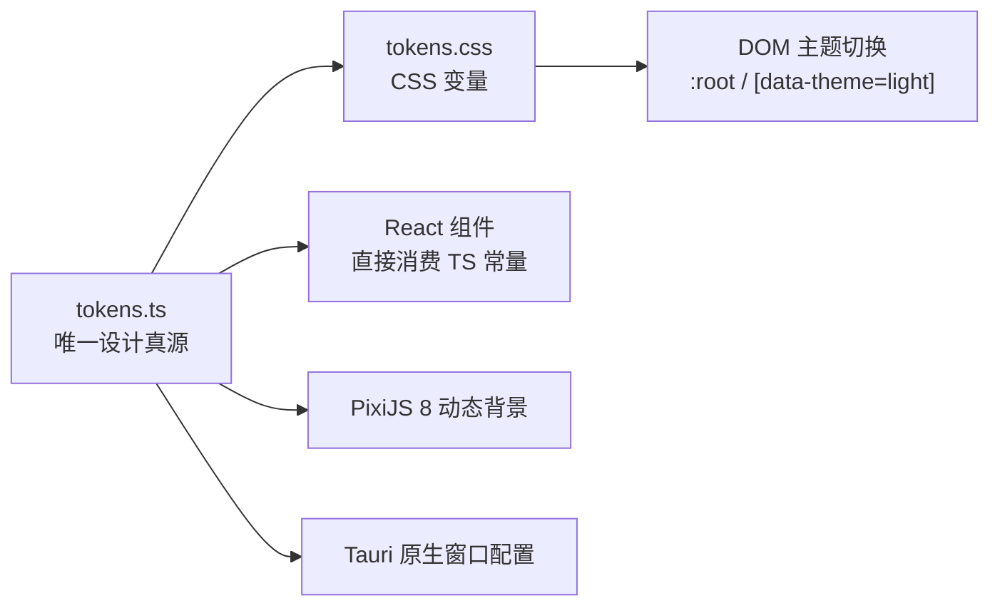

# 影幕 YingMu — 设计系统（Design Tokens / 主题 / 磁贴）

> 唯一真源：`packages/design-tokens/src/tokens.ts`（数值）与 `packages/design-tokens/src/tokens.css`（CSS 变量）。
> 约定（来自 `tokens.ts` 顶部注释）：所有数值以 rem/px 表达，动画参数统一由此导出，**禁止在组件里散落魔法数字**；`tokens.ts` 与 `tokens.css` 改动需同步两处并更新本文。



## 1. 字体与授权（重要）

**字体栈**（`typography.fontFamily`）：

```
"MiSans", "PingFang SC", "Microsoft YaHei UI", "Microsoft YaHei", "Segoe UI", system-ui, -apple-system, sans-serif
```

等宽栈（`typography.monoFamily`）：`"JetBrains Mono", "Cascadia Code", "Consolas", ui-monospace, monospace`。

授权与分发约束：

| 项 | 说明 |
| --- | --- |
| 本机状态 | 本机已安装 MiSans（`DEFAULT_SETTINGS.subtitleFontFamily = 'MiSans'`） |
| 仓库状态 | **系统字体文件不打包进仓库**。`.gitignore` 明确忽略 `*.ttf` / `*.otf` / `*.woff` / `*.woff2`，仅保留 SVG 品牌图形与授权说明 |
| 运行依赖 | 字体栈以 MiSans 优先，但**不硬依赖**：未安装时按栈回退到系统字体，不影响功能 |
| 正式发行 | 如需随应用分发字体，必须**从官方渠道获取并遵守其授权条款**；具体许可名称、可再分发范围与限制**待法务确认**（见根目录 `THIRD_PARTY_NOTICES.md`） |
| 禁止事项 | 不得把「本机已安装字体」等同于「可随应用再分发」；不得把系统字体二进制提交进仓库 |

> 字体授权状态：**待法务确认**。本文不编造许可证名称，也不宣称任何再分发权利。

## 2. 色彩

### 2.1 品牌色（不随主题变化）

| Token | 值 | 用途 |
| --- | --- | --- |
| `cinemaAmber` | `#D9A55B` | 银幕暖光，主品牌 / 强调 / 收藏，刻意避开紫粉渐变 |
| `cinemaAmberSoft` | `#E8C58C` | 暖光柔和变体 |
| `silverScreen` | `#F2EFE9` | 银幕白，深色主题主文本 |

### 2.2 深色主题（默认，`:root`）

| Token | 值 | Token | 值 |
| --- | --- | --- | --- |
| `bgBase` | `#0B0D10` | `bgElevated` | `#12151A` |
| `bgOverlay` | `#191D23` | `surface` | `#1C2128` |
| `surfaceHover` | `#252B33` | `border` | `#2A3038` |
| `borderStrong` | `#3A424C` | `textPrimary` | `#F2EFE9` |
| `textSecondary` | `#A8B0BA` | `textTertiary` | `#6E7884` |
| `scrim` | `rgba(6, 8, 10, 0.72)` | | |

### 2.3 浅色主题（`[data-theme='light']` 覆盖）

| Token | 值 | Token | 值 |
| --- | --- | --- | --- |
| `bgBase` | `#F7F6F3` | `bgElevated` | `#FFFFFF` |
| `bgOverlay` | `#FFFFFF` | `surface` | `#FFFFFF` |
| `surfaceHover` | `#EFEDE8` | `border` | `#E2DFD8` |
| `borderStrong` | `#CFCAC0` | `textPrimary` | `#1A1D21` |
| `textSecondary` | `#5A6069` | `textTertiary` | `#8A9099` |
| `scrim` | `rgba(247, 246, 243, 0.78)` | | |

### 2.4 语义色（不随主题变化）

| Token | 值 | 语义 |
| --- | --- | --- |
| `success` | `#6FB28C` | 成功 |
| `warning` | `#D9A55B` | 警告 |
| `danger` | `#D97A6C` | 危险 / 错误 |
| `info` | `#7C9BB5` | 信息 |
| `favorite` | `#D9A55B` | 收藏 |

### 2.5 阴影

| 档位 | 深色 | 浅色 |
| --- | --- | --- |
| `sm` | `0 2px 8px rgba(0,0,0,0.28)` | `0 2px 8px rgba(26,29,33,0.06)` |
| `md` | `0 8px 24px rgba(0,0,0,0.36)` | `0 8px 24px rgba(26,29,33,0.10)` |
| `lg` | `0 24px 64px rgba(0,0,0,0.52)` | `0 24px 64px rgba(26,29,33,0.14)` |
| `glow` | `0 0 0 1px rgba(217,165,91,0.28), 0 16px 48px rgba(0,0,0,0.56)` | `0 0 0 1px rgba(217,165,91,0.42), 0 16px 48px rgba(26,29,33,0.12)` |

## 3. 字体排印

字重（`typography.weights`）：`light 300` / `regular 400` / `medium 500` / `semibold 600` / `bold 700`。

| 档位 | 字号 | 行高 | 字距 |
| --- | --- | --- | --- |
| `display` | `3.25rem` | `1.1` | `-0.03em` |
| `h1` | `2rem` | `1.2` | `-0.02em` |
| `h2` | `1.5rem` | `1.28` | `-0.01em` |
| `h3` | `1.125rem` | `1.35` | `0` |
| `body` | `0.9375rem` | `1.6` | `0` |
| `caption` | `0.8125rem` | `1.5` | `0.01em` |
| `overline` | `0.6875rem` | `1.4` | `0.14em` |

## 4. 圆角

| Token | 值 | 说明 |
| --- | --- | --- |
| `xs` | `4px` | 小控件 |
| `sm` | `8px` | — |
| `md` | `12px` | — |
| `tile` | `18%` | **磁贴采用相对圆角（短边 18%）**，保持不同尺寸下的一致观感 |
| `lg` | `20px` | — |
| `xl` | `28px` | — |
| `pill` | `999px` | 胶囊 |

## 5. 间距

秩序基准（`spacing`）：**横向 16 / 纵向 24**。

| Token | 值 | Token | 值 |
| --- | --- | --- | --- |
| `unit` | `4` | `gutterX` | `16` |
| `gutterY` | `24` | `pageX` | `40` |
| `pageY` | `32` | `tileGap` | `16` |

刻度（`scale`）：`1→4px`、`2→8px`、`3→12px`、`4→16px`、`5→20px`、`6→24px`、`8→32px`、`10→40px`、`12→48px`、`16→64px`。

## 6. 动效（Motion）

`motion` 为 Motion for React 提供统一参数：

| Token | 值 |
| --- | --- |
| `spring` | `{ type: 'spring', stiffness: 260, damping: 30, mass: 0.9 }` |
| `springSoft` | `{ type: 'spring', stiffness: 180, damping: 26 }` |
| `hoverScale` | `1.025` |
| `hoverLift` | `-6` |
| `cardExpand` | `{ duration: 0.42, ease: [0.22, 1, 0.36, 1] }` |
| `pageTransition` | `{ duration: 0.36, ease: [0.22, 1, 0.36, 1] }` |
| `stagger` | `0.035` |
| `reducedMotionFallback` | `{ duration: 0.01 }` |

约束：尊重系统「减少动效」偏好，命中时回退到 `reducedMotionFallback`；缓动统一使用 `--ease-out-expo: cubic-bezier(0.22, 1, 0.36, 1)`，CSS 侧时长 `--duration-card: 420ms`、`--duration-page: 360ms` 与 TS 侧 `0.42` / `0.36` 对应。

## 7. 磁贴尺寸体系

网格基准（`tile`）：`gridColumns: 12`、`rowHeight: 32`、`gap: 16`、`posterAspect: '2 / 3'`、`minColumns: 4`。磁贴跨度以「8px 基准行高 + 16px 间距」的网格定义，与 `TileLayout` 的 `colSpan` / `rowSpan` / `variant` 对应。

| variant | colSpan | rowSpan | aspect | 用途 |
| --- | --- | --- | --- | --- |
| `hero` | 6 | 12 | `21 / 9` | 主视觉横幅 |
| `portrait-lg` | 3 | 12 | `2 / 3` | 大竖版海报 |
| `portrait-sm` | 2 | 8 | `2 / 3` | 小竖版海报 |
| `wide` | 6 | 8 | `16 / 7` | 横版 |
| `resume` | 4 | 6 | `16 / 9` | 续播 |
| `dynamic` | 3 | 6 | `4 / 3` | 动态/方形 |

`TileLayout.order` 与 `MediaItem.wallWeight` 共同决定幕墙排序，用户拖拽排序可覆盖权重。

## 8. 层级（z-index）

| Token | 值 | Token | 值 |
| --- | --- | --- | --- |
| `background` | 0 | `content` | 10 |
| `sticky` | 30 | `overlay` | 50 |
| `playerChrome` | 70 | `modal` | 90 |
| `toast` | 110 | | |

## 9. 深浅主题规则

- `ThemeMode = 'dark' | 'light' | 'system'`（`types.ts`），`DEFAULT_SETTINGS.theme = 'dark'`（`bridge.ts`）。
- `tokens.css` 中 `:root` 为**深色默认值**，`[data-theme='light']` 覆盖为浅色；`index.html` 初始 `<html data-theme="dark">` 且 `<meta name="color-scheme" content="dark light">`。
- 主题切换只切换 CSS 变量集合，组件不硬编码颜色；品牌色与语义色在两套主题下保持一致。
- `system` 模式跟随系统偏好，需在平台层读取后落到 `data-theme`；该读取属平台层职责，不进入业务核心。
- 播放器原生视频 Surface 由平台层渲染，其背景/遮罩与 `scrim`、`playerChrome` 层级配合，前端 chrome 不参与视频像素合成。

## 10. 当前状态

| 项 | 状态 |
| --- | --- |
| Design Tokens（`tokens.ts` / `tokens.css`）、磁贴/主题/动效数值 | 已定义（契约层） |
| 组件按令牌消费、深浅主题实机切换、`system` 模式跟随 | 依赖前端页面落地情况，本文不预设验证结论 |
| MiSans 字体再分发授权 | **待法务确认**；系统字体文件不打包进仓库 |
