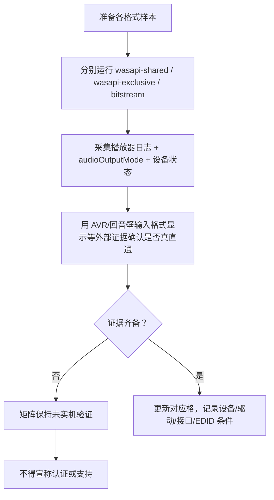

# 音频兼容性矩阵

> 状态：**全部未实机验证**。本文是能力边界文档，不是支持清单。
> 结论前置：**软件解码成功 ≠ 原生音频直通**；HDMI bitstream passthrough 与 Atmos 传递依赖完整设备链路，必须实机验证；本项目**未获得任何 Dolby / DTS 官方认证，未使用其官方 Logo**，禁止宣称认证。

## 1. 列定义（四个必须区分的概念）

| 列 | 含义 | 判定证据 |
| --- | --- | --- |
| 软件解码 | 播放器把压缩音轨解成 PCM 并能出声 | 播放日志、`audioCodec`、实际出声 |
| 多声道 PCM | 解码后按声道布局经 WASAPI 输出（共享或独占） | `DecodeStats.audioOutputMode`、设备声道布局、采样率/位深 |
| HDMI bitstream passthrough | **未解码的压缩码流**原样经 HDMI 送出 | AVR/回音壁输入格式显示、设备独占状态、码流指示、EDID 音频能力 |
| Atmos 传递 | Atmos 元数据 / 对象音频随码流（或 PCM 对象音频）传到 render 端 | AVR 显示 Atmos 输入、对象渲染生效、对应码流与设备解码 |

> 四列互不等价，尤其：**软件解码成功只证明第一列**，不能推定 bitstream 直通或 Atmos 传递成立。详见 `docs/playback/subtitles-and-audio.md`。

## 2. 兼容性矩阵

行 = 音频格式，列 = 四个概念。**每一格当前均为「未实机验证」**。

| 格式 \ 能力 | 软件解码 | 多声道 PCM | HDMI bitstream passthrough | Atmos 传递 |
| --- | --- | --- | --- | --- |
| AC-3 | 未实机验证 | 未实机验证 | 未实机验证 | 未实机验证 |
| E-AC-3 | 未实机验证 | 未实机验证 | 未实机验证 | 未实机验证 |
| E-AC-3 JOC | 未实机验证 | 未实机验证 | 未实机验证 | 未实机验证 |
| TrueHD | 未实机验证 | 未实机验证 | 未实机验证 | 未实机验证 |
| Atmos（元数据层） | 未实机验证 | 未实机验证 | 未实机验证 | 未实机验证 |
| DTS | 未实机验证 | 未实机验证 | 未实机验证 | 未实机验证 |
| DTS-HD MA | 未实机验证 | 未实机验证 | 未实机验证 | 未实机验证 |
| DTS:X | 未实机验证 | 未实机验证 | 未实机验证 | 未实机验证 |
| FLAC | 未实机验证 | 未实机验证 | 未实机验证 | 未实机验证 |
| AAC | 未实机验证 | 未实机验证 | 未实机验证 | 未实机验证 |
| PCM | 未实机验证 | 未实机验证 | 未实机验证 | 未实机验证 |

> 图例：「未实机验证」= 无本机/实机证据，既不判定支持也不判定不支持。任何格改为已验证，必须补齐上表「判定证据」并归档（见 `docs/playback/windows-surface-validation.md` 阶段 E）。
>
> 技术备注（中性格式事实，非能力声明）：FLAC / AAC / PCM 通常经解码后以 PCM 形态输出，「压缩码流 HDMI 直通」对其一般不适用；Atmos 是叠加在 E-AC-3 JOC 或 TrueHD 之上的元数据/对象层，而非独立编解码器。这些说明**不改变**矩阵「未实机验证」的取值，也不得据此填写任何「支持」。

## 3. 与代码契约的映射

| 代码位置 | 说明 |
| --- | --- |
| `AudioStreamInfo.format`（`types.ts`） | 枚举 `ac3` / `eac3` / `eac3-joc` / `truehd` / `truehd-atmos` / `dts` / `dts-hd-ma` / `dts-x` / `flac` / `aac` / `pcm` / `other`，**仅代表音轨识别** |
| `AppSettings.audioOutput`（`bridge.ts`） | `auto` / `wasapi-shared` / `wasapi-exclusive` / `bitstream`，四种输出模式开关 |
| `DecodeStats.audioOutputMode`（`player-api`） | 回读**实际生效**的输出模式，未采集实机数据前不得据此宣称可用 |
| `DiagnosticsReport`（`bridge.ts`） | 后端未初始化时 `backend: 'none'`、`backendReady: false`，不得谎称可用 |

WASAPI 模式对照：

| 模式 | 数据形态 | 与「直通」的关系 |
| --- | --- | --- |
| `wasapi-shared` | 解码后 PCM，经系统混音 | 非直通 |
| `wasapi-exclusive` | 解码后 PCM，应用独占设备 | 非直通（仍是解码后 PCM） |
| `bitstream` | 原始压缩码流经 HDMI 送出 | 需设备/驱动/接口/EDID/HDCP 全链路支持 |
| `auto` | 平台层选择，结果需回读 `audioOutputMode` | 不得假定 |

## 4. 强制声明

1. **软件解码成功 ≠ 原生音频直通。** 能出声仅证明解码与 PCM 输出；是否把原始码流（含 Atmos 元数据）原样送外部解码设备，必须由 AVR 输入格式显示、设备独占状态、码流指示等外部实机证据确认。
2. **bitstream / Atmos 依赖完整链路**：播放后端、音频驱动、Windows 音频栈、接口（HDMI/DP、HDCP）、EDID 声明的音频能力、AVR/回音壁/显示设备的解码能力共同决定，必须实机验证。
3. **认证与商标**：本项目**未获得 Dolby / DTS 任何官方认证**，**未使用其官方 Logo**；文中格式名称仅为中性技术指称。相关商标与技术需单独授权，本项目未获授权（见 `docs/adr/0006-license-status.md`、`THIRD_PARTY_NOTICES.md`）。**禁止宣称任何认证**。
4. **「未实机验证」≠「不支持」**：本报告不判定不可行，只陈述「尚无证据」。
5. **但不得宣称支持**：证据齐备前，不得在文档、界面、发行说明中写「支持 Atmos 直通 / DTS:X / TrueHD 透传」等结论。
6. **本阶段前置条件缺失**：安装包本阶段未生成、仓库 Rust 代码未经编译验证；libmpv 未集成、音频路径未实机验证（见 `docs/playback/windows-surface-validation.md`）。

## 5. 验证与证据要求

## 6. 状态汇总

| 项 | 状态 |
| --- | --- |
| 四列概念区分、格式枚举、WASAPI 模式契约 | 已定义（契约层） |
| 矩阵 11 × 4 = 44 格 | **全部未实机验证** |
| 软件解码 / 多声道 PCM / bitstream / Atmos 传递实机验证 | **未执行** |
| Dolby / DTS 官方认证与 Logo | **未获得 / 未使用** |
