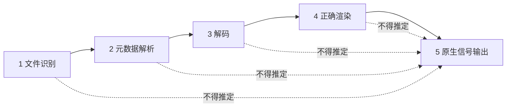

# Dolby Vision 兼容性矩阵（核心交付）

> 状态：**全部未验证**。本文是能力声明的边界文档，不是功能支持清单。
> 结论前置：**读取到 DV 标识 ≠ 原生 DV 输出**；原生输出依赖 GPU / 驱动 / Windows 显示路径 / 接口 / 显示设备，必须实机验证；本项目**未获得 Dolby 官方认证、未使用 Dolby 官方 Logo**。

## 1. 五层分级模型

唯一真源：`packages/player-api/src/index.ts` 的 `CapabilityStage` 与 `CapabilityClaim`。能力上报分 5 层，**任何一层都不能由上一层推定成立**；未验证一律 `CapabilityClaim.verified = false`。

| 层 | `CapabilityStage` | 含义 | 需要证明什么 |
| --- | --- | --- | --- |
| 1 文件识别 | `identified` | 从容器/码流读出 DV 标识、Profile、RPU/EL 存在性 | 解析出 `VideoStreamInfo` 中对应字段，且与文件实际一致 |
| 2 元数据解析 | `metadata-parsed` | 解析 RPU 动态元数据、色彩参数、 reshaping 曲线 | 元数据被正确读取并可用于后续处理 |
| 3 解码 | `decoded` | 软解/硬解得到正确的基带/增强层帧 | 无花屏、无错帧，硬解实际生效（`DecodeStats.hwDecoderActive`） |
| 4 正确渲染 | `rendered` | 色彩空间、位深、动态元数据应用、图层合成正确 | `outputPixelFormat` / `outputColorSpace` 正确，未发生非预期 `toneMappingActive` |
| 5 原生信号输出 | `native-output` | 经 GPU/驱动/Windows 显示路径把原生 DV/HDR 信号送显示设备 | DXGI 色彩空间、10-bit 呈现、HDCP、显示设备 EDID 与 HDR 模式、AVR/显示设备实际接收 |

## 2. 兼容性矩阵

行 = 验证维度，列 = 五层能力。**每一格当前均为「未验证」**（无实机证据，不得推定成立）。

| 维度 \ 层 | 1 文件识别 | 2 元数据解析 | 3 解码 | 4 正确渲染 | 5 原生信号输出 |
| --- | --- | --- | --- | --- | --- |
| Dolby Vision Profile 5 | 未验证 | 未验证 | 未验证 | 未验证 | 未验证 |
| Dolby Vision Profile 7 | 未验证 | 未验证 | 未验证 | 未验证 | 未验证 |
| Dolby Vision Profile 8.1 | 未验证 | 未验证 | 未验证 | 未验证 | 未验证 |
| Base Layer（BL） | 未验证 | 未验证 | 未验证 | 未验证 | 未验证 |
| Enhancement Layer（EL） | 未验证 | 未验证 | 未验证 | 未验证 | 未验证 |
| RPU（动态元数据） | 未验证 | 未验证 | 未验证 | 未验证 | 未验证 |
| HDR10 回退 | 未验证 | 未验证 | 未验证 | 未验证 | 未验证 |
| SDR tone mapping | 未验证 | 未验证 | 未验证 | 未验证 | 未验证 |

> 图例：「未验证」= 截至本次审查**未获得该维度的该层实机证据**。这既不代表「不支持」，也**绝不代表「支持」**。任何一格要改为已验证，必须补齐 `CapabilityClaim.evidence` 指向的实机证据（见 `docs/playback/windows-surface-validation.md`）。

## 3. 逐维度技术说明（中性格式描述）

以下仅用于**定义验证对象**，是对公开格式事实的中性描述，**不代表本项目已实现任何解析、解码、渲染或输出**：

| 维度 | 说明 | 与该维度相关的验证要点 |
| --- | --- | --- |
| Profile 5 | 单层 DV，基于 PQ/ICtCp 与 reshaping，常见于流媒体，无独立 HDR10 兼容基带 | 单层解码、动态元数据应用、非 HDR10 基带的呈现路径 |
| Profile 7 | 双层结构（BL + EL）+ RPU，常见于 UHD 蓝光；EL 有 MEL/FEL 之分 | 双层读取、EL 与 BL 组合、RPU 处理、是否需要 FEL 解码 |
| Profile 8.1 | 单层 + RPU，带 HDR10 兼容基线 | 兼容层回退、RPU 动态元数据、跨设备回退行为 |
| Base Layer（BL） | 兼容基带（HDR10 / HDR10+ 等） | 基础 HDR 解码与呈现是否正确 |
| Enhancement Layer（EL） | P7 的增强层 | 增强层解码、与 BL 的正确合成 |
| RPU | DV 动态元数据，携带逐帧/逐场景 tone mapping 指令 | 元数据解析与逐帧应用是否正确 |
| HDR10 回退 | 无法进行 DV 处理时以 HDR10 静态元数据呈现 | 回退是否发生、是否被如实标记（而非宣称 DV 输出） |
| SDR tone mapping | 把 HDR 内容映射到 SDR 显示 | 是否发生色调映射（`DecodeStats.toneMappingActive`）、映射质量 |

关键区分：**HDR10 回退 / SDR tone mapping 属于「降级呈现」**。一旦发生回退或色调映射，就**不是**第 5 层的「原生 DV 信号输出」；二者不得混为一谈，也不得把回退成功表述为「支持 Dolby Vision」。

## 4. 与代码契约的映射

| 代码位置 | 对应层 | 契约注释要点 |
| --- | --- | --- |
| `VideoStreamInfo.hdrFormat` / `dolbyVisionProfile` / `hasRpu` / `hasEnhancementLayer`（`types.ts`） | 仅第 1 层 | 「HDR 格式标识：仅代表文件识别，不代表 HDR 原生输出」；「识别结果，不等于具备对应渲染/输出能力」 |
| `CapabilityStage` / `CapabilityClaim`（`player-api`） | 全 5 层 | 「只上报真实探测到的能力，未验证项 `verified=false`」 |
| `DecodeStats.outputPixelFormat` / `outputColorSpace` / `toneMappingActive` / `hwDecoderActive`（`player-api`） | 第 3–4 层证据 | 「用于区分 HDR 识别与渲染」 |
| `DiagnosticsReport.displayCaps`（`bridge.ts`） | 第 5 层前置 | 「仅代表已探测到的显示能力，不代表 HDR 原生输出已验证」 |
| `PlayerBackend.validated`（`player-api`） | 全局 | 「libmpv 未集成时必须为 `false`」 |

> 因此：即使未来代码能填出 `dolbyVisionProfile: 8.1` 或 `hasRpu: true`，也只满足**第 1 层**，不能据此填写第 2–5 层的「支持」。

## 5. 强制声明

1. **读取到 DV 标识不等于原生 DV 输出。** 第 1 层成立不能推定第 2–5 层成立。
2. **原生输出依赖完整链路**：GPU、驱动、Windows 显示路径（DXGI/DWM/色彩空间协商）、接口（HDMI/DP 版本、HDCP）、显示设备（EDID、HDR 能力、AVR/回音壁）共同决定，**且需实机验证**。
3. **认证与商标**：本项目**未获得 Dolby 官方认证**，**未使用 Dolby 官方 Logo**；文中「Dolby Vision」「Dolby Atmos」等仅为技术格式的中性指称。Dolby 商标与相关技术需单独授权，本项目未获授权（见 `docs/adr/0006-license-status.md`、`THIRD_PARTY_NOTICES.md`）。
4. **「未验证」≠「不支持」**：本报告不判定功能不可行，只陈述「尚无证据」。
5. **但不得宣称支持**：在证据齐备前，不得在文档、界面、发行说明中写「支持 Dolby Vision / 原生 DV 输出」等结论。
6. **本阶段前置条件缺失**：安装包本阶段未生成、仓库 Rust 代码未经编译验证；libmpv DLL 未获取、4K HEVC/HDR/DV 输出未实测（见 `docs/playback/windows-surface-validation.md`），因此矩阵全部为「未验证」。

## 6. 验证与更新流程

```mermaid
flowchart TD
  A["准备覆盖样本（P5/P7/P8.1/BL/EL/RPU）"] --> B["逐层采集实机证据<br/>见 windows-surface-validation 阶段 C/D"]
  B --> C{"该维度该层证据齐备？"}
  C -->|"否"| D["矩阵保持「未验证」"]
  C -->|"是"| E["填写 CapabilityClaim.evidence<br/>更新 DecodeStats / DiagnosticsReport"]
  E --> F["把对应格改为已验证，并记录设备/驱动/接口/显示设备条件"]
  D --> G["不得宣称支持"]
```

## 7. 状态汇总

| 项 | 状态 |
| --- | --- |
| 五层模型与各维度定义 | 已定义（契约层） |
| 矩阵 8 × 5 = 40 格 | **全部未验证** |
| Dolby 官方认证 / 官方 Logo | **未获得 / 未使用** |
| 4K HEVC / HDR / DV 原生输出实机验证 | **未实测、未验证** |
