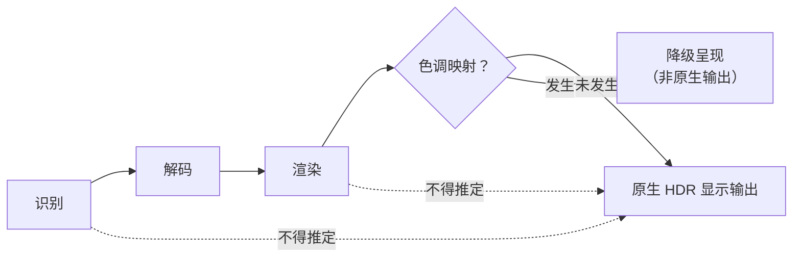

# HDR 验证文档（识别 / 解码 / 渲染 / 色调映射 / 显示输出）

> 状态：**本机未实测**。本文区分 HDR 处理的五个环节，明确「识别」不等于「渲染」更不等于「显示输出」。
> 结论前置：HDR10 / HDR10+ / HLG / DV 的识别、解码、渲染、色调映射、显示输出**均未实测**；本项目**未获得 Dolby 官方认证、未使用 Dolby 官方 Logo**。

## 1. 五环节定义

| 环节 | 含义 | 需要证明什么 |
| --- | --- | --- |
| 识别 | 从容器/码流读出 HDR 格式与元数据 | `VideoStreamInfo.hdrFormat`、静态/动态元数据、色彩参数与文件一致 |
| 解码 | 软解/硬解得到正确的 HDR 帧 | 无花屏/错帧，硬解实际生效（`DecodeStats.hwDecoderActive`） |
| 渲染 | 色彩空间、位深、传输函数、合成正确 | `outputPixelFormat` / `outputColorSpace` 正确（如 10-bit、BT.2020、PQ/HLG） |
| 色调映射 | 是否发生 HDR→SDR 或格式间映射 | `DecodeStats.toneMappingActive`；**一旦发生即非原生 HDR 直通** |
| 显示输出 | 经 GPU/驱动/Windows 显示路径送显示设备 | Windows HDR 模式、DXGI 10-bit 呈现、PQ/HLG 色彩空间协商、HDCP、显示设备 EDID 与 HDR 能力 |

关键区分：**色调映射 / 格式回退属于降级呈现**。发生 tone mapping（如 HDR→SDR、DV→HDR10）时，即便画面正常，也**不是**「原生 HDR 显示输出」，不得混为一谈。

## 2. 验证矩阵

行 = HDR 格式，列 = 五环节。**每一格当前均为「未实测」**（本机未获得任何实机证据）。

| 格式 \ 环节 | 识别 | 解码 | 渲染 | 色调映射 | 显示输出 |
| --- | --- | --- | --- | --- | --- |
| HDR10 | 未实测 | 未实测 | 未实测 | 未实测 | 未实测 |
| HDR10+ | 未实测 | 未实测 | 未实测 | 未实测 | 未实测 |
| HLG | 未实测 | 未实测 | 未实测 | 未实测 | 未实测 |
| Dolby Vision | 未实测 | 未实测 | 未实测 | 未实测 | 未实测 |

> 图例：「未实测」= 本机未执行该格式该环节的实机测试，既不判定支持也不判定不支持。DV 的逐 Profile 逐层矩阵见 `docs/dolby-compatibility/compatibility-matrix.md`。

格式中性说明（仅定义验证对象，非能力声明）：

| 格式 | 元数据特征 |
| --- | --- |
| HDR10 | 静态元数据（MaxCLL / MaxFALL、 mastering display），PQ + BT.2020 |
| HDR10+ | 动态元数据（逐场景/逐帧） |
| HLG | 混合对数伽马，面向广播，无绝对亮度元数据 |
| Dolby Vision | 动态元数据（RPU），多 Profile，可能含 BL/EL（见兼容性矩阵） |

## 3. 与代码契约的映射

| 代码位置 | 说明 |
| --- | --- |
| `VideoStreamInfo.hdrFormat`（`types.ts`） | `'hdr10' \| 'hdr10plus' \| 'hlg' \| 'dolby-vision' \| 'none'`，注释明确「仅代表文件识别，不代表 HDR 原生输出」 |
| `VideoStreamInfo.colorSpace` / `colorTransfer` / `colorPrimaries` / `bitDepth`（`types.ts`） | 识别层的色彩参数 |
| `DecodeStats.outputPixelFormat` / `outputColorSpace` / `toneMappingActive` / `hwDecoderActive`（`player-api`） | 渲染与色调映射环节的实际证据，「用于区分 HDR 识别与渲染」 |
| `DiagnosticsReport.displayCaps`（`bridge.ts`） | 注释明确「**仅代表已探测到的显示能力，不代表 HDR 原生输出已验证**」 |
| `AppSettings.preferHdrPassthrough`（`bridge.ts`） | 默认 `false`，注释「不宣称任何 Dolby 认证能力」；是偏好开关，非能力证明 |

> 即使 `displayCaps.hdrSupported = true` 被探测到，也只是「显示能力被探测到」，**不等于**第 5 环节「显示输出」已验证；必须由 DXGI swapchain 格式、色彩空间协商、HDCP、显示设备实际接收等证据确认。

## 4. 强制声明

1. **识别 ≠ 渲染 ≠ 显示输出**：`hdrFormat` 仅满足识别环节，不能推定后续环节成立。
2. **色调映射是降级信号**：`toneMappingActive = true` 表示发生映射，不能表述为「原生 HDR 输出」。
3. **显示输出依赖完整链路**：GPU、驱动、Windows 显示路径（DXGI/DWM/色彩空间协商）、HDR 开关、接口（HDMI/DP 版本、HDCP）、显示设备（EDID、HDR 能力）共同决定，必须实机验证。
4. **本机验证结果：未实测**。安装包本阶段未生成、仓库 Rust 代码未经编译验证；libmpv 未集成、4K HEVC / HDR 输出未实测（见 `docs/playback/windows-surface-validation.md`）。
5. **认证与商标**：本项目**未获得 Dolby 官方认证、未使用 Dolby 官方 Logo**；相关商标与技术需单独授权，本项目未获授权（见 `docs/adr/0006-license-status.md`、`THIRD_PARTY_NOTICES.md`）。
6. **「未实测」≠「不支持」**，但同样**不得宣称支持**；证据齐备前不得在文档、界面、发行说明中写「支持 HDR 原生输出」等结论。

## 5. 后续验证要点

- 采集 `DecodeStats` 的 `outputPixelFormat` / `outputColorSpace` / `toneMappingActive` / `hwDecoderActive`。
- 用 DXGI / 图形调试工具抓取 swapchain 格式（10-bit）与色彩空间（PQ/HLG + BT.2020），确认是否进入 HDR 呈现路径。
- 记录 Windows HDR 开关、接口/HDCP 状态、显示设备 EDID。
- 逐格式（HDR10 / HDR10+ / HLG / DV）分别给五环节结论，证据归档到 `<EVIDENCE_DIR>`（不入库），未拿到证据即保持「未实测」。

## 6. 状态汇总

| 项 | 状态 |
| --- | --- |
| 五环节模型、格式枚举、字段契约 | 已定义（契约层） |
| 矩阵 4 × 5 = 20 格 | **全部未实测** |
| 4K HEVC / HDR 输出实机验证 | **未实测、未验证** |
| Dolby 官方认证 / 官方 Logo | **未获得 / 未使用** |
