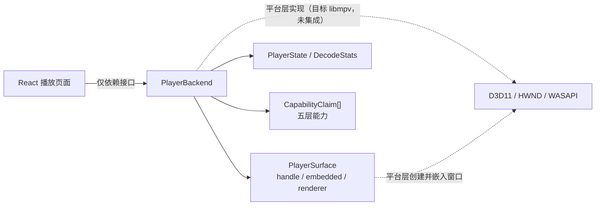
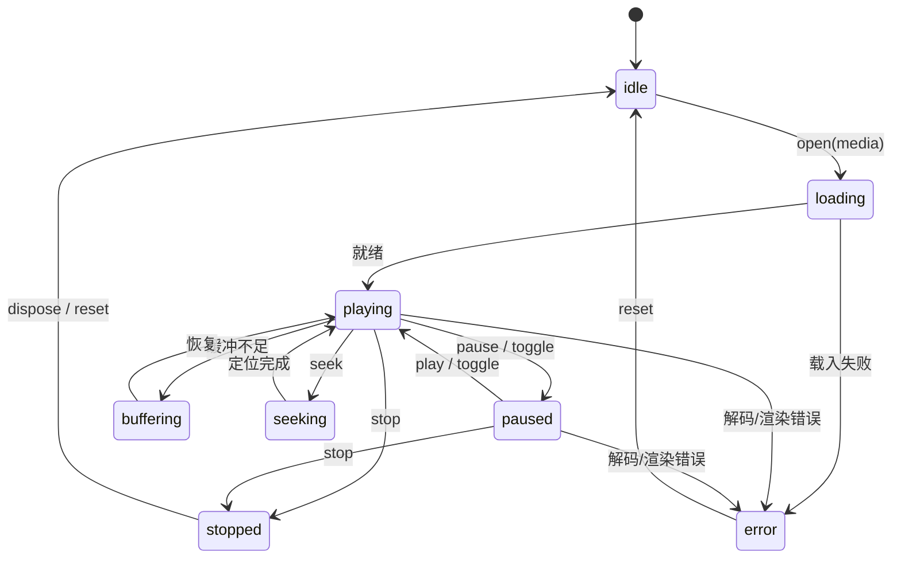

# 播放器接口（PlayerBackend 抽象）

> 唯一真源：`packages/player-api/src/index.ts`。
> 设计原则（来自该文件顶部注释）：React 组件只依赖本接口，不直接依赖 libmpv / D3D11 / WASAPI；原生视频 Surface 由平台层创建并嵌入 Tauri 窗口，前端只持有 handle；**禁止用独立外部播放器窗口冒充嵌入式播放**；能力上报分 5 层，任何一层都不能由上一层推定成立。

## 1. 接口总览

`PlayerBackend` 成员：

| 成员 | 签名 / 类型 | 说明 |
| --- | --- | --- |
| `name` | `readonly string` | 后端标识 |
| `validated` | `readonly boolean` | **是否已完成本机技术验证；libmpv 未集成时必须为 `false`** |
| `initialize()` | `Promise<void>` | 初始化 |
| `attachSurface(containerId)` | `Promise<PlayerSurface>` | 在 Tauri 窗口内创建/绑定原生视频 Surface |
| `detachSurface()` | `Promise<void>` | 解绑 |
| `open(media)` | `Promise<void>` | 载入 `PlayerMediaDescriptor` |
| `command(cmd)` | `Promise<void>` | 下发 `PlayerCommand` |
| `state()` | `Promise<PlayerState>` | 当前状态 |
| `stats()` | `Promise<DecodeStats>` | 实时解码统计 |
| `capabilities()` | `CapabilityClaim[]` | 只上报真实探测到的能力 |
| `onStateChange(listener)` / `onStats(listener)` | `() => void`（取消订阅） | 状态/统计订阅 |
| `dispose()` | `Promise<void>` | 释放 |

`PlayerMediaDescriptor`：`mediaId` / `versionId` / `uri`（平台层解析出的可播放 URI，**前端不接触本地绝对路径**）/ `startSeconds?` / `video?` / `audio[]` / `subtitles[]` / `chapters[]`。

## 2. 状态机

状态取值（`PlayerBackendState`）：`idle` / `loading` / `playing` / `paused` / `buffering` / `seeking` / `error` / `stopped`。

`PlayerState` 字段：`state` / `positionSeconds` / `durationSeconds` / `speed` / `volume` / `muted` / `paused` / `bufferingPercent` / `audioTrackIndex?` / `subtitleTrackIndex?` / `fullscreen` / `error?`。

## 3. 命令（`PlayerCommand`）

| 命令 | 载荷 | 说明 |
| --- | --- | --- |
| `play` / `pause` / `toggle` / `stop` / `frame-step` | 无 | 播放控制 |
| `seek` | `seconds: number; exact?: boolean` | 定位 |
| `set-speed` | `speed: number` | 倍速 |
| `set-volume` / `set-muted` | `volume: number` / `muted: boolean` | 音量 |
| `set-audio-track` | `index: number` | 切换音轨 |
| `set-subtitle-track` | `index: number \| null` | 切换字幕（`null` 关闭） |
| `load-external-subtitle` | `uri: string` | 加载外挂字幕 |
| `set-subtitle-delay` | `milliseconds: number` | 字幕延迟 |
| `set-fullscreen` | `fullscreen: boolean` | 全屏 |
| `chapter` | `index: number` | 章节跳转 |

## 4. Surface 嵌入要求

`PlayerSurface`：`handle: string`（平台层创建的原生视频 Surface 句柄）、`embedded: boolean`（是否确实嵌入应用窗口）、`renderer?: string`（如 `d3d11` / `gpu-next`）。

硬性要求：

1. **原生 Surface 由平台层创建并绑定**到 Tauri 窗口的子区域，前端只持有 `handle`，**不解释其内容**。
2. `embedded` 必须为 `true` 才代表嵌入式播放；**禁止用独立外部播放器窗口冒充嵌入式播放**。
3. `renderer` 仅作渲染后端标识，用于诊断，不改变前端逻辑。
4. 前端 chrome（控制条、遮罩、`scrim`、`playerChrome` 层级）不参与视频像素合成；视频像素由原生 Surface 输出。
5. 窗口尺寸/位置变化时由平台层重设 Surface 布局，前端通过 `attachSurface` / `detachSurface` 表达生命周期，不直接操作 HWND。

> 当前状态：`PlayerSurface`、`attachSurface` 等为**接口契约**；对应的 D3D11 + 原生 HWND Surface 实现**未集成、未验证**，见 `docs/playback/windows-surface-validation.md`。

## 5. 能力五层模型

`CapabilityStage`（`player-api`）：

| 层 | 值 | 含义 |
| --- | --- | --- |
| 1 | `identified` | 文件识别（读到容器/编码/HDR/DV 标识） |
| 2 | `metadata-parsed` | 元数据解析（RPU、动态元数据、色彩参数） |
| 3 | `decoded` | 解码（软解/硬解得到帧） |
| 4 | `rendered` | 正确渲染（色彩、色调映射、图层合成正确） |
| 5 | `native-output` | 原生信号输出（经 GPU/驱动/显示路径输出原生 HDR/DV/bitstream） |

`CapabilityClaim`：`feature` / `stage` / `verified` / `evidence`。规则：

- **未验证一律 `verified=false`**。
- **任何一层都不能由上一层推定成立**：读到 DV 标识 ≠ 能解码 ≠ 正确渲染 ≠ 原生 DV 输出。
- `evidence` 必须指向实机采集的证据（见 `windows-surface-validation.md`），无证据不得置 `verified=true`。

完整矩阵见 `docs/dolby-compatibility/compatibility-matrix.md` 与 `audio-matrix.md`。

## 6. 实时解码信息（`DecodeStats`）

用于「视频信息 / 实时解码信息」面板，也是验证证据的采集点：

| 字段 | 用途 |
| --- | --- |
| `videoCodec` / `audioCodec` | 实际编解码器 |
| `hwDecoderActive` | **硬件解码是否实际生效，而非「已请求」** |
| `displayedFps` / `estimatedVsyncFps` / `droppedFrames` / `voDelayedFrames` / `displaySyncRatio` | 帧率与同步健康度 |
| `cacheDurationSeconds` | 缓冲 |
| `outputPixelFormat` / `outputColorSpace` | **实际像素格式 / 色彩空间，用于区分 HDR 识别与渲染** |
| `toneMappingActive` | 是否发生色调映射（映射发生即非原生 HDR 直通） |
| `audioOutputMode` | 实际音频输出模式 |

## 7. 与 IPC 契约的关系

`bridge.ts` 的 `IPC` 定义了 `playerOpen` / `playerControl` / `playerState` / `playerAttachSurface` 四个命令（见 `docs/architecture/ipc-contract.md`），与 `PlayerBackend` 的 `open` / `command` / `state` / `attachSurface` 语义对应；当前 `PlatformBridge` 接口尚未暴露这些方法，播放器调用路径待平台层落地时对齐。

## 8. 当前状态

| 项 | 状态 |
| --- | --- |
| `PlayerBackend` / 状态机 / `PlayerCommand` / `PlayerSurface` / 能力五层 / `DecodeStats` 契约 | 已定义（接口层） |
| libmpv 后端实现、`validated=true` | **未集成、未验证**；`validated` 必须为 `false` |
| D3D11 + HWND Surface 嵌入 | **未验证** |
| 4K HEVC / HDR / DV 原生输出 | **未实测、未验证** |
