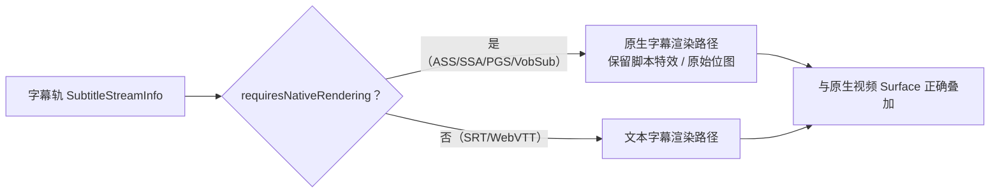
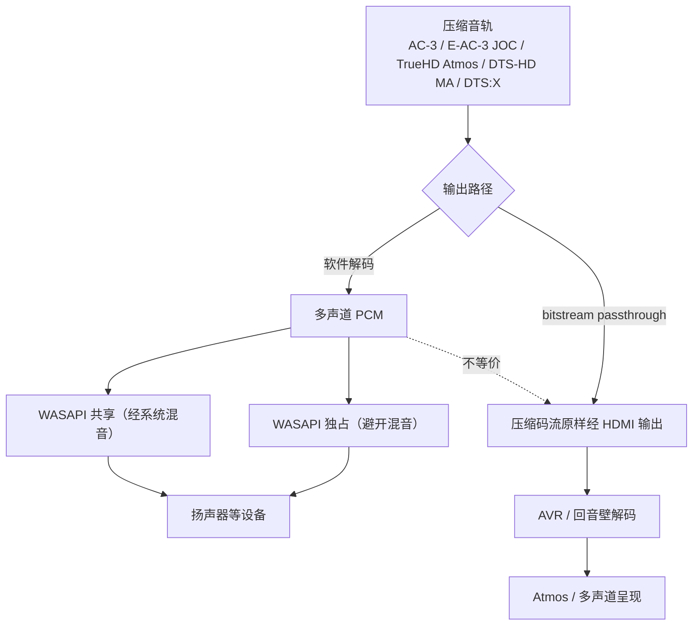

# 字幕与音频路径设计

> 契约来源：`packages/media-models/src/types.ts`（`SubtitleStreamInfo` / `AudioStreamInfo`）、`packages/media-models/src/bridge.ts`（`AppSettings`）、`packages/player-api/src/index.ts`（`PlayerCommand` / `DecodeStats`）。
> 状态：本文为**设计规格与路径区分**，所有渲染/输出能力**未实机验证**，逐项矩阵见 `docs/dolby-compatibility/audio-matrix.md`。

## 1. 字幕格式与原生渲染要求

`SubtitleStreamInfo.format` 取值：`srt` / `ass` / `ssa` / `pgs` / `vobsub` / `webvtt` / `other`。`external` 标记区分内封与外挂，`requiresNativeRendering` 标记是否必须保留原始渲染路径。

| 格式 | 类型 | 原生渲染要求 | 降级为纯文本的后果 |
| --- | --- | --- | --- |
| `srt` / `webvtt` | 纯文本 + 时间码 | 可由文本渲染器处理 | 基本无损 |
| `ass` / `ssa` | 带样式、定位、特效的脚本字幕 | **必须原生渲染**（`requiresNativeRendering=true`），依赖脚本字幕渲染引擎（如 libass 级能力） | 丢失字体、颜色、描边、`\pos` 定位、`\fad` 淡入淡出、变形与动画、卡拉OK 特效 |
| `pgs` | 位图（图片）字幕 | **必须原生渲染**，按时间戳叠加原始位图数据 | 无文本可提取，降级即完全丢失 |
| `vobsub` | 位图（图片）字幕 | **必须原生渲染** | 同上 |
| `other` | 未知 | 保守处理，不得臆测 | — |

硬性要求（来自 `types.ts` 注释）：**ASS 特效 / PGS 图片字幕必须保留原始渲染路径，禁止降级为纯文本**。

相关命令与设置：

- `PlayerCommand`：`load-external-subtitle`（加载外挂字幕）、`set-subtitle-track`（切换/关闭）、`set-subtitle-delay`（延迟）。
- `AppSettings`：`subtitleFontSize`（默认 24）、`subtitleFontFamily`（默认 `MiSans`）、`subtitleColor`（默认 `#FFFFFF`）、`subtitlePosition`（默认 88）、`subtitleDelayMs`（默认 0）。
- 字体约束：ASS 脚本可能引用特定字体；MiSans 系统字体**不打包进仓库**，正式发行需从官方渠道获取并遵守授权（见 `docs/design/design-system.md` 与 `THIRD_PARTY_NOTICES.md`）。

## 2. 音频输出模式区分

`AppSettings.audioOutput` 取值：`auto` / `wasapi-shared` / `wasapi-exclusive` / `bitstream`。

| 模式 | 数据形态 | 特征 | 限制 |
| --- | --- | --- | --- |
| WASAPI 共享 | 解码后的 PCM，经系统混音 | 与其他应用共用设备，系统可能重采样/混音/限幅 | 不保证原始采样率/位深，不是直通 |
| WASAPI 独占 | 解码后的 PCM，应用独占设备 | 可匹配原始采样率/位深，避开系统混音 | 仍为**解码后 PCM**，压缩码流已被解码 |
| HDMI bitstream passthrough | **未解码的压缩码流**原样送 HDMI | 由 AVR/回音壁/显示设备解码 | 依赖设备 EDID 能力、驱动、接口、HDCP、播放器输出配置共同支持 |
| `auto` | 由平台层选择 | — | 选择结果需通过实际 `audioOutputMode` 回读，不得假定 |

### 四个必须区分的概念

| 概念 | 含义 | 与「直通」的关系 |
| --- | --- | --- |
| 软件解码成功 | 播放器把压缩音轨解成 PCM 并能出声 | **仅此而已，不代表直通** |
| 多声道 PCM 输出 | 解码后按声道布局送 WASAPI | 是解码后形态，非原始码流 |
| HDMI bitstream passthrough | 原始压缩码流不经解码经 HDMI 送出 | 需要设备/接口/驱动全链路支持 |
| Atmos 传递 | 元数据（如 E-AC-3 JOC / TrueHD Atmos）随码流或 PCM 对象音频传到 render 端 | 需要对应码流、设备解码与扬声器布局 |

> **软件解码成功 ≠ 原生音频直通。** 能出声只证明解码与 PCM 输出可用；是否把原始码流（含 Atmos 元数据）原样送到外部解码设备，必须由 AVR 输入格式显示、设备独占状态、码流指示等**外部实机证据**确认（见 `docs/playback/windows-surface-validation.md` 阶段 E）。

## 3. 音频格式识别

`AudioStreamInfo.format` 枚举（仅代表**识别**）：`ac3` / `eac3` / `eac3-joc` / `truehd` / `truehd-atmos` / `dts` / `dts-hd-ma` / `dts-x` / `flac` / `aac` / `pcm` / `other`。逐格式的软件解码、多声道 PCM、bitstream、Atmos 传递能力矩阵见 `docs/dolby-compatibility/audio-matrix.md`，**全部标注为未实机验证**。

`DecodeStats.audioOutputMode` 用于回读实际生效的输出模式；未采集到实机数据前不得据此宣称任何模式可用。

## 4. 当前状态

| 项 | 状态 |
| --- | --- |
| 字幕格式枚举、`requiresNativeRendering`、外挂/内封区分、字幕设置与命令契约 | 已定义（契约层） |
| ASS/SSA 特效、PGS/VobSub 位图原生渲染落地 | **未集成、未验证** |
| WASAPI 共享/独占/bitstream 三种模式实现 | **未实现、未实机验证** |
| 软件解码、多声道 PCM、HDMI bitstream、Atmos 传递 | **未实机验证**；禁止宣称认证或支持 |
| 音频相关 Dolby / DTS 认证 | **未获得**；详见 `docs/dolby-compatibility/audio-matrix.md` |
