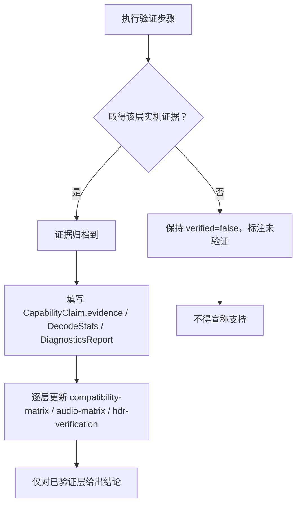

# Windows 原生 Surface 与播放链路 — 技术验证报告

> 报告性质：**技术验证状态报告**，不是功能完成报告。
> 结论摘要：截至本次审查，**影幕的嵌入式播放、HDR / Dolby Vision 输出、音频直通等链路均未完成任何实机验证**。本阶段仅完成环境与前置条件探测，未获得任何可用于宣称「支持」的证据。
> 原则：**「未验证」≠「不支持」**，但同样**不得据此宣称支持**。任何能力声明必须以下文所述的实机证据为准。

## 1. 本机实测环境

| 项 | 实测结果 | 对验证的影响 |
| --- | --- | --- |
| Node / npm | 22.22.2 / 10.9.7，可用，`node_modules` 已安装 | 前端可运行，与播放链路验证无直接关系 |
| Git | 2.55，可用 | 与验证无直接关系 |
| WebView2 Runtime | **156.0.4314.58，已安装** | Tauri 外壳前置条件之一满足；但仅代表运行时存在，不代表应用已能编译或播放 |
| 网络 | 可达 github.com / api.github.com / static.rust-lang.org / npm registry | 可下载工具链与依赖；不代表已完成下载或构建 |
| Rust / Cargo / rustup | **已安装**：`cargo 1.99.1` / `rustc 1.99.1`，含 `rustfmt`、`clippy`，工具链 `stable-x86_64-pc-windows-msvc`；位于 `%USERPROFILE%\.cargo\bin`，**不在自动化 shell 的默认 PATH 中** | Rust 源码已落地，可运行 `cargo fmt` 等纯前端检查；但无法完成链接 |
| MSVC / Windows SDK（便携工具链） | **已就位**：cl.exe / link.exe / lib.exe 与 SDK 导入库、头文件、rc.exe 齐备（需显式配置 `PATH` / `LIB` / `INCLUDE`） | 单文件 Rust/C 程序已实测编译链接并运行成功；工作区级构建仍受构建环境限制 |
| GitHub 推送通道 | ✅ 已打通（`api.github.com` + Basic） | 源码已推送 173 个文件、173/173 blob SHA 一致；与播放能力验证无直接关系 |
| 磁盘 | C: 剩余 15.6GB | 工具链与依赖安装的容量参考 |
| 仓库 `MokoKing666/yingmu` | 返回 404（不存在） | — |
| Tauri / NSIS 安装包 | **本阶段未生成** | 由 CI / Release 在 `windows-latest` 构建并把关，无可安装产物，安装与实机播放测试无法启动 |
| libmpv DLL / 开发包 | **未获取** | 无播放后端可验证 |

> 结论：**Tauri / NSIS 安装包本阶段未生成，libmpv 嵌入式播放未完成技术验证。** 本报告的「未验证」源于：尚无安装包产物、仓库 Rust 代码未经编译验证、libmpv 未集成，而非已测试后判定为失败。

## 2. 验证对象与判定准则

采用 `packages/player-api` 的五层能力模型，逐层单独判定，**上层成立不能推定下层成立**：

| 层 | 名称 | 判定问题 |
| --- | --- | --- |
| 1 | 文件识别 | 能否从容器/码流读出编码、HDR/DV 标识？ |
| 2 | 元数据解析 | 能否解析 RPU / 动态元数据 / 色彩参数？ |
| 3 | 解码 | 能否软解/硬解得到正确帧？ |
| 4 | 正确渲染 | 色彩空间、色调映射、图层合成是否正确？ |
| 5 | 原生信号输出 | 能否经 GPU/驱动/Windows 显示路径输出原生 HDR/DV/bitstream？ |

只有拿到该层对应的实机证据，才把 `CapabilityClaim.verified` 置为 `true`；否则一律 `false`。

## 3. 逐项验证结果（全部未验证）

| 验证项 | 结果 | 说明 |
| --- | --- | --- |
| WebView2 运行时可用性 | **已安装（156.0.4314.58）** | 仅运行时探测，非应用编译或播放验证 |
| libmpv DLL / 开发包 | **未获取** | 无播放器二进制，无法集成 |
| Tauri 应用编译 / NSIS 安装包 | **本阶段未生成** | `cargo fmt --all -- --check` 已通过（exit 0，格式已归一化）；`cargo check` / `cargo test` / `cargo clippy` 受构建环境限制未成功完成，仓库 Rust 代码仍未经完整编译与测试验证，所有 `#[cfg(test)]` 单元测试未运行。实际阻断有两类：默认 shell 中 Git Bash 的 `/usr/bin/link.exe`（GNU coreutils 硬链接命令）遮蔽 MSVC 链接器，报 `link: extra operand`；部分执行通道存在 safe-delete 删除拦截，cargo 清理 rlib 临时目录时返回 `拒绝访问 (os error 5)`。二者均发生在第三方依赖编译阶段，未到达 `yingmu-core` 自身源码类型检查完成 |
| D3D11 + 原生 HWND Surface 嵌入组合 | **未验证** | 未创建过子 HWND，未把 Surface 交给播放器，未证明「嵌入式」而非独立窗口 |
| 4K HEVC 解码（软解/硬解） | **未实测** | 无播放链路，无 `DecodeStats` 证据 |
| HDR10 / HDR10+ / HLG 输出 | **未实测** | 见 `docs/dolby-compatibility/hdr-verification.md` |
| Dolby Vision（P5 / P7 / P8.1）识别→渲染→输出 | **未验证** | 见 `docs/dolby-compatibility/compatibility-matrix.md` |
| 音频 WASAPI 共享/独占/HDMI bitstream、Atmos 传递 | **未实机验证** | 见 `docs/playback/subtitles-and-audio.md` 与 `docs/dolby-compatibility/audio-matrix.md` |
| GPU 适配器 / 显示路径 / 显示设备能力 | **未采集** | 无 `DiagnosticsReport.gpuAdapter` / `displayCaps` 实机数据 |

**当前 `DiagnosticsReport` 应有的诚实取值**（`bridge.ts` 约定）：后端未初始化时 `backend: 'none'`、`backendReady: false`；`webview2Version` 可填实测值，`gpuAdapter` / `displayCaps` 无实机探测则不得填充或谎报；`notes` 记录上述未验证项。

## 4. 关键边界声明

1. **读取到 DV / HDR 标识不等于原生 DV / HDR 输出**。`VideoStreamInfo.hdrFormat`、`dolbyVisionProfile`、`hasRpu` 等仅为文件识别结果（见 `docs/architecture/overview.md`）。
2. **原生输出依赖完整链路**：GPU、驱动、Windows 显示路径（DXGI / DWM / 色彩空间协商）、接口（HDMI / DP 版本、HDCP）、显示设备（EDID、HDR 能力、AVR/回音壁）共同决定，缺一不可，且**必须实机验证**。
3. **「未验证」≠「不支持」**：本报告不判定功能不可行，只陈述「尚无证据」。
4. **但也不得宣称支持**：在拿到证据前，不得在任何文档、界面、发行说明中写「支持 Dolby Vision / HDR 原生输出 / Atmos 直通」等结论。
5. **认证与商标**：本项目**未获得 Dolby 官方认证、未使用 Dolby 官方 Logo**；Dolby 相关技术描述仅为中性格式说明，见 `docs/adr/0006-license-status.md` 与 `THIRD_PARTY_NOTICES.md`。

## 5. 后续可执行的验证步骤清单

按依赖顺序执行；每一步都要产出可归档证据，未产出证据则保持「未验证」。

### 阶段 A — 前置条件

1. Rust 已安装（`%USERPROFILE%\.cargo\bin`，不在默认 PATH）：将其加入 PATH 并确认 `cargo -V` 可用；Rust 源码已落地，无需再装 Rust 或重写源码。
2. 安装 Visual Studio Build Tools + MSVC + Windows SDK，确认 `cl.exe`、`link.exe` 可用，并确认 Windows SDK 导入库齐备；确认 `WebView2` SDK 与运行时版本匹配。**这是当前唯一缺失的编译前置条件。**
3. 获取 libmpv 开发包（DLL + 头文件 + 导入库），确认其构建配置与许可证（LGPL/GPL，见 `THIRD_PARTY_NOTICES.md`），记录版本与来源。
4. `cargo fmt --all -- --check` 已通过（exit 0）；下一步是在允许正常删除临时文件的构建环境（如 GitHub Actions `windows-latest`）完成工作区级编译、产出最小 Tauri 外壳与可安装产物，使后续验证有载体。

### 阶段 B — Surface 嵌入验证（最小 repro，先于完整 App）

5. 在 Tauri 窗口内创建子 HWND 与 D3D11 swapchain，把 HWND 交给播放器（如 mpv 的 `wid` / `gpu-context=d3d11` 路径），验证视频渲染在**应用窗口内**。
6. 采集嵌入证据（见第 6 节）：窗口父子关系、截图、`PlayerSurface.embedded` 的真实来源、`renderer` 标识。
7. 验证窗口缩放 / 移动 / DPI 变化时 Surface 正确跟随，无独立外部播放器窗口。

### 阶段 C — GPU / 显示路径证据采集

8. 枚举 DXGI 适配器与输出，记录适配器描述、输出色深、色彩空间、HDR 支持标志。
9. 记录 Windows 显示 HDR 开关状态、接口类型/版本、HDCP 状态、显示设备 EDID 中的 HDR 静态元数据与音频能力。
10. 用图形调试工具抓取 swapchain 格式与色彩空间（如 10-bit 格式、PQ/BT.2020 色彩空间），确认是否真正进入 HDR 呈现路径。

### 阶段 D — 解码与渲染实测

11. 准备覆盖矩阵：4K HEVC SDR、4K HEVC HDR10、HLG、HDR10+、DV P5 / P7 / P8.1 样本（样本属私有媒体，按 `.gitignore` 不入库，置于受控测试目录 `<TEST_MEDIA_DIR>`）。
12. 逐样本采集播放器详细日志（如 `--msg-level=all=v`）、硬解是否实际生效、实际像素格式 / 色彩空间、是否发生色调映射、丢帧 / 同步比 / 显示帧率。
13. 把采集值填入 `DecodeStats` 与 `CapabilityClaim.evidence`，逐层（1→5）给出判定。

### 阶段 E — 音频路径实测

14. 分别验证 WASAPI 共享、WASAPI 独占、HDMI bitstream 三种模式（见 `subtitles-and-audio.md`）。
15. 用 AVR/回音壁的输入格式显示、设备独占状态、码流指示灯等外部证据确认是否真正 bitstream 直通，而非「软件解码成功 + 多声道 PCM」。

### 阶段 F — 判定与归档

16. 每层单独给结论；仅当证据齐备才把对应 `verified` 置为 `true`，并同步更新 `docs/dolby-compatibility/*`。
17. 证据归档到受控目录 `<EVIDENCE_DIR>`（日志、截图、DXGI/EDID 输出、播放器 stats），**不写入仓库**（`.gitignore` 已排除截图/日志/媒体样本）。

## 6. GPU / 显示路径证据采集方法

| 证据类型 | 采集工具 / 接口 | 对应数据落点 |
| --- | --- | --- |
| GPU 适配器 | `dxdiag`、DXGI `EnumAdapters` / `GetDesc` | `DiagnosticsReport.gpuAdapter` |
| 输出色深 / 色彩空间 / HDR 支持 | DXGI `IDXGIOutput6::GetDesc1`、`DXGI_COLOR_SPACE_*`、Windows 显示设置 | `DiagnosticsReport.displayCaps.{hdrSupported, bitDepth, colorSpace}` |
| Swapchain 实际格式 | PIX / RenderDoc / D3D11 调试层，观察如 `DXGI_FORMAT_R10G10B10A2_UNORM` 与 PQ/BT.2020 色彩空间 | 第 4 层「正确渲染」证据 |
| 窗口嵌入关系 | `GetParent` / `GetAncestor` / `EnumChildWindows`、窗口截图 | `PlayerSurface.embedded` |
| 播放器内部状态 | 播放器详细日志、`hwdec-current`、`video-params`、输出像素格式/色彩空间、`tone-mapping` 状态 | `DecodeStats.{hwDecoderActive, outputPixelFormat, outputColorSpace, toneMappingActive, displayedFps, droppedFrames, displaySyncRatio}` |
| 显示设备能力 | EDID 解析、HDR 静态元数据、HDMI/DP 版本、HDCP 状态 | 第 5 层「原生输出」证据 |
| 音频路径 | WASAPI 会话模式、设备独占状态、AVR 输入格式显示 | `DecodeStats.audioOutputMode`、音频矩阵证据 |

> 所有路径均用占位符（`<TEST_MEDIA_DIR>`、`<EVIDENCE_DIR>`、`%USERPROFILE%\.cargo\bin`）表示，不写入任何本机绝对路径、密钥或凭据。

## 7. 判定与归档流程

## 8. 状态汇总

| 项 | 状态 |
| --- | --- |
| WebView2 运行时 | 已安装（探测） |
| Rust 工具链 / Rust 源码 | 已安装 1.99.1 / 源码已落地（未经编译验证） |
| MSVC 链接器与 Windows SDK | 已就位（便携工具链） | 可安装包本阶段未生成 |
| libmpv DLL | 未获取 |
| D3D11 + 原生 HWND Surface 嵌入 | **未验证** |
| 4K HEVC 解码与渲染 | **未实测** |
| HDR10 / HDR10+ / HLG / DV 输出 | **未实测、未验证** |
| 音频 bitstream / Atmos 传递 | **未实机验证** |
| GPU / 显示路径证据 | **未采集** |
