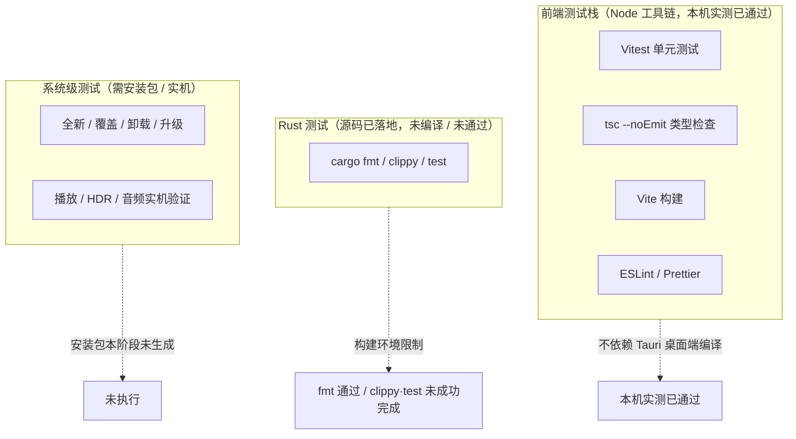

# 测试策略与执行状态

> 状态：本文区分**已真实运行并通过的前端测试**、**源码已落地但 Rust 检查未通过 / 测试未运行**、**未执行的安装与实机验证**三类。
> **原则：禁止伪造测试结果。** 本文档只记录有本机运行日志支撑的真实结果，不记录任何臆造的通过率、失败数、覆盖率或「已通过」结论。凡未拿到日志证据的项，一律标注「未执行 / 未验证」。

## 1. 测试分层总览

## 2. 前端测试栈（已真实运行并通过）

前置条件（实测）：Node 22.22.2（要求 `>=20.19.0`）、npm 10.9.7、`node_modules` 已安装、npm registry 可达。**这一层不依赖 Tauri 桌面端编译产物**，因为前端走 `WebDemoBridge` 与 Vite（见 `docs/adr/0002-platform-bridge.md`）；本机工具链已就位但桌面端构建产物尚未产出，前端仍可独立运行。

| 类型 | 命令 | 配置来源 | 说明 |
| --- | --- | --- | --- |
| 单元测试 | `npm run test` / `test:watch` / `test:coverage` | `apps/desktop/vite.config.ts`（Vitest） | `environment: jsdom`、`globals: true`、`setupFiles: ./src/test/setup.ts`、`include: src/**/*.{test,spec}.{ts,tsx}`、覆盖率 v8 |
| 类型检查 | `npm run typecheck` | `apps/desktop/tsconfig.json` | `tsc --noEmit`，`strict` / `noUnusedLocals` / `noUnusedParameters` / `noUncheckedIndexedAccess` |
| 构建 | `npm run build` | 根 / desktop `package.json` | `typecheck && vite build`；target `es2022`、`outDir dist`、sourcemap、`manualChunks`（pixi / motion） |
| 静态检查 | `npm run lint` | `eslint.config.js` | `eslint . --max-warnings 0` |
| 格式检查 | `npm run format:check` | 根 `package.json` | `prettier --check` |

测试基础设施（真实存在于仓库）：`apps/desktop/src/test/setup.ts` 为 jsdom 补齐 `ResizeObserver` / `IntersectionObserver` / `matchMedia` 的可控替身，供磁贴幕墙可见区域渲染与懒加载相关测试使用。

### 本机实测结果（2026-11-06，真实执行）

| 检查 | 命令 | 实测结果 |
| --- | --- | --- |
| 类型检查 | `npm run typecheck` | ✅ **通过**（TypeScript 严格模式） |
| Lint | `npm run lint` | ✅ **通过**（ESLint 0 警告） |
| 单元测试 | `npm run test` | ✅ **通过**（6 个测试文件 / 50 个用例全部通过） |
| 生产构建 | `npm run build` | ✅ **通过**（Vite 产出 `dist/`） |
| 凭据扫描 | `node scripts/secret-scan.mjs` | ✅ **通过**（扫描 168 个文件，未发现敏感信息） |
| 仓库契约测试 | `node --test tests/repo-contract.test.mjs` | ✅ **通过**（6/6） |

> 以上结果为 2026-11-06 本机实际执行日志所记录的真实结论，不是计划或预设。`npm run format:check` 本次未纳入上述实测清单，其结果以实际执行日志为准，不预置结论。禁止把「配置存在」写成「测试已通过」，也禁止把 `WebDemoBridge` 演示数据下的前端通过，当作 Rust 平台层或播放能力已通过。

## 3. Rust 测试（源码已落地，检查未通过 / 测试未运行）

根 `package.json` 定义了三个脚本：

| 脚本 | 命令 | 当前状态 |
| --- | --- | --- |
| `cargo:fmt` | `cargo fmt --all -- --check` | ✅ **通过**（exit 0，格式已归一化） |
| `cargo:clippy` | `cargo clippy --workspace --all-targets -- -D warnings` | ❌ **未成功完成**：受构建环境限制，见下方说明 |
| `cargo:test` | `cargo test --workspace` | ❌ **未通过**：同上，Rust 单元测试未运行 |

原因（实测）：**Rust 1.99.1 已安装；本地已具备 MSVC 编译器/链接器与 Windows SDK 导入库/头文件（便携工具链，非系统级 Visual Studio 安装，需显式配置 `PATH` / `LIB` / `INCLUDE`）**；Rust 源码（`crates/**`、`apps/desktop/src-tauri/**`，含 `Cargo.toml` 与 SQL 迁移）**已落地**；crates.io 依赖可访问、`Cargo.lock` 已生成（419 个包）。但 `cargo fmt --all -- --check` 已通过（exit 0，格式已归一化）；`cargo check` / `cargo test` / `cargo clippy` 受构建环境限制未成功完成，仓库 Rust 代码仍未经完整编译与测试验证，所有 `#[cfg(test)]` 单元测试未运行。实际阻断有两类：默认 shell 中 Git Bash 的 `/usr/bin/link.exe`（GNU coreutils 硬链接命令）遮蔽 MSVC 链接器，报 `link: extra operand`；部分执行通道存在 safe-delete 删除拦截，cargo 清理 rlib 临时目录时返回 `拒绝访问 (os error 5)`。二者均发生在第三方依赖编译阶段，未到达 `yingmu-core` 自身源码类型检查完成。**不得把「Rust 已安装」「工具链已就位」或「源码已落地」等同于「Rust 检查已通过」。**

## 4. 安装与升级测试（未执行）

| 用例 | 关注点 | 当前状态 |
| --- | --- | --- |
| 全新安装 | 首次安装、默认设置、数据库初始化 | **未执行** |
| 覆盖安装 | 复用既有数据目录、数据不丢失、执行必要迁移 | **未执行** |
| 卸载 | 是否删除用户数据目录、是否有明确可选项 | **未执行** |
| 版本升级 | `schema_migrations` 版本真源 + 冗余 `PRAGMA user_version` 迁移、备份/回滚、用户数据保留 | **未执行** |
| 数据保留 | `favorite`/`tags`/`playCount`/`resumeSeconds`/`playlists`/`history`/`settings` 保留 | **未执行** |

原因：**Tauri / NSIS 安装包本阶段未生成**（由 CI / Release 在 `windows-latest` 构建，无安装产物可测）。数据保留设计见 `docs/database/schema.md`。

## 5. 播放与兼容性实机验证（未执行）

| 用例 | 当前状态 |
| --- | --- |
| D3D11 + 原生 HWND Surface 嵌入 | **未验证** |
| 4K HEVC / HDR / Dolby Vision 输出 | **未实测、未验证** |
| WASAPI 共享/独占/HDMI bitstream、Atmos 传递 | **未实机验证** |
| ASS/PGS 原生字幕渲染 | **未验证** |

前置条件与证据清单见 `docs/playback/windows-surface-validation.md`；矩阵见 `docs/dolby-compatibility/*`。本项目**未获得任何 Dolby 官方认证**，禁止宣称支持或认证。

## 6. 后续执行清单

按依赖顺序执行，每一步产出日志/证据并归档，未产出即保持「未执行 / 未验证」。阶段 1–6 已在本机执行并通过（见第 2 节），此处保留为可复现步骤。

| 阶段 | 动作 / 命令 | 前置条件 | 期望证据 |
| --- | --- | --- | --- |
| 1 | `npm install` | Node/npm、网络 | 依赖安装日志 |
| 2 | `npm run typecheck` | 阶段 1 | `tsc` 输出（无错误或有明确错误清单） |
| 3 | `npm run lint` | 阶段 1 | ESLint 输出，`--max-warnings 0` |
| 4 | `npm run format:check` | 阶段 1 | Prettier 输出 |
| 5 | `npm run test`（含 `test:coverage`） | 阶段 1 + 测试用例文件 | Vitest 结果、覆盖率报告 |
| 6 | `npm run build` + `secret-scan` + 仓库契约测试 | 阶段 1–5 | `dist/` 产物、扫描报告、6/6 通过日志 |
| 7 | 补齐 MSVC Build Tools + Windows SDK，并把 `%USERPROFILE%\.cargo\bin` 加入 PATH | Rust 已安装、`crates/**` 与 `src-tauri/**` 源码已落地 | `cargo -V`、`cl.exe`/`link.exe` 可用 |
| 8 | 在允许正常删除临时文件的构建环境复跑 `cargo:clippy` / `cargo:test` 并产出安装包 | 阶段 7 | Rust 检查与测试日志、CI 产物 |
| 9 | 编译 Tauri / NSIS 安装包 | 阶段 7–8 | `.exe`/`.msi` 安装产物 |
| 10 | 安装测试矩阵（全新/覆盖/卸载/升级/数据保留） | 阶段 9 | 每用例执行记录与数据保留核对 |
| 11 | 获取 libmpv 并集成播放器后端 | 阶段 9 | 后端初始化日志、`DiagnosticsReport.backend` |
| 12 | Surface 嵌入与 GPU/显示路径实机验证 | 阶段 11 | 见 `windows-surface-validation.md` 证据表 |
| 13 | 音频/字幕/兼容性矩阵逐项验证 | 阶段 11–12 | 见 `docs/dolby-compatibility/*` |

## 7. 结果记录规范

- 所有日志、截图、覆盖率报告、DXGI/EDID 输出归档到受控目录 `<EVIDENCE_DIR>`，**不写入仓库**（`.gitignore` 已排除 `coverage/`、`*.log`、`screenshots-local/`、媒体样本等）。
- 每个测试项登记为「通过 / 失败 / 未执行 / 未验证」之一，并附日志引用；**禁止回填臆造数据**。
- 通过项需记录执行环境（Node/npm/Rust/工具链版本、GPU/驱动/接口/显示设备）；环境相关的能力项必须注明设备条件。
- 「未验证」不等于「不支持」，也不得据此宣称支持；能力类结论以 `CapabilityClaim.evidence` 为准。

## 8. 状态汇总

| 类别 | 状态 |
| --- | --- |
| Vitest / 类型检查 / 构建 / Lint（前端） | ✅ **2026-11-06 本机实测通过**（50 用例 / 0 警告 / `dist/` 产出） |
| 凭据扫描 / 仓库契约测试 | ✅ **本机实测通过**（168 文件零命中 / 6-6） |
| Rust `cargo:fmt` / `cargo:clippy` / `cargo:test` | **`fmt` 已通过（exit 0）；`clippy` / `test` 未成功完成**：受构建环境限制（GNU `link.exe` 遮蔽、safe-delete 拦截临时目录删除），单元测试未运行 |
| 全新 / 覆盖 / 卸载 / 升级 / 数据保留安装测试 | **未执行**（安装包本阶段未生成） |
| 播放 / HDR / 音频 / 字幕实机验证 | **未验证、未实测** |
| 任何 Dolby / DTS 认证与官方 Logo | **未获得 / 未使用** |
